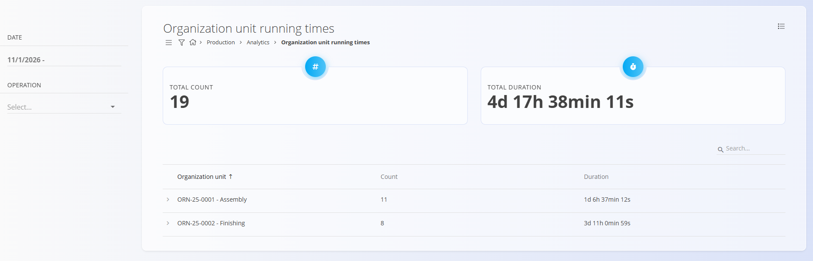
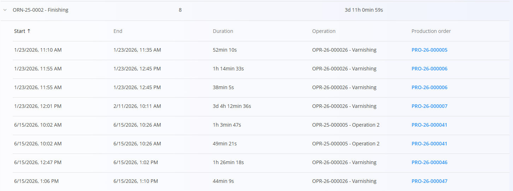

<!-- app_route: /production/analytics/organization-unit-running-times -->
<!-- app_label: Organization unit running times -->
<!-- canonical_source_url: https://tom-pit.github.io/Connected.Docs/en/Domains/Production/Analytics/OrganizationUnitRunningTimes/ -->
<!-- canonical_source_title: Organization unit running times -->

# Organization unit running times

The **Organization unit running times** page shows how many running times were recorded for each organization unit, and how long they lasted in total. Use it to see which organization units have the most recorded running time in a selected period.

This page is analytical only. It does **not** create or change operations.

To access this page, go to **Production / Analytics / Organization unit running times** in the [navigation](../../../Common/UI/Navigation.md).

## Totals

Two tiles at the top show the totals for the current selection:

- **Total count** – The number of recorded running times.
- **Total duration** – The combined duration of all recorded running times, for example **4d 17h 38min 11s**.

## Filters

The left sidebar includes the following filters:

- **Date** – Select a date range for which running times should be displayed.
- **Operation** – Select the operation you want to view.

## Organization unit list

The table lists the recorded running times grouped by **Organization unit**. For each organization unit, it shows:

- **Organization unit** – The code and name of the organization unit.
- **Count** – The number of recorded running times for that organization unit.
- **Duration** – The total duration of those running times.

Use the search box above the table to find an organization unit. Each row can be expanded with the arrow on the left. An expanded row lists each recorded running time for that organization unit, with the following columns:

- **Start** – The date and time when the running time began.
- **End** – The date and time when the running time ended.
- **Duration** – The duration of that running time.
- **Operation** – The operation that was run.
- **Production order** – The production order the running time belongs to, shown as a link.

## Menu

The menu lists the following action under **Action**:

- **Pause all operations** – Pause all operations of production orders that are currently in progress. A dialog asks you to approve the action.

For details about menu actions, see [**Menu actions**](../../../Common/Concepts/MenuActions.md).
