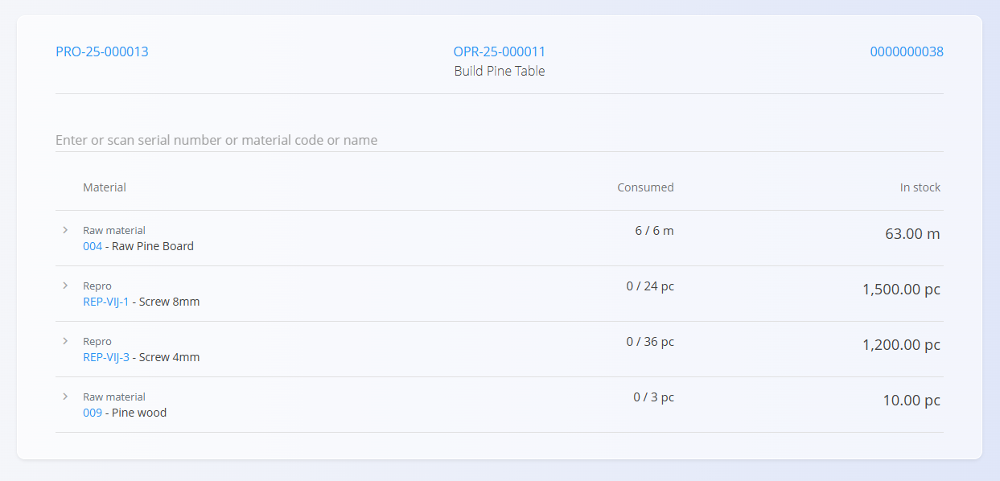
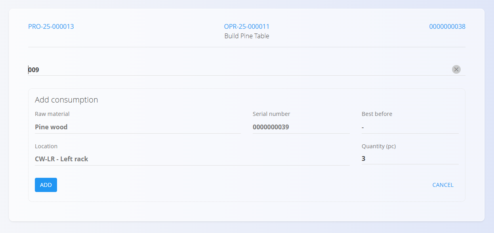
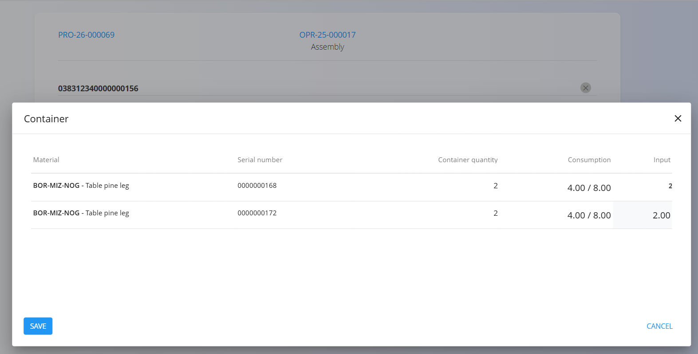

<!-- app_route: /production-orders/execution -->
<!-- app_label: Execution -->
<!-- app_navigation_hint: In Execution, click the action button and select Consumed. -->
<!-- canonical_source_url: https://tom-pit.github.io/Connected.Docs/en/Domains/Production/Documents/Consumed/ -->
<!-- canonical_source_title: Consumed -->

# Consumed

The **Consumed** activity records the usage of input materials during an operation. Use it when you take materials from stock to make products (for example: screws, glue, paint, wiring, or a specific serial/batch). This keeps stock accurate and ensures full traceability of inputs (materials, serials, batches).

Open the **Consumed** screen from the main [**Execution**](Execution.md) page via the activity selection menu (click the [action button](../../../Common/UI/ActionButton.md) and select **Consumed**).

## Record a consumption

1. Open the **Consumed** page from the [**Execution action menu**](Execution.md#action-menu-and-activities).  
2. Review the list of consumed materials (with stock info).  
3. Select a material from the list, or search/scan by name, code, serial, EAN, or container number.  
   - If a container number matches, the [**Container**](#consume-from-a-container) dialog opens.  
   - If a material, serial or EAN matches only one item, that item opens.  
   - If several items match, they are listed for you to choose from.  
4. On the **Add consumption** screen, enter the quantity to consume. 

   

5. Click **Add** to save the consumption.  
6. Repeat for other materials as needed.

The consumed quantity is linked to the operation and reflected in stock in real time.

### Consume from a container

When you select a container, the **Container** dialog opens with one row for each serial number in the container.

The columns are:

- **Material**: the material in the container.
- **Serial number**: the serial number of this row.
- **Container quantity**: the quantity of this serial number in the container.
- **Consumption**: the quantity consumed so far, out of the quantity required for the operation.
- **Input**: the quantity to consume now. It is filled in with the full quantity of the row.

To consume the whole container, leave the **Input** values as they are and click **Save**. To consume part of it, change the **Input** value for one or more rows before you save.

### Validations

The system validates:

- Availability in stock (sufficient quantity)
- Correct warehouse and location
- Serial/batch ownership and status

If any validation fails, an error is shown and the consumption is not recorded.

