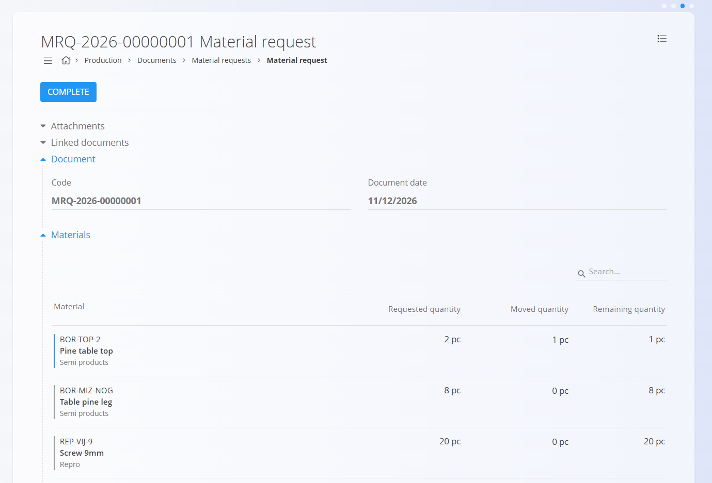
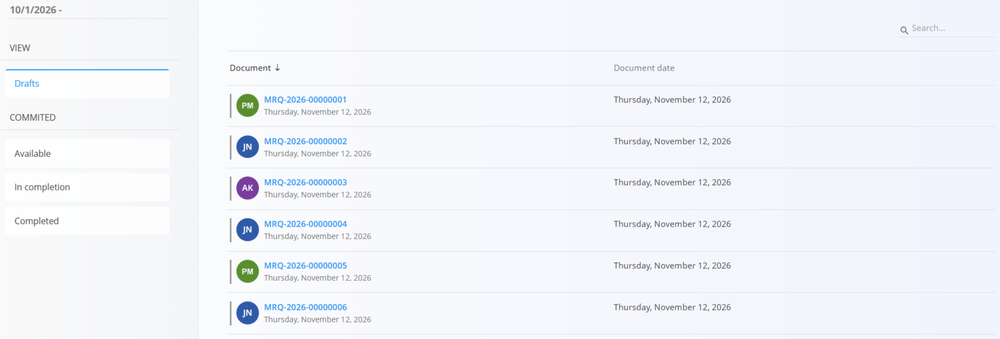
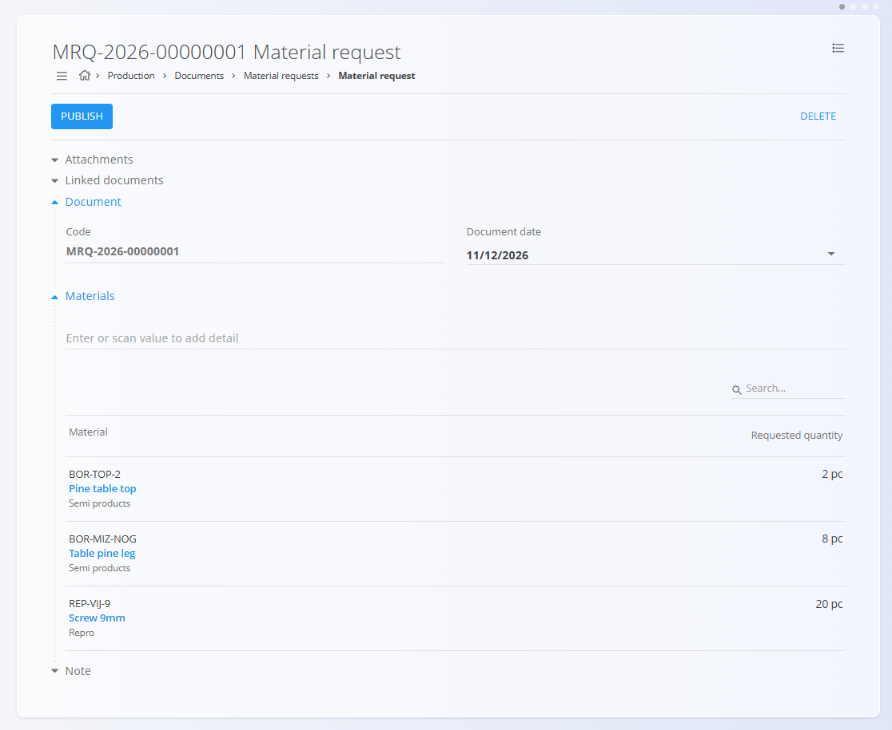
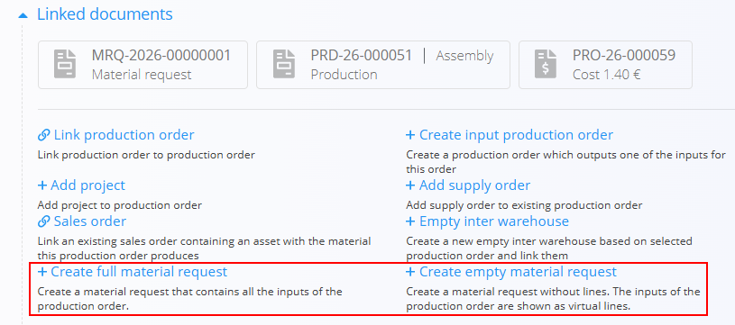
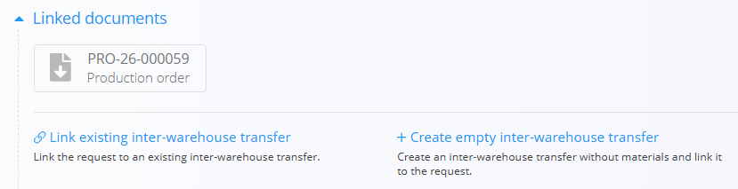

<!-- app_route: /logistics/documents/material-requests -->
<!-- app_label: Material requests -->
<!-- canonical_source_url: https://tom-pit.github.io/Connected.Docs/en/Domains/Production/Documents/MaterialRequests/ -->
<!-- canonical_source_title: Material requests -->

# Material requests

A **Material request** asks the warehouse for materials. A planner or shift supervisor lists the materials and quantities that a production area needs. The warehouse then moves the materials with one or more [**Inter warehouse**](../../Logistics/Documents/InterWarehouse.md) documents.

A material request does not change stock. Only the inter warehouse documents created from it move materials.

To access this page, go to **Production / Documents / Material requests** in the [navigation](../../../Common/UI/Navigation.md).

## How material requests fit into the production workflow

1. A [**production order**](ProductionOrders.md) defines the materials it needs.
2. A material request is created from the production order, with **Create full material request** or **Create empty material request**.
3. The warehouse links one or more inter warehouse documents to the request and moves the materials.

## Schema

<strong>Document</strong>

| Field | Description |
|-------|-------------|
| [**Code**](../../../Common/UI/DocumentCodes.md) | System-generated unique identifier for the material request. |
| **Document date** | Date of the request. |
| **Notes** | Additional remarks for the warehouse. |
| **Attachments** | Files related to the request. |

<strong>Materials</strong>

| Field | Description |
|-------|-------------|
| [**Material**](../../Assets/Materials/README.md) | The material requested. |
| **Code** | The code of the material. Enter or scan a code to add the material. |
| **Requested quantity** | The quantity requested, in the unit of the material (for example pc). |
| **Moved quantity** | The quantity already moved by the inter warehouse documents created from the request. Filled in automatically. |
| **Remaining quantity** | The quantity that still has to be moved. Filled in automatically. |

> [!NOTE]
> The details do not include prices or taxes. A material request is a request for stock, not a financial document.

## Management

### Document states

A material request is in one of four states:

- **Drafts** – the request is being prepared. Drafts can be edited and deleted.
- **Available** – the request is published, and the warehouse can act on it.
- **In completion** – the request is partly moved. An inter warehouse document has moved some, but not all, of the materials. The remaining quantity stays on the request.
- **Completed** – the request is complete. Select **Complete** to set the request to this state, even if some materials are still not moved.

### List view

The Material requests list shows all requests, separated by the states in the left sidebar: **Drafts**, **Available**, **In completion** and **Completed**. The last three are listed together under **Commited**, the spelling the app uses. Use the search bar to find a document, or filter the list with the left sidebar. The filters work the same way as on the [**Receives**](../../Logistics/Documents/Receives.md) page. There is no warehouse filter yet.

## Actions

### Create a material request

1. Select the [action button](../../../Common/UI/ActionButton.md) and select **Add new**.
2. In the **Materials** section, enter or scan the code or name of a material to add it. Repeat for each material you need, and enter the requested quantity for each one.
3. Enter any **Notes** or attach files if the warehouse needs them.
4. Select **Save** to store the document as a draft.

The request appears in the **Drafts** state. You can print or export it from the [menu](#menu) before it goes to the warehouse.

### Create a material request from a production order

You can create a material request directly from a [**production order**](ProductionOrders.md). Select one of the following in the **Linked documents** section of the order:

- **Create full material request** creates a material request that contains all the inputs of the production order.
- **Create empty material request** creates a material request without lines. The inputs of the production order are shown as virtual lines.

For a full request, the system copies all inputs of the order. For an empty request, add the lines you need. You can change the materials before you save.

The material request is linked to the production order. On the request, you can see:

- the **requested quantity**, and
- the **quantity already moved** to production by the inter warehouse documents created from it.

This matters because one request can be filled in several transfers.

### Edit a material request

Only drafts can be edited. You can change the document date and the materials, add or remove materials, and change the details, such as the **Requested quantity**.

#### Linked documents

The linked documents section enables the creation of operational or follow-up documents. This section also shows any previously linked documents.

For details about document relationships, traceability, and creating related documents, see [**Linked documents**](../../../Common/Concepts/LinkedDocuments.md).

### Delete a material request

Draft material requests can be deleted on the edit screen. To remove a single material from a draft, select it in the **Materials** section and select **Delete** in the **Edit item** window.

### Return a request to draft

Use **Return to draft** to change a request that is available, for example to correct a quantity. The request then returns to the **Drafts** state.

### Create an inter warehouse document from a material request

When the warehouse processes a request, it links an [**Inter warehouse**](../../Logistics/Documents/InterWarehouse.md) document to it. In the **Linked documents** section of the request, select one of the following:

- **Create empty inter-warehouse transfer** creates an inter warehouse document and links it to the request. The lines of the request are listed in the document under **Material request lines not yet transferred**.
- **Link existing inter-warehouse transfer** links the request to an inter warehouse document that already exists.

You select the **destination warehouse**. If the organization unit that runs the order is linked to a warehouse in its master data, the destination warehouse is selected automatically. Publishing the inter warehouse document moves the stock.

To move only some of the materials, see [**Move part of a material request**](../../Logistics/Documents/InterWarehouse.md#move-part-of-a-material-request).

#### Example: moving half of an order in two parts

1. A production order needs materials for its full run, but the warehouse can move only part of the order at a time.
2. On the production order, select **Create full material request**. The request opens as a draft.
3. The shift supervisor reviews the request and publishes it.
4. On Monday, the warehouse creates an inter warehouse document from the request and moves about 50 % of the materials to production.
5. On Wednesday, the warehouse creates a second inter warehouse document from the same request and moves the rest.

## Menu

The menu provides additional actions available on this page.

Available actions:

- **Printing**
- **Exporting (PDF)**
- **Return to draft** (available requests only) returns the request to the **Drafts** state.
- **Reactivate** (completed requests only) moves the request back to its previous state, **In completion** or **Available**.

For details about menu actions, see [**Menu actions**](../../../Common/Concepts/MenuActions.md).
