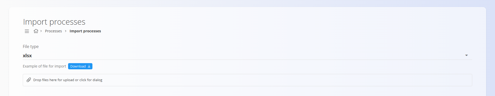
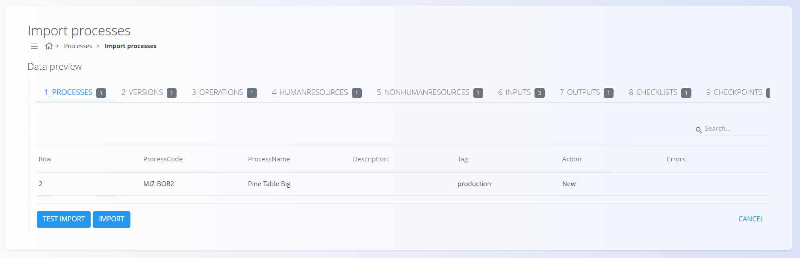
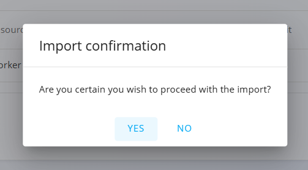
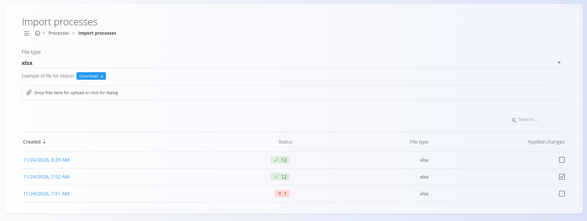
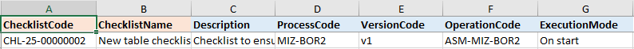

<!-- app_route: /management/processes/import -->
<!-- app_label: Import processes -->
<!-- canonical_source_url: https://tom-pit.github.io/Connected.Docs/en/Domains/Production/Management/ProcessImport/ -->
<!-- canonical_source_title: Process import -->

# Process import

This document describes how to add many processes at once, with their versions, operations, resources, materials and checklists, from an Excel file. The import is done from the [Processes](Processes.md) screen.

> [!WARNING]
> **Prerequisites**
> Before you import, these must already exist in Connected: materials, workers and machines, resource categories, competences, job positions and organization units. The import does not create them.

To access the import, open the **Processes** list, click the [action button](../../../Common/UI/ActionButton.md) and select **Import**.

## Schema

The import list shows every import you have uploaded.

| Field | Description |
|-------|-------------|
| **Created** | The date and time when the file was uploaded. Click it to see the results. |
| **Status** | The number of items in the file. A green tick means the import completed. A red cross shows the number of items that failed. |
| **File type** | The format of the uploaded file. Only **xlsx** is supported. |
| **Applied changes** | Ticked when the changes were written to Connected. Not ticked for a test import or a failed import. |

## File type

The import accepts only the **xlsx** format. Click **Download** next to **Example of file for import** to get the template. The template contains the required sheets and columns in the correct order.

## Upload the file

1. Fill in the sheets of the template (see [Template sheets](#template-sheets)).
2. Drop the file on the upload area, or click the area to choose it. The data preview opens, with one tab per sheet. Each tab shows the number of rows, the action for each row (for example **New**), and any errors.

   

3. Click **Test import** to check the file without changing any data.
4. If the check shows no errors, click **Import**. Confirm in the dialog by clicking **Yes**.

   

## Results list

Every import is listed on the **Import processes** screen. Click the date of an import in the **Created** column to review its results and any errors.

The results show the total number of items, the number that failed, and for each type of record, how many were new and how many were updated.
## Template sheets

The sheets are linked by their codes: process, then version, then operation, then resources, inputs, outputs and checklists.

| Sheet | Contents |
|-------|----------|
| **1_Processes** | Process code, name, description and tag. The **Production** tag is added automatically. |
| **2_Versions** | Versions of each process, for example v1. |
| **3_Operations** | Operations of each version, in order, with their organization unit. |
| **4_HumanResources** | Workers, job positions or competences needed for each operation. |
| **5_NonHumanResources** | Machines or resource categories needed for each operation. |
| **6_Inputs** | Input materials of each operation. |
| **7_Outputs** | Output materials of each operation. Set **OutputType** to **Main** for the main output. |
| **8_Checklists** | Checklists, identified by **ChecklistCode**. Optionally linked to an operation with an **ExecutionMode**. See [Checklists](#checklists). |
| **9_CheckPoints** | Steps of each checklist. |
| **Lists** | The possible values for the drop-down columns, such as **Tag**, **ExecutionMode**, **TimeUnit** and **Calculation**. |

> [!WARNING]
> - Do not rename the sheets or change the first row. Replace the example in row 2.
> - The first column of each sheet must be filled in. Reading a sheet stops at the first empty row.
> - Orange columns are required, blue columns are optional.
> - For columns with a drop-down list, use exactly the values from the **Lists** sheet.
> - Sheets without data are ignored. To import only checklists, fill in **8_Checklists** and **9_CheckPoints** and leave the other sheets empty.

- **Calculation** has two options:
  - **Dynamic** (the default): the time scales with the order quantity.
  - **Static**: the time is fixed per order, for example for machine setup.
- Example: 0.24 minutes with **Dynamic** on an order of 1000 pieces is 240 minutes.

## During import

- New processes, versions, operations, resources, inputs, outputs and checklists are created.
- Existing records are matched by their codes. Resources are matched by name, checklists by ChecklistCode, and check points by instruction. Matching records are updated to the values in the file.
- Rows are linked by their codes. Each row must refer to a process, version and operation that exist in the file or in Connected.
- The import writes everything or nothing. If the file contains an error, nothing is imported.
- Nothing is deleted. Records that are not in the file stay as they are.
- If a process already has an enabled version, a new version is imported as disabled.
- Locked versions cannot be updated.

## Checklists

You can use this screen to create or update checklists without importing any processes. Checklists are identified by **ChecklistCode** on **8_Checklists**, and their check points are listed on **9_CheckPoints** with the same code.

Choose the option that matches what you want to do:

- **Create a new checklist.** Use a ChecklistCode that doesn't exist yet. Fill in ChecklistName and Description on **8_Checklists**, and add the check points on **9_CheckPoints**. To link the checklist to an operation, also fill in ProcessCode, VersionCode and OperationCode, and set an ExecutionMode.
- **Update an existing checklist.** Use the code of the existing checklist. Change ChecklistName and Description on **8_Checklists**, and list the check points on **9_CheckPoints**. Existing check points are matched by their instruction. Updated instructions change the check points, and new instructions are added as new check points.
- **Add an existing checklist to a new process.** Use the code of the existing checklist on **8_Checklists**, and fill in ProcessCode, VersionCode and OperationCode for the new operation, with an ExecutionMode. Leave the checklist's rows out of **9_CheckPoints**, so its check points stay as they are. Do not change ChecklistName and Description, because they would overwrite the current values.

> [!WARNING]
> Updating an existing checklist changes it for every process that uses it, not only for the process in the file.

To import only checklists, fill in just **8_Checklists** and **9_CheckPoints** and leave the process sheets empty. The process fields on **8_Checklists** can then stay empty, and the checklist is created or updated without a link to an operation. The operation must already exist in Connected when you link a checklist to it this way.

