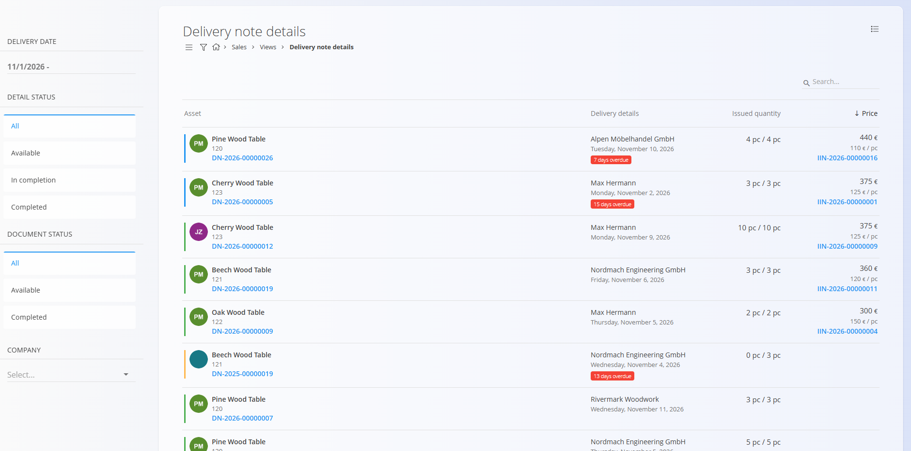

<!-- app_route: /sales/views/delivery-note-details -->
<!-- app_label: Delivery note details -->
<!-- canonical_source_url: https://tom-pit.github.io/Connected.Docs/en/Domains/Sales/Views/DeliveryNoteDetails/ -->
<!-- canonical_source_title: Delivery note details -->

# Delivery note details

Use the **Delivery note details** view to quickly review the state of your deliveries. It lists the items from [**delivery notes**](../Documents/DeliveryNotes.md) one line at a time, so you can see how much has been issued, and which items have been invoiced and at what price.

This view is analytical only. It does **not** create or change delivery notes.

To access this view, go to **Sales / Views / Delivery note details** in the [navigation](../../../Common/UI/Navigation.md).

### Purpose

This view is useful for:

- Checking which delivered items have been invoiced, and at what price
- Following up on the invoice reference for each delivered item
- Reviewing the delivery history for a customer, line by line

It complements the [**Delivery note reports**](DeliveryNoteReports.md) view by focusing on **individual lines** rather than totals per customer.

## Delivery note details list

Each line represents a **single item** on a delivery note, including:

- **Item** – The asset being delivered, with its code and name. The delivery note code is shown with a link to the [**delivery note**](../Documents/DeliveryNotes.md).
- **Delivery details** – Customer and delivery date.
- **Issued quantity** – The number of items already issued, followed by the total quantity on the delivery note, for example **0 pc / 3 pc**.
- **Price** – The price taken from the invoice. The invoice code is shown with a link to the invoice. The price is blank for delivery notes that have not been invoiced.

### Filters

The left sidebar includes the following filters:

- **Delivery date** – Select a delivery time window.
- **Detail status** – Filters the items by sending progress.
  - *All*
  - *Available* – No items have been sent.
  - *In completion* – Some items have been sent, but not all. For example, 1 of 4 items.
  - *Completed* – All items have been sent.
- **Document status** – Shows the completion state of the delivery note.
  - *All*
  - *Available* – The delivery note is not completed.
  - *Completed* – The delivery note has been completed and saved.
- **Company** – Filter by customer.

### Overdue delivery notes

Under the delivery date, a red badge shows how many days the delivery is overdue, for example **15 days overdue**. The badge appears when the delivery date written in the delivery note has passed, and it counts the days since that date. Completed delivery notes do not show the badge.

## Menu

The menu provides additional actions available on this page.

The **Exporting** action opens a dialog with these options:

- **Report** – Select **Details**.
- **File format** – Select **CSV**.

Then select **EXPORT**.

For details about menu actions, see [**Menu actions**](../../../Common/Concepts/MenuActions.md).
