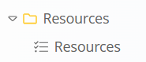
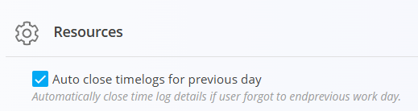

<!-- app_route: /management/configuration -->
<!-- app_label: Configuration -->
<!-- canonical_source_url: https://tom-pit.github.io/Connected.Docs/en/Domains/System/Settings/ResourcesSettings/ -->
<!-- canonical_source_title: Resources settings -->

# Resources settings

The **Resources** section of the configuration controls how resource folders are organized, how the system closes time logs left open at the end of a day, how paid lunch time is recorded, and who receives paid leave requests.

To access these settings, go to **System / Configuration** and find the **Resources** section. The **Time log** settings are in the same area.

> [!WARNING]
> These settings affect the time log and leave processes for all workers. Only system administrators should modify them.

## Resources

### Auto close timelogs for previous day

When this setting is selected, the system closes an open work time at the end of the previous day, when the user clocks in the next day. The new work time then starts.

<!-- TODO: Confirm the exact end time with the developers. A test on 18 November 2026 ended the work time at 10:59 PM. -->

Clear this setting for companies that work 24-hour shifts. For example, a worker can clock in at 22:00 and go to lunch at 00:31. With the setting cleared, the system does not close the previous day's work time when the user clocks in the next day.

### Folder resource limit

Enter the maximum number of resources that a folder can contain.

## Time log

### Paid leave recipients

Select the users who receive an email when a leave request form is sent, so that they can approve the request.

### Paid lunch time

Enter the maximum lunch time, in minutes, that the system records as paid lunch time for workers. Any lunch time longer than this value is recorded as private time and is not counted as work hours.

For example, with **Paid lunch time** set to 30 minutes:

1. A worker clocks out for lunch at 12:00. Work time stops, and lunch time starts.
2. The worker clocks back in at 12:35.
3. The system records the lunch from 12:00 to 12:30 as paid lunch time.
4. The remaining 5 minutes, from 12:30 to 12:35, are recorded as private time and are not counted toward work hours.
