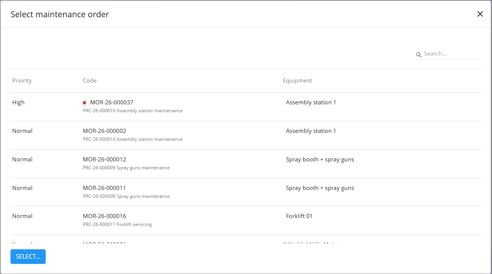
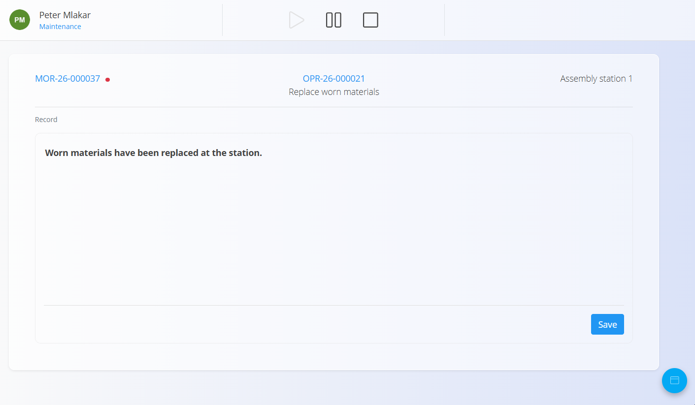
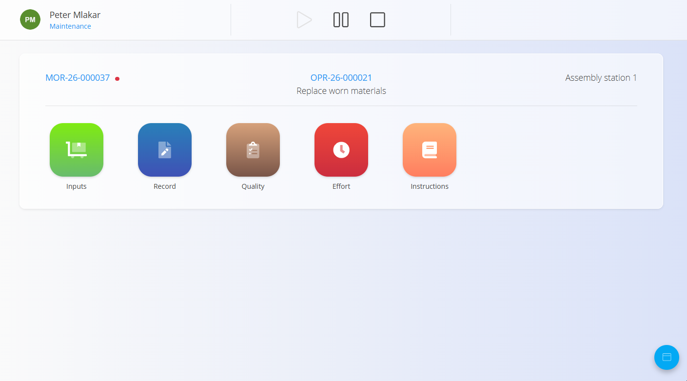
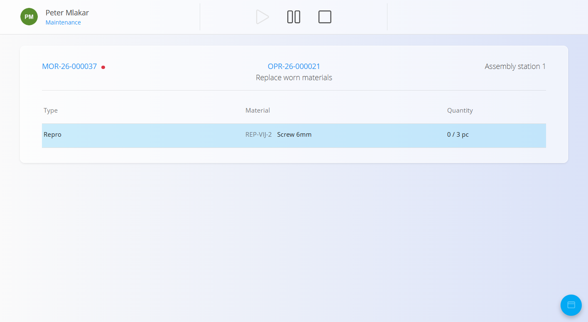
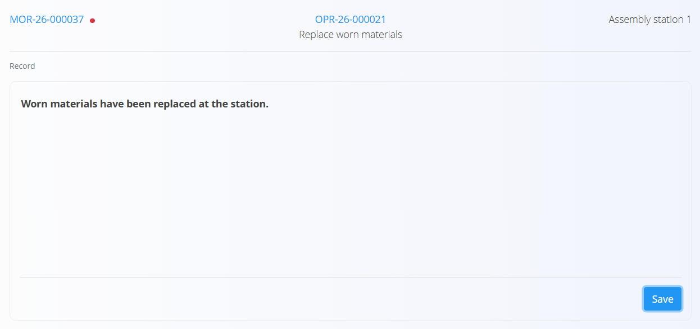

<!-- app_route: /maintenance-orders/execution -->
<!-- app_label: Maintenance execution -->
<!-- canonical_source_url: https://tom-pit.github.io/Connected.Docs/en/GettingStarted/MaintenanceExecutionQuickUserGuide/ -->
<!-- canonical_source_title: Maintenance Execution – Quick User Guide -->

# Maintenance Execution – Quick User Guide

This guide shows the **essential steps** to carry out maintenance work using the Maintenance execution screen.

> [!NOTE]
>
> For more information and details refer to the full **[Maintenance execution](../Domains/Maintenance/Documents/MaintenanceExecution.md)** documentation.

## 1. Select your maintenance order

When you open **Maintenance execution**:
- Make sure the correct organization unit is selected at the top of the screen.
- Check that the maintenance order and operation shown are the ones you will work on.

To choose a different maintenance order, click the **maintenance order** in the top-left corner. In the dialog, select the order (it shows **Priority**, **Code** and **Equipment**) and click **Select**. See [**Select a maintenance order**](../Domains/Maintenance/Documents/MaintenanceExecution.md#select-a-maintenance-order).

If no maintenance order is selected, or none are available, the screen will prompt you to choose one.

## 2. Start the operation

Press **Start** to begin the current operation. The operation becomes active and the execution time starts to be recorded. See [**Start maintenance**](../Domains/Maintenance/Documents/MaintenanceExecution.md#start-maintenance).

If you need to interrupt the work, press **Pause**. The operation stays open and you can resume it by pressing **Start** again. See [**Pause maintenance**](../Domains/Maintenance/Documents/MaintenanceExecution.md#pause-maintenance).

## 3. Complete quality checklists (if applicable)

[Quality checklists](../Domains/Maintenance/Documents/MaintenanceExecution.md#quality) are simple step-by-step checks that help keep the work safe and the result correct. A checklist can pop up when the operation starts, while it is paused, or when it is stopped, depending on how the operation is set up.

1. Follow the steps shown on screen.
2. Complete each step. When you are done, tap **Finish**.
3. To review checklists at any time, open the [action button](../Common/UI/ActionButton.md) and select **Quality**.

> [!NOTE]
> You can’t stop the operation if a required checklist isn’t finished.

## 4. Follow instructions (if available)

If instructions are defined for the operation, open the [action button](../Common/UI/ActionButton.md) and select **Instructions**. See [**Instructions**](../Domains/Maintenance/Documents/MaintenanceExecution.md#instructions).

Review them before you start the task and use them as guidance while you work. They may include safety notes, step-by-step actions or visual references.

## 5. Record consumed materials (if applicable)

Use this when materials are used during the maintenance:

1. Open the [action button](../Common/UI/ActionButton.md) and select **Inputs**. See [**Inputs**](../Domains/Maintenance/Documents/MaintenanceExecution.md#inputs).
2. Select the material.
3. Enter the quantity used.
4. Click **Save**.

The screen shows the consumed quantity against the planned quantity, for example **0 / 3 pc**.

## 6. Record the work performed

1. Open the [action button](../Common/UI/ActionButton.md) and select [**Record**](../Domains/Maintenance/Documents/MaintenanceExecution.md#record).
2. Enter a description of the maintenance work performed in the free-text field.
3. Click **Save**.

The saved record is also shown on the maintenance order.

## 7. Record effort (working time)

1. Open the [action button](../Common/UI/ActionButton.md) and select [**Effort**](../Domains/Maintenance/Documents/MaintenanceExecution.md#effort) if required by your workflow.

### Automatic:

Press **Start** → carry out the work → press **Stop**.

### Manual:

Open **Effort**, then enter:
- Date
- Start and end time or duration
- Notes (optional)

Save the entry. The recorded efforts are listed below.

## 8. Finish the operation

When all maintenance work is completed:

1. Check that the checklists are completed, and that materials and effort are recorded.
2. Press **Stop** to finish the operation. See [**Complete maintenance**](../Domains/Maintenance/Documents/MaintenanceExecution.md#complete-maintenance).

The operation is marked as **Completed** and its completion time is recorded.

If the process has more operations, the next operation opens automatically when you stop the current one. Continue with the next operation from step 2.

When the last operation of the maintenance order is stopped, the order closes automatically.

You can also complete the maintenance order from the order itself, without stopping the remaining operations. Open the menu in the upper-right corner of the maintenance order and, under **Action**, select **Complete maintenance order**.

## 9. Reactivate a completed operation (if needed)

A completed operation cannot be reactivated from the Maintenance execution screen. To reopen it, open the maintenance order and select **Reactivate** for that operation. See the note in [**Complete maintenance**](../Domains/Maintenance/Documents/MaintenanceExecution.md#complete-maintenance).

## Related guides

- [**Execution – Quick User Guide**](ExecutionQuickUserGuide.md)
