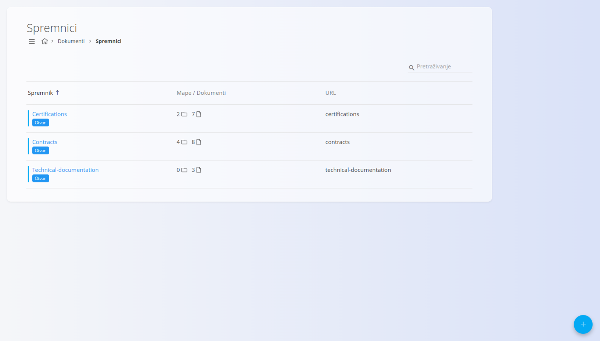
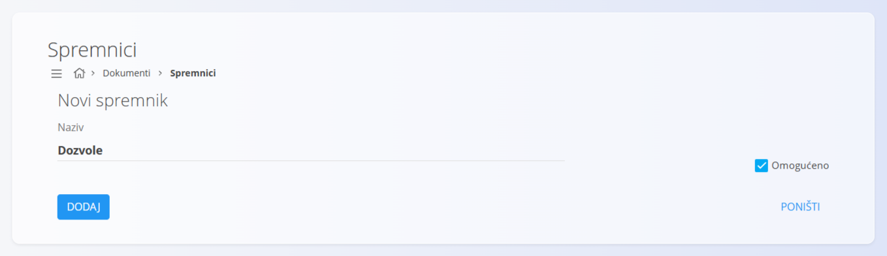
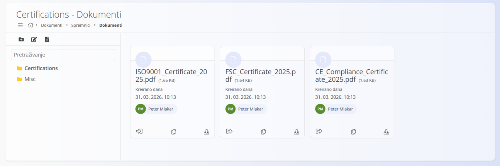
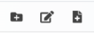
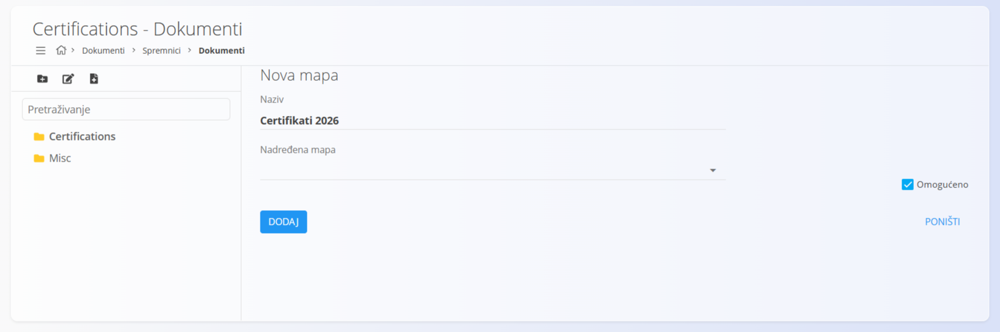
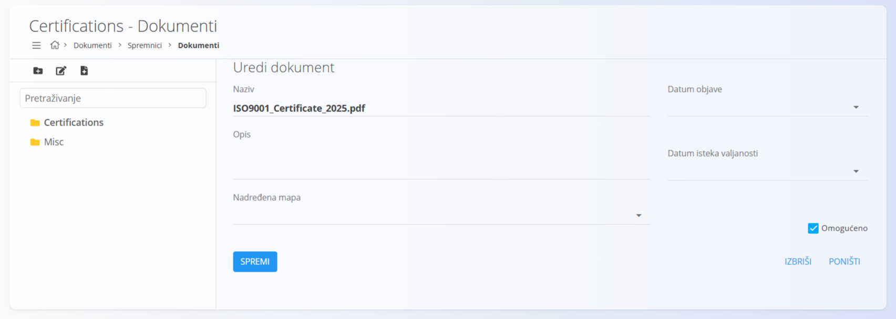

<!-- app_route: /documents/containers -->
<!-- app_label: Spremnici -->
<!-- canonical_source_url: https://github.com/Tom-PIT/Connected.Docs/blob/main/hr/Domene/Dokumenti/Dokumenti/Spremnici.md -->
<!-- canonical_source_title: Spremnici -->

# Spremnici

Zaslon **Spremnici** definira glavna **spremišta dokumenata** koja se koriste u domeni **Dokumenti**.

Spremnici služe za organizaciju učitanih vanjskih dokumenata, kao što su:
- certifikati  
- dozvole  
- ugovori  
- tehnička dokumentacija  

Svaki spremnik predstavlja korijensku strukturu u kojoj se dokumenti mogu grupirati u mape i njima upravljati.

Za pristup ovom zaslonu otvorite **Dokumenti / Spremnici** u [navigaciji](../../../Zajednicko/UI/Navigacija.md).

## Shema

| Polje | Opis |
|-------|------|
| **Naziv** | Naziv spremnika (obavezno). |
| **Omogućeno** | Označava je li spremnik aktivan i dostupan. |

## Pregled popisa

Popis prikazuje sve definirane spremnike.

Svaki redak prikazuje:
- **Spremnik** – naziv spremnika
- **Mape / Dokumenti** – broj mapa i dokumenata
- **URL** – identifikator koji se koristi za pristup
- **Otvori** – otvara sadržaj spremnika

Za pretraživanje spremnika koristite polje **Pretraživanje**.

Svaki zapis ima indikator statusa lijevo od naziva:
- **Plava** boja označava da je spremnik aktivan  
- **Siva** boja označava da je spremnik neaktivan  

> [!NOTE]
> Spremnici definiraju **najvišu razinu strukture** za organizaciju dokumenata.

## Akcije

### Dodavanje novog spremnika

Kliknite [akcijski gumb](../../../Zajednicko/UI/AkcijskiGumb.md) za dodavanje novog spremnika i ispunite polje **Naziv**.

Potvrdni okvir **Omogućeno** određuje je li spremnik aktivan.

Kliknite **Dodaj** za izradu spremnika.

Nakon izrade spremnik se prikazuje na popisu i može se otvoriti radi upravljanja njegovim sadržajem.

## Upravljanje sadržajem spremnika

Kliknite **Otvori** na spremniku za prikaz njegova sadržaja.

Lijeva bočna traka prikazuje mape, a glavno područje prikazuje dokumente.

### Akcije na alatnoj traci

Dostupne su sljedeće akcije:

- **Nova mapa** – izrađuje mapu za organizaciju dokumenata  
- **Uredi mapu** – mijenja odabranu mapu  
- **Preuzmi dokument** – učitava novu datoteku u odabranu mapu  

### Struktura mapa

- Mape se prikazuju u **stablastom prikazu**
- Dokumenti se mogu pohraniti unutar mapa ili na korijenskoj razini
- Mape nisu obavezne, ali se preporučuju radi bolje organizacije

### Izrada mape

1. Kliknite **Nova mapa**
2. Unesite:
   - **Naziv**
   - **Nadređena mapa** (neobvezno)
   - **Omogućeno**
3. Kliknite **Dodaj**

### Učitavanje dokumenata

Za učitavanje dokumenta najprije odaberite mapu u bočnoj traci, kliknite **Preuzmi dokument** i odaberite datoteku na svom uređaju. Datoteka se učitava u odabranu mapu i prikazuje na zaslonu.

Učitani dokument dodaje se na popis. Za svaki dokument dostupne su sljedeće akcije:
- **Odjavi** – zaključava dokument radi uređivanja. Drugi korisnici ne mogu mijenjati dokument dok ga ponovno ne prijavite (**Prijavi**).
- **Kopiraj** – kopira URL dokumenta u međuspremnik.
- **Preuzmi** – preuzima dokument na vaš uređaj.

### Uređivanje dokumenata

Nakon učitavanja dokumenta kliknite naziv datoteke za uređivanje njegovih metapodataka.

Dostupna polja:

| Polje | Opis |
|-------|------|
| **Naziv** | Naziv datoteke (obavezno). |
| **Opis** | Neobvezni opis. |
| **Nadređena mapa** | Mapa u kojoj je dokument pohranjen. |
| **Datum objave** | Datum od kojeg je dokument valjan i vidljiv. |
| **Datum isteka valjanosti** | Datum nakon kojeg dokument više nije valjan. |
| **Omogućeno** | Označava je li dokument aktivan. |

Kliknite **Spremi** za potvrdu promjena.

Kliknite **Izbriši** za brisanje dokumenta. Prikazat će se dijaloški okvir za potvrdu kako bi se spriječilo slučajno brisanje. Izbrisani dokumenti ne mogu se vratiti.
