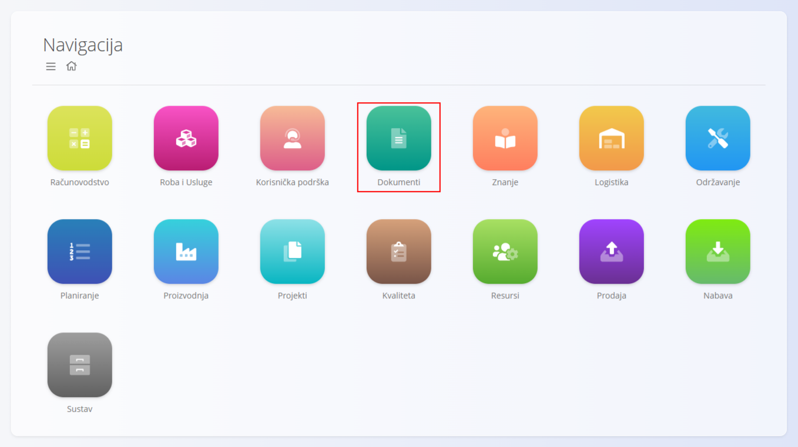
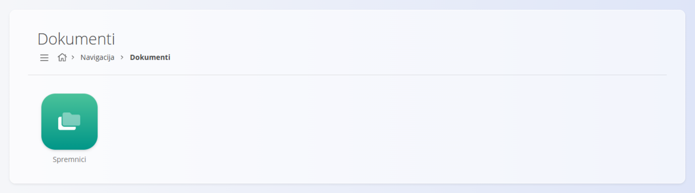

<!-- app_route: /sitemap/documents -->
<!-- app_label: Dokumenti -->
<!-- canonical_source_url: https://github.com/Tom-PIT/Connected.Docs/blob/main/hr/Domene/Dokumenti/README.md -->
<!-- canonical_source_title: Domena Dokumenti -->

# Domena Dokumenti

Domena **Dokumenti** pruža centralno mjesto za upravljanje **vanjskim dokumentima** koje sustav ne generira, ali ih je potrebno pohraniti, organizirati i učiniti dostupnima unutar platforme.

Tipični primjeri su:

- certifikati  
- dozvole  
- ugovori  
- tehnička dokumentacija  
- dokumentacija o usklađenosti i regulatorni dokumenti  

Za razliku od poslovnih dokumenata (npr. proizvodnih naloga ili računa), domena Dokumenti namijenjena je **učitanim datotekama** koje podržavaju poslovne procese te osiguravaju sljedivost i usklađenost s propisima.

Za pristup domeni otvorite **Dokumenti** u [navigaciji](../../Zajednicko/UI/Navigacija.md).

> [!NOTE]
> Dostupne domene i funkcionalnosti ovise o konfiguraciji tvrtke i omogućenim modulima.

## Što sadrži domena Dokumenti?

Domena je organizirana oko **spremnika**, koji služe kao glavna spremišta za grupiranje dokumenata.

- **[Spremnici](Dokumenti/Spremnici.md)** – definiranje logičkih grupa dokumenata (npr. certifikati, ugovori, tehnička dokumentacija).

Svaki spremnik sadrži mape i dokumente organizirane u stablastu strukturu.
