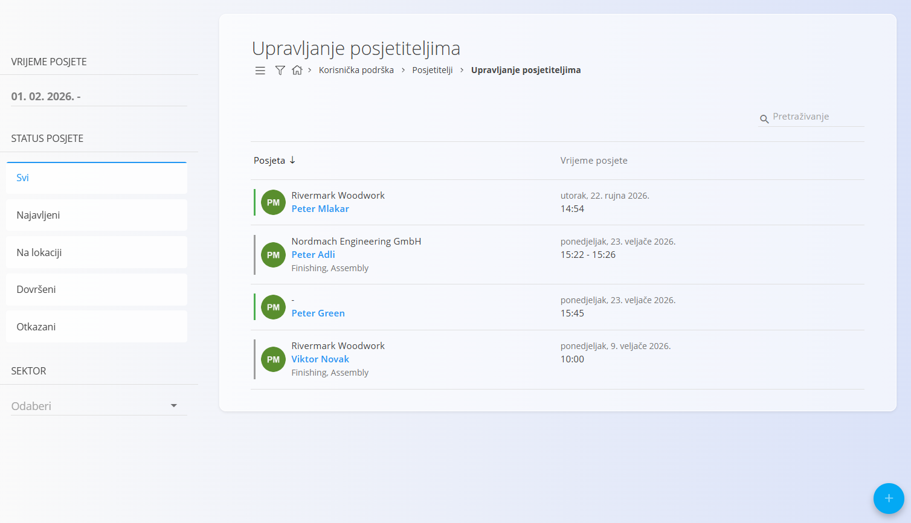
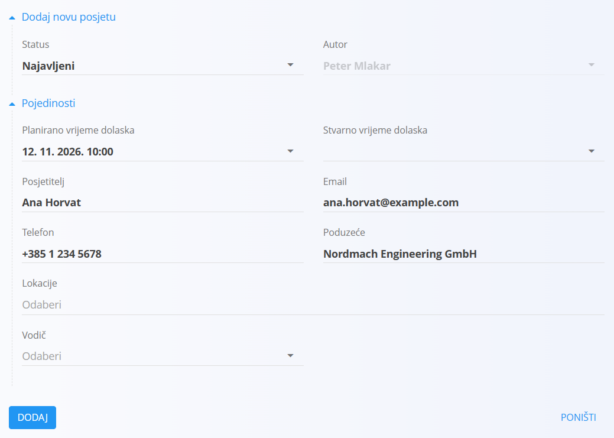
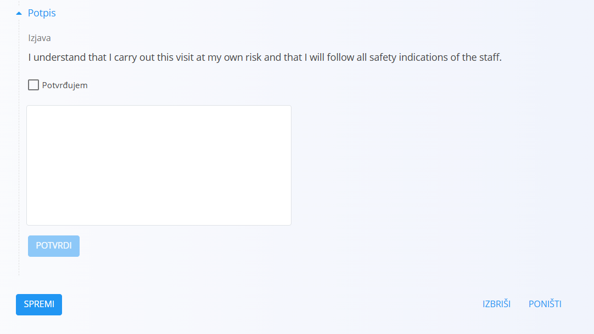

<!-- app_route: /customers/visitors/management -->
<!-- app_label: Upravljanje posjetiteljima -->
<!-- canonical_source_url: https://github.com/Tom-PIT/Connected.Docs/blob/main/hr/Domene/KorisnickaPodrska/Posjetitelji/UpravljanjePosjetiteljima.md -->
<!-- canonical_source_title: Upravljanje posjetiteljima -->

# Upravljanje posjetiteljima

Ekran **Upravljanje posjetiteljima** služi za stvaranje i praćenje zapisa o posjetama. Obuhvaća podatke o posjetitelju, planirano i stvarno vrijeme dolaska, status posjete i lokacije koje se posjećuju.

Svaka posjeta prolazi jasno definirani životni ciklus, od najave do završetka ili otkazivanja.

Do ovog ekrana dolazite tako da u [navigaciji](../../../Zajednicko/UI/Navigacija.md) odaberete **Korisnička podrška / Posjetitelji / Upravljanje posjetiteljima**.

## Shema

| Polje | Opis |
|------|-------------|
| **Status** | Trenutni status posjete: Najavljeni, Na lokaciji, Dovršeni ili Otkazani. |
| **Autor** | Korisnik koji je stvorio zapis o posjeti. |
| **Planirano vrijeme dolaska** | Planirani datum i vrijeme posjete. |
| **Stvarno vrijeme dolaska** | Stvarni datum i vrijeme kada je posjetitelj stigao. |
| **Posjetitelj** | Ime posjetitelja (obavezno). |
| **Email** | Adresa e-pošte posjetitelja. |
| **Telefon** | Broj telefona posjetitelja. |
| **Poduzeće** | Tvrtka koju posjetitelj predstavlja. |
| **Lokacije** | Lokacije koje se posjećuju, preuzete iz šifrarnika [**Organizacijske jedinice**](../../Proizvodnja/Upravljanje/OrganizacijskeJedinice.md). |
| **Vodič** | Interna osoba odgovorna za posjetitelja. |
| **Potpis** | Izjava posjetitelja, potvrda i potpis, dostupni u načinu uređivanja. Tekst izjave može se konfigurirati u postavkama sustava. |

## Prikaz popisa i filteri

Prikaz popisa sadrži sve evidentirane posjete i omogućuje filtriranje radi brzog pronalaženja relevantnih zapisa.

Na popisu se posjete razlikuju bojom:

- Najavljeni – plava
- Na lokaciji – zelena
- Dovršeni – siva
- Otkazani – crvena

Dostupni filteri:

- **Vrijeme posjete**
- **Status posjete**
  - Svi
  - Najavljeni
  - Na lokaciji
  - Dovršeni
  - Otkazani
- **Sektor**

Svaki redak prikazuje posjetitelja, poduzeće, posjećene lokacije i datum i vrijeme posjete.

## Životni ciklus posjete i statusi

Posjeta prolazi kroz sljedeće statuse:

- **Najavljeni** – posjeta je isplanirana i unaprijed evidentirana
- **Na lokaciji** – posjetitelj je stigao na lokaciju
- **Dovršeni** – posjeta je završila
- **Otkazani** – posjeta je otkazana i nije se dogodila

## Dodavanje nove posjete

Nova posjeta stvara se kada se planira fizički posjet.

Uobičajeni tijek:

1. Kliknite [gumb radnji](../../../Zajednicko/UI/AkcijskiGumb.md) da biste stvorili novu posjetu.
2. Polje **Status** prema zadanoj vrijednosti postavljeno je na **Najavljeni**.
3. Unesite podatke o posjeti (polje **Posjetitelj** je obavezno).
4. Kliknite **Dodaj**.

U ovoj fazi posjeta se na popisu prikazuje kao **Najavljeni**.

## Upravljanje posjetom

### Dolazak posjetitelja

Kada posjetitelj stigne na lokaciju:

1. Otvorite zapis o posjeti.
2. Promijenite **Status** u **Na lokaciji**.
3. Upišite **Stvarno vrijeme dolaska**.
4. Ispunite izjavu posjetitelja i potpis u odjeljku **Potpis** (vidi u nastavku).
5. Kliknite **Spremi**.

Posjeta se sada na popisu prikazuje kao **Na lokaciji**, a počinje praćenje trajanja posjete.

> [!NOTE]
> Spremanjem dokumenta nakon unosa **Stvarnog vremena dolaska** i potpisa u odjeljku **Potpis** status se automatski mijenja u **Na lokaciji**.

#### Potvrda potpisa

Kada se zapis o posjeti otvori u načinu uređivanja, postaje dostupan odjeljak **Potpis**.

Odjeljak prikazuje izjavu koju posjetitelj mora pregledati i potvrditi prije potpisivanja.

Za dovršetak potvrde:

1. Pregledajte **Izjavu**.
2. Odaberite **Potvrđujem**.
3. Potpišite u polju za potpis.
4. Kliknite **Potvrdi**.

Tekst koji se prikazuje ispod **Izjave** može se konfigurirati u postavkama: **Sustav / Postavke / Customers.Visitors / Customers.Visitors Settings**. U dijelu **Izjave za vođene posjete** uredite tekst **Izjava za posjetitelje** prema potrebi.

### Završetak posjete

Nakon što posjeta završi:

1. Otvorite zapis o posjeti.
2. Promijenite **Status** u **Dovršeni**.
3. Kliknite **Spremi**.

Time se zaustavlja praćenje trajanja posjete. Posjeta se premješta na popis **Dovršenih** i prikazuje vrijeme dolaska i odlaska.

### Otkazivanje posjete

Ako se planirana posjeta ne održi:

1. Otvorite zapis o posjeti.
2. Postavite **Status** na **Otkazani**.
3. Kliknite **Spremi**.

Posjeta se premješta u stanje **Otkazani** i tako se prikazuje na popisu.

## Brisanje posjete

Posjete se mogu obrisati ako su stvorene greškom ili više nisu potrebne.

Za brisanje posjete:
1. Otvorite zapis o posjeti.
2. Kliknite **Izbriši** i potvrdite radnju.

## Ulazni prikaz za operativni rad (način rada na tabletu)

Uz administrativni prikaz, sustav nudi pojednostavljeni operativni prikaz namijenjen korištenju na tabletu na ulazu.

Ovaj prikaz:

- prikazuje samo današnje posjete sa statusom **Najavljeni** i **Na lokaciji**
- nema filtere
- automatski se osvježava svakih 15 minuta

Interakcija se malo razlikuje od administrativnog prikaza:

- Odabirom **Najavljene** posjete status se automatski mijenja u **Na lokaciji** i postavlja se stvarno vrijeme dolaska.
- Odabirom posjete **Na lokaciji** status se automatski mijenja u **Dovršeni** i postavlja se stvarno vrijeme odlaska.
- Gumbom **+** nova posjeta izravno se stvara u statusu **Na lokaciji**.
