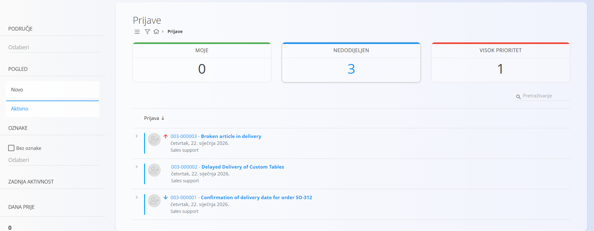
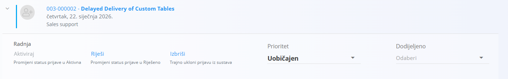
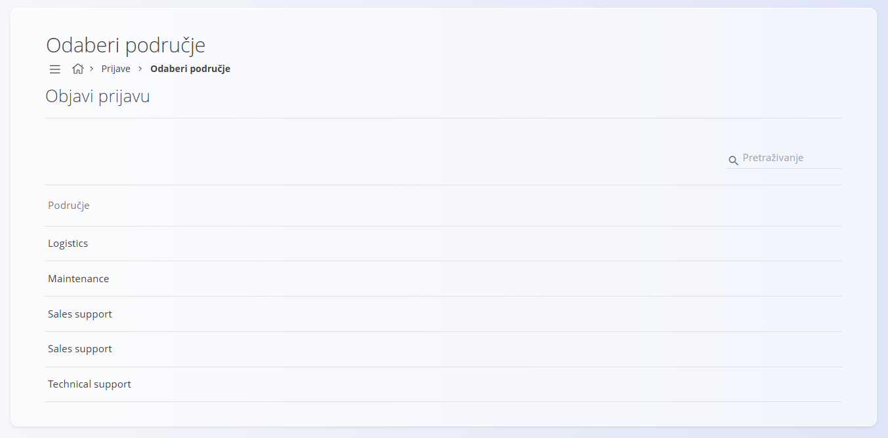
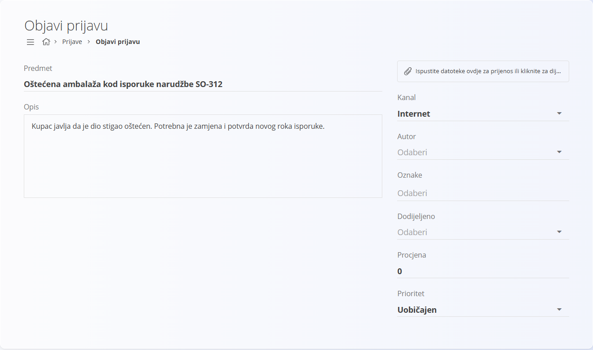
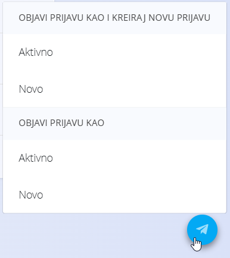
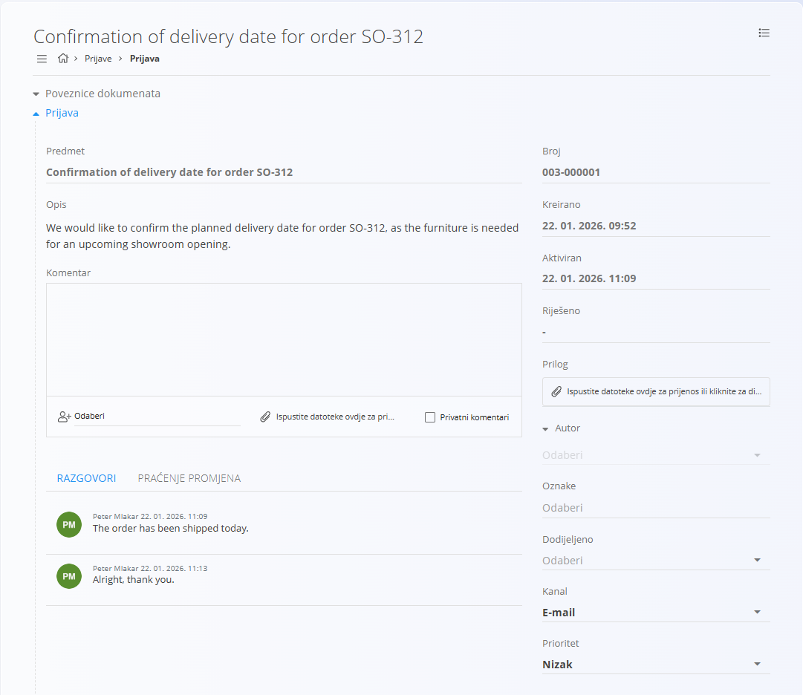
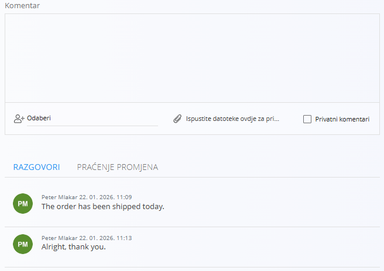
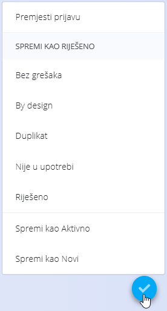
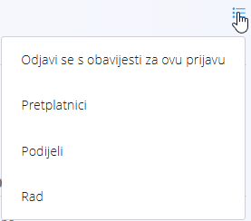

<!-- app_route: /customer-support -->
<!-- app_label: Prijave -->
<!-- canonical_source_url: https://github.com/Tom-PIT/Connected.Docs/blob/main/hr/Domene/KorisnickaPodrska/Prijave/Prijave.md -->
<!-- canonical_source_title: Prijave -->

# Prijave

Ekran **Prijave** glavni je radni prostor domene Korisnička podrška. Služi za stvaranje, praćenje, ažuriranje i rješavanje zahtjeva za podršku koje podnose kupci, partneri ili interni korisnici.

Prijave su razvrstane po **području** (na primjer Održavanje, Prodajna podrška, Tehnička podrška) i tijekom životnog ciklusa prolaze kroz različita stanja.

Do ovog ekrana dolazite tako da u [navigaciji](../../../Zajednicko/UI/Navigacija.md) odaberete **Korisnička podrška / Prijave**.

## Shema

| Polje | Opis |
|-----|------------|
| **Predmet** | Kratki naslov koji opisuje problem |
| **Opis** | Detaljan opis prijave |
| **[Područje](../Upravljanje/Podrucja.md)** | Područje podrške kojem prijava pripada |
| **Kanal** | Izvor prijave (**Internet**, **Telefon**, **E-mail**) |
| **Autor** | Korisnik koji je stvorio prijavu |
| **Dodijeljeno** | Korisnik odgovoran za rješavanje prijave |
| **Oznake** | Oznake za razvrstavanje |
| **Prioritet** | Razina prioriteta prijave (**Nizak**, **Uobičajen** ili **Visok**) |
| **Procjena** | Procijenjeni napor |
| **Kreirano** | Vremenska oznaka stvaranja prijave |
| **Aktiviran** | Vremenska oznaka kada prijava postaje aktivna |
| **Riješeno** | Vremenska oznaka kada je prijava riješena |
| **Prilog** | Datoteke priložene prijavi |

## Popis prijava

Popis prikazuje prijave sa statusom **Novo** i **Aktivno**. Na vrhu popisa nalaze se sažete kartice:
- **Moje**
- **Nedodijeljen**
- **Visok prioritet**

Svaka prijava prikazuje se kao redak koji se može proširiti da bi se vidjele brze radnje. Dostupne radnje uključuju:

- **Aktiviraj**
- **Riješi**
- **Izbriši**
- **Prioritet**
- **Dodijeljeno**

### Filteri

Prijave se mogu filtrirati pomoću lijevog panela:

- **Područje**
- **Pogled**
  - Novo
  - Aktivno
- **Oznake**
- **Zadnja aktivnost**
- **Dana prije**

## Statusi prijava

Prijave prolaze kroz sljedeće glavne statuse:

- **Novo** – prijava je stvorena, ali još nije aktivirana
- **Aktivno** – prijava se obrađuje
- **Riješeno** – prijava je završena i premještena u [**Riješene prijave**](RijesenePrijave.md)

## Stvaranje nove prijave

Za stvaranje nove prijave kliknite [gumb radnji](../../../Zajednicko/UI/AkcijskiGumb.md) u donjem desnom kutu.

### Korak 1: Odabir područja

Prvi korak je odabir **područja** kojem prijava pripada. Odaberite područje, zatim kliknite gumb radnji za prijelaz na sljedeći korak.

### Korak 2: Podaci o prijavi

U drugom koraku unose se ili uređuju podaci o prijavi.

Kliknite gumb radnji da biste:
- objavili prijavu kao **Novo**
- objavili prijavu kao **Aktivno**
- objavili prijavu kao **Novo** ili **Aktivno** i odmah stvorili novu prijavu

## Rad s prijavama

### Otvaranje prijave

Kliknite naslov prijave da biste otvorili cijeli prikaz prijave.

Prikaz prijave sadrži:
- podatke o prijavi
- vremenske oznake statusa
- priloge
- autora, oznake, dodjelu i prioritet

### Komentari i razgovori

Prijave podržavaju stalnu komunikaciju putem komentara.

Pri dodavanju komentara:
- može se uputiti određenom korisniku
- može se označiti kao **privatni**
- mogu se priložiti datoteke

Da biste spremili komentar, prijava se mora ažurirati:
- spremanjem kao **Novo** ili **Aktivno**
- ili promjenom statusa (na primjer rješavanjem)

### Praćenje promjena

Praćenje promjena bilježi sve promjene prijave na vremenskoj crti. Da biste ga otvorili, kliknite karticu **Praćenje promjena** u prikazu prijave, u odjeljku **Komentar**.

## Rješavanje prijave

Kliknite [gumb radnji](../../../Zajednicko/UI/AkcijskiGumb.md) da biste otvorili izbornik i odaberite opciju rješenja:

- **By design** – problem je namjeran i očekivan
- **Duplikat** – prijava je kopija druge prijave
- **Bez grešaka** – nema problema za rješavanje
- **Nije u upotrebi** – prijava nije relevantna
- **Riješeno** – problem je otklonjen

Kada se prijava riješi:
- njezin se status postavlja na **Riješeno**
- uklanja se s popisa aktivnih prijava
- prikazuje se na ekranu [**Riješene prijave**](RijesenePrijave.md)

## Izbornik

Izbornik nudi dodatne radnje dostupne na ovom ekranu.

Dostupne radnje:

- **Odjavi se s obavijesti za ovu prijavu** (prikazano za prijavu koju pratite)
- **Pretplatnici** – pregled korisnika koji prate prijavu
- **Podijeli**
- **Rad** – evidentiranje truda

> [!NOTE]
> Postavke obavijesti po području uređujete u [**Postavkama obavijesti**](../Upravljanje/PostavkeObavijesti.md).

Pojedinosti o radnjama izbornika potražite u odjeljku [**Radnje izbornika**](../../../Zajednicko/Koncepti/RadnjeIzbornika.md).
