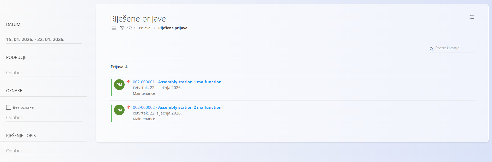
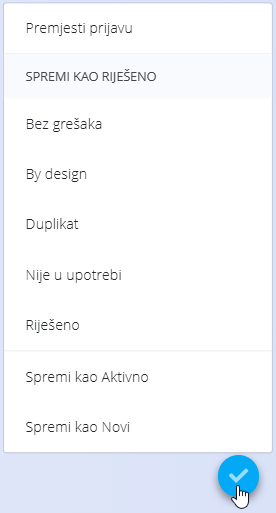
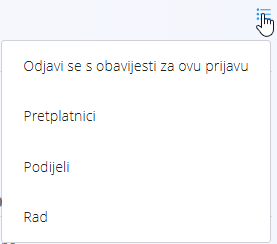

<!-- app_route: /customer-support/resolved-tickets -->
<!-- app_label: Riješene prijave -->
<!-- canonical_source_url: https://github.com/Tom-PIT/Connected.Docs/blob/main/hr/Domene/KorisnickaPodrska/Prijave/RijesenePrijave.md -->
<!-- canonical_source_title: Riješene prijave -->

# Riješene prijave

Ekran **Riješene prijave** prikazuje pregled prijava koje su završile svoj životni ciklus. Služi za pregled dovršenog rada, uvid u povijest prijave i, po potrebi, ponovno otvaranje prijava ako je potrebna daljnja radnja.

Do ovog ekrana dolazite tako da u [navigaciji](../../../Zajednicko/UI/Navigacija.md) odaberete **Korisnička podrška / Prijave / Riješene prijave**.

## Shema

| Polje | Opis |
|-----|------------|
| **Predmet** | Kratki naslov riješenog problema |
| **Broj** | Jedinstveni identifikator prijave |
| **[Područje](../Upravljanje/Podrucja.md)** | Područje kojem prijava pripada |
| **Kanal** | Izvor prijave (**Internet**, **Telefon**, **E-mail**) |
| **Autor** | Korisnik koji je stvorio prijavu |
| **Dodijeljeno** | Korisnik koji je obradio prijavu |
| **[Oznake](Prijave.md#shema)** | Oznake za razvrstavanje |
| **Prioritet** | Razina prioriteta prijave (**Nizak**, **Uobičajen**, **Visok**) |
| **Kreirano** | Vremenska oznaka stvaranja prijave |
| **Aktiviran** | Vremenska oznaka kada je prijava postala aktivna |
| **Riješeno** | Vremenska oznaka kada je prijava riješena |

## Popis riješenih prijava

Popis prikazuje sve prijave sa statusom **Riješeno**.

Svaki redak prikazuje:
- broj i predmet prijave
- datum rješavanja
- područje kojem prijava pripada

Klik na naslov prijave otvara cijeli prikaz prijave.

### Filteri

Riješene prijave mogu se filtrirati pomoću lijevog panela:

- **Datum**
- **Područje**
- **Oznake**
- **Rješenje – opis**

## Pregled riješene prijave

Otvaranje riješene prijave prikazuje isti detaljni prikaz kao i za aktivne prijave, uključujući:
- podatke o prijavi
- opis i priloge
- cijelu povijest komentara
- praćenje promjena

Većina polja je samo za čitanje. I dalje možete mijenjati odabrana polja (na primjer **Predmet**, **Opis**, **Prioritet**), dodavati komentare i koristiti radnje preko [gumba radnji](../../../Zajednicko/UI/AkcijskiGumb.md).

## Ponovno otvaranje prijave

Iz prikaza prijave ponovno otvorite riješenu prijavu pomoću [gumba radnji](../../../Zajednicko/UI/AkcijskiGumb.md).

Dostupne opcije:
- **Spremi kao Aktivno**
- **Spremi kao Novi**

Kada se prijava ponovno otvori:
- uklanja se s popisa **Riješene prijave**
- ponovno se pojavljuje na ekranu [**Prijave**](Prijave.md)
- njezin se status ažurira u skladu s odabirom

## Izbornik

Izbornik nudi dodatne radnje dostupne na ovom ekranu.

Dostupne radnje:

- **Odjavi se s obavijesti za ovu prijavu** (prikazano za prijavu koju pratite)
- **Pretplatnici** – pregled korisnika koji prate prijavu
- **Podijeli**
- **Rad** – evidentiranje truda

> [!NOTE]
> Postavke obavijesti po području uređujete u [**Postavkama obavijesti**](../Upravljanje/PostavkeObavijesti.md).

Pojedinosti o radnjama izbornika potražite u odjeljku [**Radnje izbornika**](../../../Zajednicko/Koncepti/RadnjeIzbornika.md).
