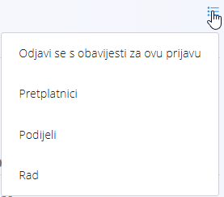

<!-- app_route: /customer-support/sla -->
<!-- app_label: SLA prijave -->
<!-- canonical_source_url: https://github.com/Tom-PIT/Connected.Docs/blob/main/hr/Domene/KorisnickaPodrska/Prijave/SLAPrijave.md -->
<!-- canonical_source_title: SLA prijave -->

# SLA prijave

Ekran **SLA prijave** prikazuje pregled prijava koje podliježu pravilima **ugovora o razini usluge (SLA)** definiranima po područjima. Pomaže korisnicima pratiti prijave kojima se **vrijeme SLA za aktivaciju ili rješavanje**:

- približava granici, ili
- je već prekoračeno.

Do ovog ekrana dolazite tako da u [navigaciji](../../../Zajednicko/UI/Navigacija.md) odaberete **Korisnička podrška / Prijave / SLA prijave**.

## Dostupnost

Funkcije SLA ovise o konfiguraciji tvrtke. Ako postavke SLA nisu uključene ili područja nemaju definirana SLA pravila, ovaj ekran može biti prazan. Na ekranu se prikazuju samo prijave područja s uključenom SLA konfiguracijom.

> [!IMPORTANT]
> Ako područje nema definirana SLA pravila, njegove prijave neće se prikazati u ovom prikazu. Ako ne vidite nikakve podatke, obratite se administratoru da omogući postavke SLA za područja.

## Shema

| Polje | Opis |
|------|------|
| **Prijava** | Identifikator i predmet prijave |
| **Područje** | Područje kojem prijava pripada |
| **Vrsta SLA** | Aktivacija ili rješavanje |
| **Vrijeme** | Preostalo ili prekoračeno vrijeme SLA |

## Pokazatelji SLA

Na vrhu ekrana sažete kartice prikazuju trenutačni status SLA:

- **Približava se SLA** – prijave koje su blizu prekoračenja praga SLA.
- **Neuspjelo SLA** – prijave kojima je vrijeme SLA već prekoračeno.

Klik na pokazatelj filtrira popis.

> [!NOTE]
> Prijave u SLA prikazu izračunavaju se dinamički, na temelju konfiguracije područja i vremenskih oznaka prijave.

## Prikaz popisa

Popis prikazuje prijave pod utjecajem SLA pravila, grupirane po statusu SLA.

Svaki redak prikazuje:

- broj i predmet prijave
- područje
- preostalo ili prekoračeno vrijeme SLA

Popis može biti prazan ako nijedno područje nema SLA pravila ili ako nijedna prijava ne odgovara kriterijima.

## Filteri

Lijevi panel nudi filtere za sužavanje popisa:

- **Područje** – ograničava rezultate na određeno područje
- **Pogled**
  - Aktivacija
  - Rješavanje
- **Pretraživanje** – pretraživanje po broju prijave ili predmetu

## Pristup prijavi

Kliknite naziv prijave da biste otvorili njezin prikaz. Odatle korisnici mogu pregledati prijavu, dodati komentar ili promijeniti status.

Ako je prijava riješena ili ponovno otvorena, automatski se uklanja s popisa SLA prijava ili se u njemu razvrstava ponovno.

## Izbornik

Izbornik nudi dodatne radnje dostupne na ovom ekranu.

Dostupne radnje:

- **Odjavi se s obavijesti za ovu prijavu** (prikazano za prijavu koju pratite)
- **Pretplatnici** – pregled korisnika koji prate prijavu
- **Podijeli**
- **Rad** – evidentiranje truda

> [!NOTE]
> Postavke obavijesti po području uređujete u [**Postavkama obavijesti**](../Upravljanje/PostavkeObavijesti.md).

Pojedinosti o radnjama izbornika potražite u odjeljku [**Radnje izbornika**](../../../Zajednicko/Koncepti/RadnjeIzbornika.md).
