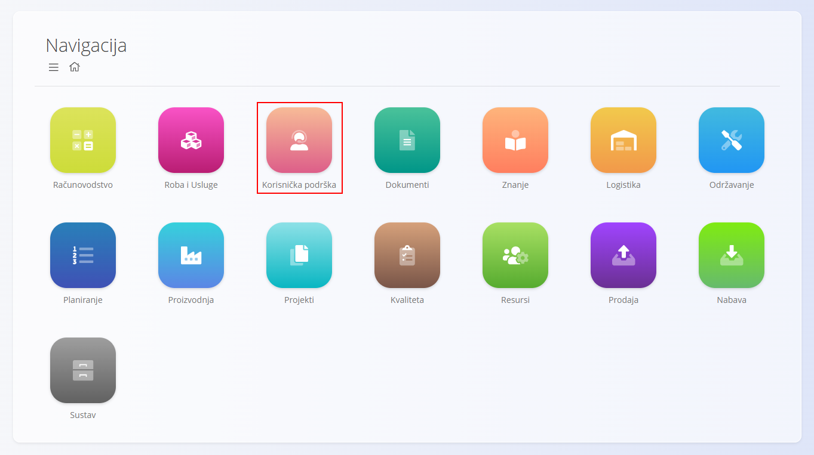
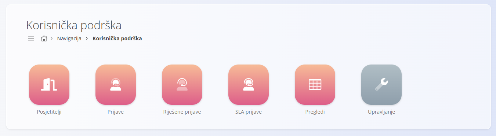
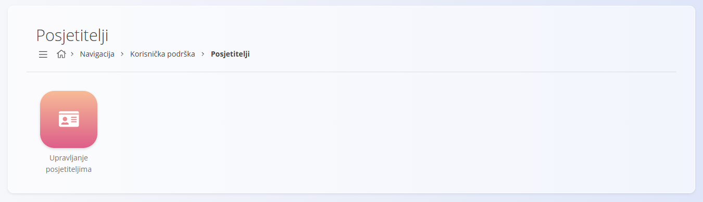
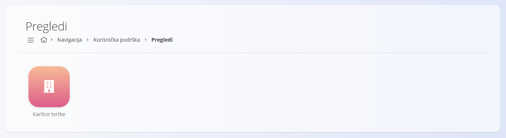
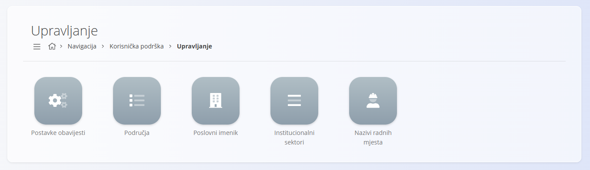

<!-- app_route: /sitemap/customers -->
<!-- app_label: Korisnička podrška -->
<!-- canonical_source_url: https://github.com/Tom-PIT/Connected.Docs/blob/main/hr/Domene/KorisnickaPodrska/README.md -->
<!-- canonical_source_title: Korisnička podrška -->

# Korisnička podrška

Domena **Korisnička podrška** pruža alate za upravljanje interakcijama s kupcima, zahtjevima za podršku i komunikacijom vezanom uz usluge. Omogućuje organizacijama praćenje dolaznih zahtjeva, rješavanje problema, praćenje razina usluge i održavanje strukturiranih podataka o kupcima.

Dok se domena [**Prodaja**](../Prodaja/README.md) bavi komercijalnim transakcijama, domena Korisnička podrška bavi se **komunikacijom nakon prodaje, rješavanjem problema i pomoći kupcima**.

Do ove domene dolazite tako da u glavnoj navigaciji odaberete **Korisnička podrška**.

> [!NOTE]
> Dostupne domene i funkcije ovise o konfiguraciji tvrtke i uključenim modulima.

## Što je uključeno u domenu Korisnička podrška?

Domena je organizirana u sljedeća funkcionalna područja:

- **[Posjetitelji](#posjetitelji)** – upravljanje vanjskim korisnicima i kontaktima kupaca
- **[Prijave](#prijave)** – obrada zahtjeva za podršku i problema s uslugom
- **[Pregledi](#pregledi)** – analitički i sažeti pregledi vezani uz korisničku podršku
- **[Upravljanje](#upravljanje)** – konfiguracija i matični podaci za procese korisničke podrške

## Posjetitelji

Odjeljak **Posjetitelji** odnosi se na fizičke posjete kupaca i partnera lokacijama tvrtke.

Na ekranu [**Upravljanje posjetiteljima**](Posjetitelji/UpravljanjePosjetiteljima.md) evidentiraju se fizičke posjete lokacijama tvrtke s podacima o posjetitelju, datumu i vremenu, statusu (**Najavljeno**, **Na lokaciji**, **Dovršeno**, **Otkazani**) i ciljnoj lokaciji.

## Prijave

Odjeljak **Prijave** sadrži sve zapise vezane uz podršku koji se koriste za praćenje zahtjeva kupaca i problema s uslugom.

Obuhvaća sljedeće ekrane:

- **[Prijave](Prijave/Prijave.md)** – aktivni i otvoreni zahtjevi za podršku
- **[Riješene prijave](Prijave/RijesenePrijave.md)** – dovršeni i zatvoreni slučajevi podrške
- **[SLA prijave](Prijave/SLAPrijave.md)** – prijave praćene u odnosu na definirane ugovore o razini usluge (SLA)

Ti ekrani predstavljaju glavno operativno područje domene Korisnička podrška. Omogućuju agentima podrške praćenje prijava od nastanka do rješenja uz uvid u vremena odgovora i rješavanja.

## Pregledi

Odjeljak **Pregledi** sadrži ekrane samo za čitanje koji podatke o kupcima prikazuju u strukturiranom i sažetom obliku.

Dostupni pregledi uključuju:

- **[Kartice tvrtke](../Prodaja/Pogledi/KarticeTvrtke.md)** – pregled kupaca i njihove povezane aktivnosti u cijelom sustavu, uključujući podatke vezane uz podršku

Pregledi **ne** stvaraju niti mijenjaju podatke. Namijenjeni su analizi, navigaciji i podršci odlučivanju.

## Upravljanje

Odjeljak **Upravljanje** sadrži ekrane za konfiguraciju i šifarnike potrebne za procese korisničke podrške.

Dostupni ekrani za konfiguraciju uključuju:

- **[Postavke obavijesti](Upravljanje/PostavkeObavijesti.md)** – prilagodba obavijesti o prijavama po područjima
- **[Područja](Upravljanje/Podrucja.md)** – definiranje područja podrške i kanala usluge
- **[Poslovni imenik](../../Zajednicko/Upravljanje/PoslovniImenik.md)** – zajednički imenik tvrtki i kontakata koji se koristi u svim domenama
- **[Institucionalni sektori](Upravljanje/InstitucionalniSektori.md)** – razvrstavanje kupaca po sektoru
- **[Nazivi radnih mjesta](../../Zajednicko/Upravljanje/NaziviRadnihMjesta.md)** – definicije uloga povezane s kontaktima kupaca i korisnicima

Ti elementi određuju kako je korisnička podrška organizirana i kako korisnici komuniciraju s prijavama i obavijestima.

> [!TIP]
> Sve stavke upravljanja pogledajte u **[Indeksu upravljanja](../../IndeksUpravljanja.md)**.

## Korisnička podrška i ostale domene

Domena **Korisnička podrška** povezana je s nekoliko drugih domena:

| Područje | Povezanost |
|------|-------------|
| [**Prodaja**](../Prodaja/README.md) | Podaci o kupcima i tvrtkama zajednički se koriste u komercijalnim procesima |
| [**Projekti**](../Projekti/README.md) | Prijave mogu biti povezane s tekućim projektima kupaca |
| [**Održavanje**](../Odrzavanje/README.md) | Prijave podrške mogu biti povezane s nalozima za održavanje ili problemima |
| [**Resursi**](../Resursi/README.md) | Opterećenje podrške i raspodjela odgovornosti |
| [**Znanje**](../Znanje/README.md) | Dokumentacija i unosi baze znanja koji podupiru rješavanje problema |
