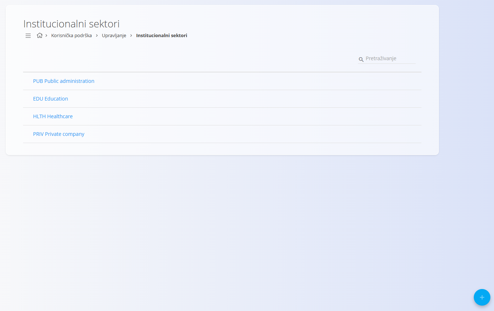
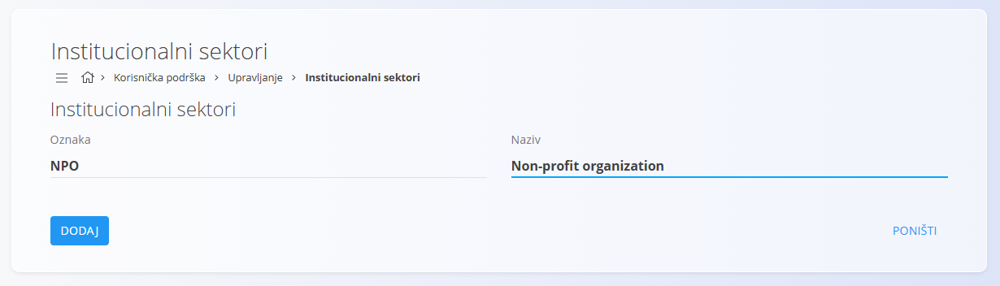

<!-- app_route: /management/contacts/institutional-sectors -->
<!-- app_label: Institucionalni sektori -->
<!-- canonical_source_url: https://github.com/Tom-PIT/Connected.Docs/blob/main/hr/Domene/KorisnickaPodrska/Upravljanje/InstitucionalniSektori.md -->
<!-- canonical_source_title: Institucionalni sektori -->

# Institucionalni sektori

## Uvod

**Institucionalni sektori** su **šifarnik** koji se koristi za razvrstavanje kupaca prema njihovoj organizacijskoj ili institucionalnoj prirodi (primjerice javna uprava, obrazovanje, zdravstvo ili privatna poduzeća). Sektori se kasnije mogu upotrijebiti pri definiranju ili upravljanju zapisima o kupcima, a pomažu pri segmentaciji, izvještavanju i filtriranju u šifarniku [**Poslovni imenik**](../../../Zajednicko/Upravljanje/PoslovniImenik.md).

Do ovog ekrana dolazite tako da u [navigaciji](../../../Zajednicko/UI/Navigacija.md) odaberete **Korisnička podrška / Upravljanje / Institucionalni sektori**.

## Shema

| Polje | Opis |
|------|------------|
| [**Oznaka**](../../../Zajednicko/UI/OznakeDokumenata.md) | Kratak, jedinstven identifikator institucionalnog sektora. |
| **Naziv** | Opisni naziv institucionalnog sektora. |

## Popis institucionalnih sektora

Prikaz popisa prikazuje sve definirane institucionalne sektore.

Značajke prikaza popisa:
- prikazuje **Oznaku** i **Naziv** svakog sektora
- podržava **pretraživanje** radi brzog filtriranja
- klik na redak otvara sektor za uređivanje

## Radnje

Radnje su dostupne preko [gumba radnji](../../../Zajednicko/UI/AkcijskiGumb.md).

### Dodavanje novog institucionalnog sektora

1. Kliknite [gumb radnji](../../../Zajednicko/UI/AkcijskiGumb.md) da biste stvorili novi sektor.
2. Unesite:
   - **Oznaka** – kratki identifikator (primjerice `NPO`)
   - **Naziv** – puni naziv sektora (primjerice *Non-profit organization*)
3. Kliknite **Dodaj** da biste spremili.

### Uređivanje institucionalnog sektora

- Kliknite postojeći sektor na popisu.
- Izmijenite **Oznaku** ili **Naziv** prema potrebi.
- Spremite promjene.

### Brisanje institucionalnog sektora

- Otvorite sektor s popisa.
- U prikazu za uređivanje kliknite **Izbriši**.
- Potvrdite brisanje.

> [!NOTE]
> Obrisani sektori više nisu dostupni za odabir pri dodjeljivanju institucionalnih sektora kupcima.
