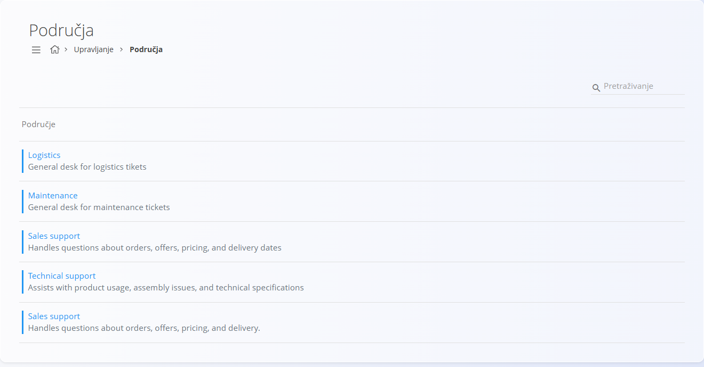
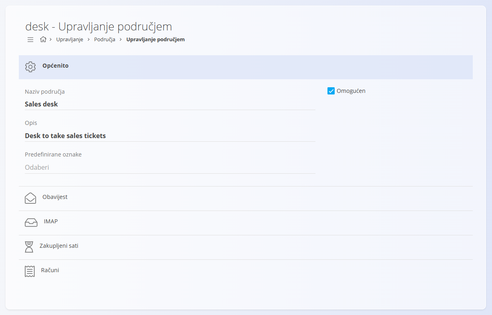
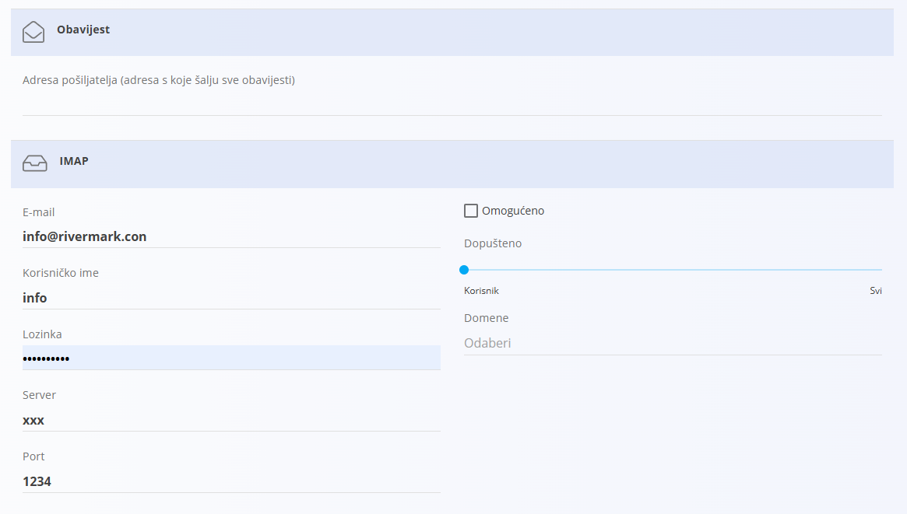
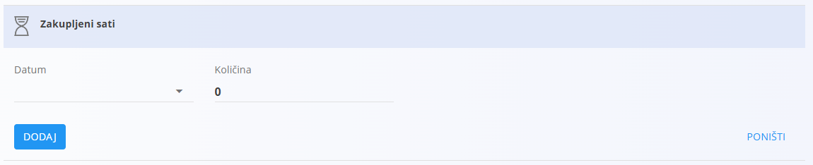

<!-- app_route: /management/customer-support/desks -->
<!-- app_label: Područja -->
<!-- canonical_source_url: https://github.com/Tom-PIT/Connected.Docs/blob/main/hr/Domene/KorisnickaPodrska/Upravljanje/Podrucja.md -->
<!-- canonical_source_title: Područja -->

# Područja

**Područja** služe za organizaciju i upravljanje **prijavama podrške** prema području odgovornosti, primjerice **Održavanje**, **Logistika** ili **Prodaja**. Određuju kako se prijave grupiraju, kako se šalju obavijesti te kako se obrađuju dodatne mogućnosti kao što su unos putem e-pošte, zakupljeni sati i računi.

Područja pomažu da se dolazni zahtjevi ispravno usmjeravaju i dosljedno obrađuju u cijeloj organizaciji.

Do ovog ekrana dolazite tako da u [navigaciji](../../../Zajednicko/UI/Navigacija.md) odaberete **Upravljanje / Područja**.

## Shema

| Polje | Opis |
|------|------|
| **Naziv područja** | Naziv područja prikazan na popisima i u prikazima prijava (obavezno). |
| **Opis** | Kratko objašnjenje namjene područja (neobavezno). |
| **Omogućen** | Pokazuje je li područje aktivno i može li primati prijave. |
| **Predefinirane oznake** | Neobavezne oznake koje se automatski dodjeljuju prijavama stvorenim u ovom području. |
| **Adresa pošiljatelja** | Adresa e-pošte koja se koristi kao pošiljatelj obavijesti vezanih uz područje. |
| **IMAP omogućen** | Omogućuje stvaranje prijava iz dolaznih e-poruka. |
| **IMAP e-mail** | Adresa e-pošte na koju stižu dolazni zahtjevi. |
| **IMAP korisničko ime i lozinka** | Podaci za prijavu na IMAP poštanski sandučić. |
| **IMAP server** | Adresa IMAP poslužitelja. |
| **IMAP port** | Port IMAP poslužitelja. |
| **IMAP ograničenja** | Pravila koja ograničavaju tko može stvarati prijave putem e-pošte. |

## Upravljanje

Šifarnik **Područja** otvara se iz odjeljka **Upravljanje** sustava. Sva su područja upravljana na jednom mjestu i mogu se koristiti u svim tokovima rada vezanim uz podršku i prijave.

### Popis područja

Sustav prikazuje popis svih područja definiranih u sustavu.

Svako područje prikazuje:
- indikator statusa u boji koji pokazuje je li područje omogućeno
- naziv područja
- kratki opis (neobavezno)

## Radnje

### Dodavanje novog područja

Kliknite [gumb radnji](../../../Zajednicko/UI/AkcijskiGumb.md) da biste dodali novo područje.

Obrazac područja podijeljen je u više odjeljaka koji određuju ponašanje područja. Pri dodavanju ili uređivanju koristite polja opisana u odjeljku [**Shema**](#shema).

#### Općenito

Određuje osnovna svojstva područja. Nazive polja i opise potražite u odjeljku [**Shema**](#shema).

#### Obavijest

Određuje adresu pošiljatelja koja se koristi za sve obavijesti vezane uz prijave kojima upravlja područje. Pogledajte [**Shemu**](#shema).

#### IMAP

Omogućuje povezivanje područja s poštanskim sandučićem. Kada je omogućeno, dolazne e-poruke automatski se pretvaraju u prijave podrške. Polja za konfiguraciju potražite u odjeljku [**Shema**](#shema).

#### Zakupljeni sati

Služi za upravljanje unaprijed plaćenim ili ugovorom dogovorenim satima podrške za područje. Unesite datum i količinu zakupljenih sati, zatim dodajte unos.

#### Računi

Prikazuje pregled računa vezanih uz aktivnost područja. Unesite datum i iznos naplaćenog računa.

### Uređivanje područja

Kliknite područje na popisu da biste ga otvorili u načinu uređivanja. Možete mijenjati sva polja i postavke prema potrebi. Promjene se spremaju automatski.
