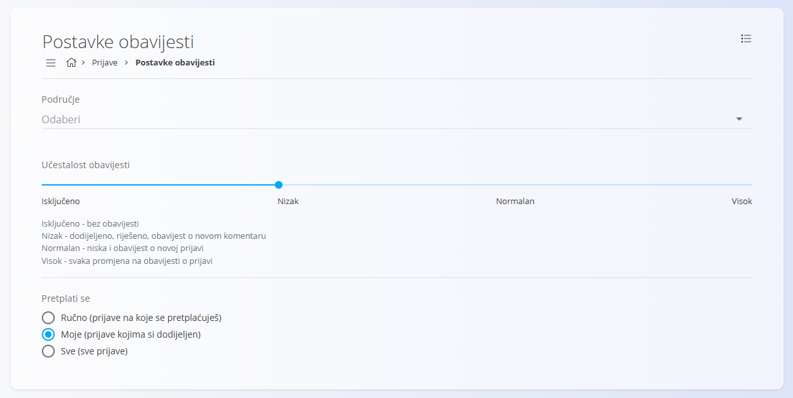

<!-- app_route: /configuration/customer-support/notifications -->
<!-- app_label: Postavke obavijesti -->
<!-- canonical_source_url: https://github.com/Tom-PIT/Connected.Docs/blob/main/hr/Domene/KorisnickaPodrska/Upravljanje/PostavkeObavijesti.md -->
<!-- canonical_source_title: Postavke obavijesti -->

# Postavke obavijesti

Ekran **Postavke obavijesti** omogućuje korisnicima da prilagode koje obavijesti o prijavama primaju. Postavke se konfiguriraju **po području**, pa svako područje može imati drugačije postavke obavijesti.

Do ovog ekrana dolazite tako da u [navigaciji](../../../Zajednicko/UI/Navigacija.md) odaberete **Korisnička podrška / Upravljanje / Postavke obavijesti**.

## Shema

| Polje | Opis |
|------|------------|
| **Područje** | Odabire područje za koje se konfiguriraju postavke obavijesti. Svako područje ima vlastite, neovisne postavke. |
| **Učestalost obavijesti** | Određuje koliko se često šalju obavijesti o promjenama prijava. |
| **Pretplati se** | Određuje za koje se prijave korisnik pretplaćuje na obavijesti. |

## Ponašanje po području

Postavke obavijesti vezane su uz **odabrano područje**:

- promjenom **područja** mijenjaju se prikazane postavke
- svako područje može imati različitu učestalost obavijesti i različita pravila pretplate
- prilagodbe utječu samo na obavijesti vezane uz trenutno odabrano područje

## Učestalost obavijesti

Klizač **Učestalost obavijesti** ima četiri razine:

- **Isključeno** – bez obavijesti
- **Nizak** – dodijeljeno, riješeno, obavijest o novom komentaru
- **Normalan** – niska i obavijest o novoj prijavi
- **Visok** – svaka promjena na obavijesti o prijavi

## Opcije pretplate

Opcija **Pretplati se** određuje za koje prijave korisnik prima obavijesti:

- **Ručno** – samo prijave na koje se korisnik sam pretplati
- **Moje** – prijave dodijeljene korisniku
- **Sve** – sve prijave unutar odabranog područja

## Napomene

- Postavke su vezane uz **korisnika**.
- Promjene se primjenjuju odmah.
- Nakon ažuriranja postavki nije potrebna dodatna potvrda.
