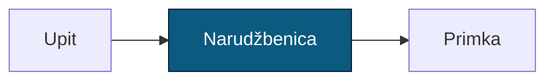
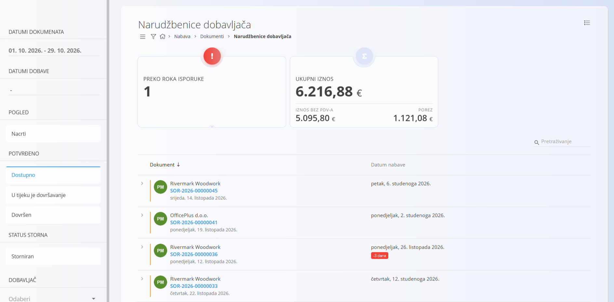
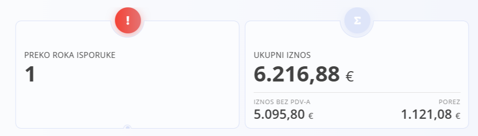
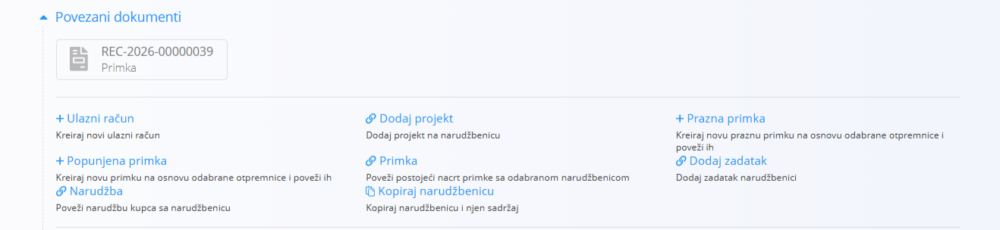

<!-- app_route: /supply/documents/supply-orders -->
<!-- app_label: Narudžbenice dobavljača -->
<!-- canonical_source_url: https://github.com/Tom-PIT/Connected.Docs/blob/main/hr/Domene/Nabava/Dokumenti/Narudzbenice.md -->
<!-- canonical_source_title: Narudžbenice dobavljača -->

# Narudžbenice dobavljača

**Narudžbenica** je službeni nabavni dokument kojim se potvrđuju materijali ili usluge naručeni od dobavljača. Definira *što* će vaša organizacija primiti, *kada* i *pod kojim uvjetima* te je osnova za operativne tijekove rada, kao što su zaprimanje materijala i raspodjela na mjesta troška.

Za pristup ovoj stranici otvorite **Nabava / Dokumenti / Narudžbenice dobavljača** u [navigaciji](../../../Zajednicko/UI/Navigacija.md).

## Mjesto narudžbenica u procesu nabave

Narudžbenice predstavljaju fazu službene potvrde u procesu nabave.

1. Zahtjev se obično pokreće [**Upitom**](Upiti.md).  
2. Nakon prihvaćanja iz upita se izrađuje **Narudžbenica** u odjeljku *Povezani dokumenti*.  
   - Narudžbenice se mogu izraditi i izravno, bez upita, te se po potrebi naknadno povezati s njim.  
3. Iz narudžbenice možete izraditi jedan ili više dokumenata [**Primka**](../../Logistika/Dokumenti/Primke.md):  
   - nekoliko **djelomičnih** primki  
   - ili jednu **potpunu** primku  
4. Kada je sav materijal zaprimljen, narudžbenica automatski prelazi u status **Dovršen**.  
   - Ako je zaprimljen samo djelomično, ostaje u statusu **Dostupno** do dovršetka.

## Shema

<strong>Dokument</strong>

| Polje | Opis |
|-------|------|
| [**Oznaka**](../../../Zajednicko/UI/OznakeDokumenata.md) | Oznaka narudžbenice koju generira sustav. |
| **Dobavljač** | Dobavljač koji isporučuje materijale ili usluge, odabran iz [Poslovnog imenika](../../../Zajednicko/Upravljanje/PoslovniImenik.md). |
| **Datum dokumenta** | Datum izrade narudžbenice. |
| **Datum nabave** | Planirani datum nabave odnosno isporuke naručenih materijala (obavezno). |
| **Rabat** | Neobvezni popust koji se primjenjuje na cijelu narudžbenicu. |
| **[Mjesto troška](../../../Zajednicko/Upravljanje/MjestaTroska.md)** | Interno mjesto troška povezano s ovom nabavom. |
| **Broj ponude** | Neobvezna referenca na ponudu dobavljača ili vanjski dokument. |
| **Dostava – Tvrtka / Adresa** | Podaci o mjestu dostave, preuzeti iz Poslovnog imenika ili po potrebi ručno prilagođeni. |
| **Sadržaj gore** | Unaprijed pripremljeni uvodni tekst iz šifrarnika [Unaprijed pripremljeni tekstovi](../../../Zajednicko/Upravljanje/UnaprijedPripremljeniTekstovi.md) (entitet: *Narudžbenica*). |
| **Sadržaj dolje** | Zaključne ili pravne napomene iz unaprijed pripremljenih tekstova. |
| **Stavke** | Popis naručenih materijala ili troškova, uključujući količine, cijene, poreze i podatke o isporuci. |

<strong>Stavke</strong>

| Polje | Opis |
|-------|------|
| **[Materijal](../../RobaIUsluge/Materijali/README.md)** | Materijal koji se nabavlja. |
| **EAN** | Crtični kod materijala (nije obavezno). |
| **Količina** | Naručena količina. |
| **Datum nabave** | Datum nabave za ovu stavku. |
| **Neto cijena (jedinična)** | Jedinična cijena preuzeta iz zapisa o materijalima dobavljača ili unesena ručno. |
| **Popust (%)** | Neobvezni popust koji se primjenjuje na ovu stavku. |
| **[Porezna stopa](../../../Zajednicko/Upravljanje/PorezneStope.md)** | Primijenjeno porezno pravilo. Ako je definirana porezna stopa od **0 %**, ona se automatski primjenjuje pri naručivanju od dobavljača sa sjedištem izvan matične zemlje. |
| **Oznaka dobavljača** | Interna oznaka ili referenca dobavljača za odabrani materijal. |
| **Ukupna cijena** | Ukupan iznos stavke (količina × neto cijena − popust + porez). |

## Upravljanje

### Stanja dokumenta

Dokument tijekom svog životnog ciklusa prolazi kroz nekoliko mogućih stanja:

- **Nacrt** – Dokument još nije objavljen. Sva polja mogu se slobodno uređivati.
- **Potvrđeno** – Dokument je objavljen. Ne može se izbrisati niti slobodno mijenjati.
    - **Dostupno** – Narudžbenica je valjana i spremna za zaprimanje.
    - **U tijeku je dovršavanje** – Dio materijala je zaprimljen (djelomično zaprimanje).
    - **Dovršen** – Sav materijal je zaprimljen i narudžbenica je u potpunosti obrađena.

### Pregled popisa

Popis prikazuje sve narudžbenice s njihovim trenutnim statusom i datumima nabave.

Na vrhu popisa narudžbenica sustav prikazuje dva ključna pokazatelja koji sažimaju trenutno filtrirane podatke.

- **Preko roka isporuke** (interaktivno) – narudžbenice kojima je prošao planirani datum nabave, a još nisu u potpunosti zaprimljene. Klikom na pokazatelj popis se automatski filtrira tako da prikazuje samo te narudžbenice.
- **Ukupni iznos** – prikazuje ukupnu vrijednost (neto + porez) svih narudžbenica obuhvaćenih aktivnim filtrom.

### Filtri

- **Datumi dokumenata**  
- **Datumi dobave**  
- **Pogled**  
  - Nacrti  
- **Potvrđeno**  
  - Dostupno  
  - U tijeku je dovršavanje  
  - Dovršen  
- **Status storna: Storniran**  
- **Dobavljač**  
- traka za pretraživanje  

## Akcije

### Izrada narudžbenice

Nove narudžbenice izrađuju se klikom na [akcijski gumb](../../../Zajednicko/UI/AkcijskiGumb.md).

Upute korak po korak potražite u vodiču [**Kako kreirati narudžbenicu**](NarudzbeniceIzrada.md).

### Uređivanje narudžbenice

Kliknite bilo koju narudžbenicu na popisu kako biste je otvorili. Narudžbenice u nacrtu mogu se slobodno uređivati.

Proširivi odjeljci:

- [Povezani dokumenti](#povezani-dokumenti)  
- [Prilozi](NarudzbeniceIzrada.md#prilozi)  
- [Dokument](NarudzbeniceIzrada.md#korak-2-unos-podataka-zaglavlja) 
- [Dostava](NarudzbeniceIzrada.md#dostava)  
- [Sadržaj gore i sadržaj dolje](NarudzbeniceIzrada.md#sadržaj-gore-i-sadržaj-dolje)  
- [Stavke](NarudzbeniceIzrada.md#korak-3-dodavanje-stavki)  

#### Povezani dokumenti

Odjeljak **Povezani dokumenti** omogućuje izradu operativnih dokumenata i njihovo povezivanje s narudžbenicom.

Više informacija o odnosima među dokumentima, sljedivosti i izradi povezanih dokumenata potražite u odjeljku [**Povezani dokumenti**](../../../Zajednicko/Koncepti/PovezaniDokumenti.md).

Dostupne akcije uključuju:

- [**+ Ulazni račun**](../../Racunovodstvo/Dokumenti/ReceivedInvoices.md) – izrada novog ulaznog računa
- **Dodaj projekt** – dodavanje projekta narudžbenici  
- [**+ Prazna primka**](../../Logistika/Dokumenti/Primke.md) – izrada prazne primke, spremne za ažuriranje kada stvarna isporuka stigne
- [**+ Popunjena primka**](../../Logistika/Dokumenti/Primke.md) – izrada popunjene primke (sa **svim** ili **dijelom** materijala) i njezino povezivanje  
- [**Primka**](../../Logistika/Dokumenti/Primke.md) – povezivanje postojeće primke u nacrtu s narudžbenicom  
- **Dodaj zadatak** – dodavanje zadatka narudžbenici  
- [**Narudžba**](../../Prodaja/Dokumenti/NarudzbeKupca.md) – povezivanje narudžbe kupca s narudžbenicom
- **Kopiraj narudžbenicu** – izrada kopije narudžbenice s njezinim sadržajem

### Dovršavanje narudžbenice

Narudžbenica se smatra dovršenom kada je sav materijal u potpunosti zaprimljen.

Dovršavanjem narudžbenice izvode se sljedeće radnje:

- Dokument prelazi iz stanja **Dostupno** u stanje **Dovršen**.  
- Uređivanje postaje ograničeno.  
- Većina akcija u odjeljku **Povezani dokumenti** postaje nedostupna (uključujući izradu dodatnih primki).  
- Sve preostale otvorene količine smatraju se u potpunosti obrađenima.

> [!NOTE]
> Dovršavanje narudžbenice administrativna je radnja kojom se zaključuje njezin životni ciklus. Pritom se **ne** izvode dodatna kretanja zaliha — ona se izvode u povezanim primkama.

### Brisanje narudžbenice

Narudžbenice u nacrtu mogu se izbrisati na zaslonu za uređivanje, ali samo ako **ne sadrže stavke**.

Ako nacrt još sadrži stavke u odjeljku **Stavke**:

1. Kliknite redak materijala kako biste otvorili zaslon **Uredi stavku**.  
2. U prozoru Uredi stavku kliknite **Izbriši** kako biste uklonili materijal.  
3. Ponovite postupak za sve preostale materijale.

Kada dokument više ne sadrži materijale, kliknite **Izbriši** kako biste uklonili nacrt.  
Nakon potvrde sustav trajno uklanja dokument; u suprotnom se ne mijenja ništa.

> [!NOTE]  
> - Izbrisati se mogu samo narudžbenice u **nacrtu**.  
> - Nakon objave narudžbenica se više ne može izbrisati.  
> - Objavljeni dokumenti ne mogu se izbrisati, ali se mogu [stornirati](../../Logistika/Dokumenti/Storno.md).

## Izbornik

Ova stranica sadrži radnje izbornika na dva mjesta.

Radnje izbornika dostupne su putem gumba **Izbornik** u gornjem desnom kutu popisa ili stranice dokumenta.

### Izbornik popisa

Izbornik popisa sadrži radnje za trenutno prikazani popis.

Dostupne radnje:

- **Izvoz u CSV**

### Izbornik dokumenta

Izbornik dokumenta sadrži radnje za trenutno otvoreni dokument.

Dostupne radnje:

- **Ispis**
- **Izvoz u PDF (dokument narudžbenice) ili CSV (stavke narudžbenice)**
- **Pošalji kao email** 
- **[Storniraj dokument](../../Logistika/Dokumenti/Storno.md)**
- **Vrati na nacrt**

Više informacija o radnjama izbornika potražite u odjeljku [**Radnje izbornika**](../../../Zajednicko/Koncepti/RadnjeIzbornika.md).
