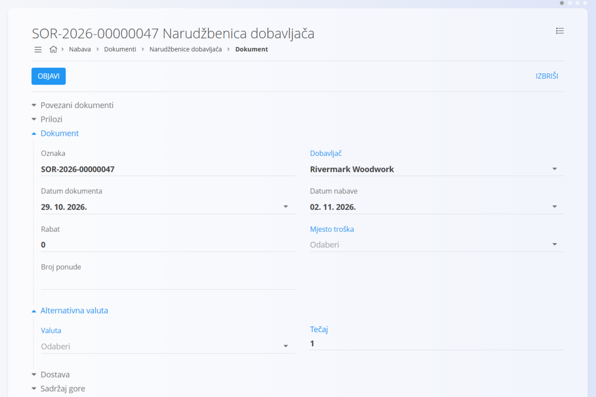
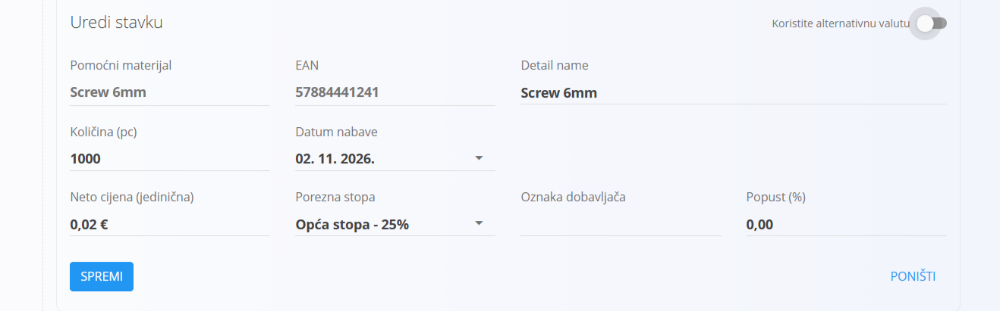
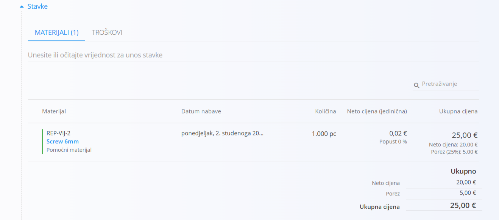

<!-- app_route: /supply/documents/supply-orders -->
<!-- app_label: Narudžbenice dobavljača -->
<!-- app_navigation_hint: Otvorite Narudžbenice dobavljača, a zatim kliknite akcijski gumb za izradu nove narudžbenice u nacrtu. -->
<!-- canonical_source_url: https://github.com/Tom-PIT/Connected.Docs/blob/main/hr/Domene/Nabava/Dokumenti/NarudzbeniceIzrada.md -->
<!-- canonical_source_title: Kako kreirati narudžbenicu -->

# Kako kreirati narudžbenicu

Nove [narudžbenice](Narudzbenice.md) mogu se izraditi:

- ručno na zaslonu **Narudžbenice dobavljača** pomoću [akcijskog gumba](../../../Zajednicko/UI/AkcijskiGumb.md)
- iz [upita](Upiti.md) putem **Povezani dokumenti → + Narudžbenica**

> [!NOTE]
> - Ručno izrađene narudžbenice počinju s praznim poljima.
>
> - Kada se narudžbenica izradi iz upita, sustav većinu polja automatski popunjava iz izvornog dokumenta, uključujući dobavljača, podatke o dostavi i stavke.

## Korak 1: Izrada dokumenta

Izradite novu narudžbenicu u nacrtu na jedan od sljedećih načina:

- kliknite [akcijski gumb](../../../Zajednicko/UI/AkcijskiGumb.md) na zaslonu **Narudžbenice dobavljača**
- u povezanom dokumentu, kao što je [upit](Upiti.md), odaberite **Povezani dokumenti → + Narudžbenica**

Izrađuje se nova narudžbenica u nacrtu. Ako je izrađena izravno iz drugog dokumenta, većina njezinih polja već je popunjena.

## Korak 2: Unos podataka zaglavlja

Unesite **Dobavljača**, **Datum dokumenta** i **Datum nabave** (ili ih provjerite ako su preuzeti iz upita).  

## Korak 3: Dodavanje stavki

Dodajte stavke u odjeljak **Stavke**. Stavke definiraju naručene artikle te njihove količine, cijene, poreze i popuste. Svaki redak odgovara određenom materijalu ili usluzi.

Za dodavanje nove stavke: 

 1. U traku **Stavke** upišite ili skenirajte **serijski broj**, **EAN** ili **naziv materijala**. Sustav prikazuje sve odgovarajuće artikle. 

    

 2. Odaberite željeni artikl s popisa.
 3. Prilagodite **količinu**, **cijenu**, **popust** ili **porezne podatke**, a zatim kliknite **Spremi**.

    

Više informacija o radu sa stavkama dokumenta potražite u odjeljku [**Stavke**](../../../Zajednicko/Koncepti/Stavke.md).

## Korak 4: Uređivanje dodatnih odjeljaka

### Alternativna valuta

Odjeljak **Alternativna valuta** omogućuje iskazivanje cijena u valuti različitoj od zadane valute sustava, što je korisno kod nabave od inozemnih dobavljača. Odaberite **Valutu** i po potrebi prilagodite **Tečaj**. Valute se definiraju u šifrarniku [**Valute**](../../../Zajednicko/Upravljanje/Valute.md).

### Dostava

Odjeljak **Dostava** određuje gdje će se naručeni materijali isporučiti. Automatski se popunjava podacima o dostavi vaše tvrtke, ali se adresa po potrebi može prilagoditi za svaku nabavu.

Te vrijednosti utječu na ispisanu narudžbenicu i na kasnije logističke dokumente (kao što su [primke](../../Logistika/Dokumenti/Primke.md)), ali ne mijenjaju matične podatke spremljene u Poslovnom imeniku.   

### Prilozi

U odjeljku **Prilozi** možete učitavati datoteke povezane s dokumentom i upravljati njima, kao što su fotografije, PDF datoteke, certifikati ili popratni zapisi.

Detaljne upute potražite u odjeljku [**Prilozi**](../../../Zajednicko/Koncepti/Privici.md).

### Sadržaj gore i sadržaj dolje

Odjeljci za unaprijed pripremljeni sadržaj omogućuju dodavanje gotovih tekstova na vrh ili dno dokumenta. To je korisno za uključivanje standardnih uvjeta, uputa za plaćanje ili drugih podataka koji se trebaju pojaviti na ispisanom dokumentu. 

Sadržaj se odabire iz šifrarnika [**Unaprijed pripremljeni tekstovi**](../../../Zajednicko/Upravljanje/UnaprijedPripremljeniTekstovi.md).

### Povezani dokumenti

Odjeljak [**Povezani dokumenti**](Narudzbenice.md#povezani-dokumenti) omogućuje izravno povezivanje srodnih dokumenata. Na primjer, narudžbenicu možete povezati s upitom ili s jednom ili više primki. Tako se održava sljedivost i olakšava kretanje između dokumenata u procesu nabave.

## Korak 5: Objava narudžbenice

Kada su uneseni svi potrebni podaci, kliknite **Objavi** kako biste dovršili pripremu narudžbenice.

Nakon objave dokument prelazi u stanje **Potvrđeno → Dostupno**, što omogućuje daljnje postupke, kao što je izrada [primki](../../Logistika/Dokumenti/Primke.md).

Ako dokument nije objavljen, ostaje u stanju **Nacrt**, u kojem se može i dalje uređivati, ažurirati ili kasnije objaviti.
