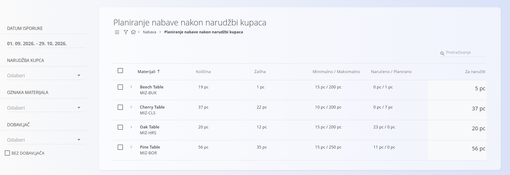
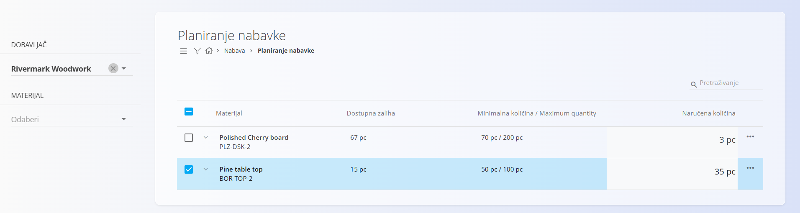
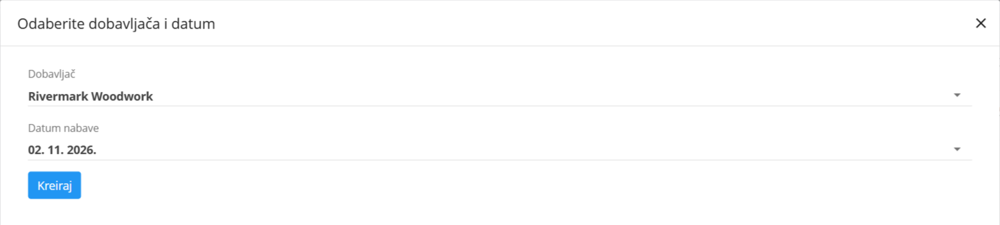

<!-- app_route: /supply/documents/supply-planning-by-sales -->
<!-- app_label: Planiranje nabave nakon narudžbi kupaca -->
<!-- canonical_source_url: https://github.com/Tom-PIT/Connected.Docs/blob/main/hr/Domene/Nabava/Dokumenti/PlaniranjeNabavePoNarudzbamaKupaca.md -->
<!-- canonical_source_title: Planiranje nabave nakon narudžbi kupaca -->

# Planiranje nabave nakon narudžbi kupaca

Prikaz **Planiranje nabave nakon narudžbi kupaca** podržava planiranje nabave na temelju **potražnje iz prodaje**. Koristi istu logiku i tijek rada kao [**Planiranje nabavke**](PlaniranjeNabavke.md), ali dodaje **analizu prodanih količina** kako bi se nadopuna zaliha mogla odrediti prema nedavnoj prodaji (bez obzira na status).

U ovom prikazu možete izravno izraditi [**Narudžbenice**](Narudzbenice.md) i [**Upite**](Upiti.md), a podaci o prodaji pružaju dodatni kontekst za odluke o planiranju.

Za pristup ovom prikazu otvorite **Nabava / Planiranje nabave nakon narudžbi kupaca** u [navigaciji](../../../Zajednicko/UI/Navigacija.md).

## Pregled popisa

Glavni popis prikazuje materijale kojima je potrebna nadopuna, obogaćene podacima o prodaji.

Stupci:

* **Materijali**
* **Količina** – količina prodana u odabranom razdoblju
* **Zaliha** – dostupna zaliha
* **Minimalno / Maksimalno** – minimalna i maksimalna količina iz granica zalihe
* **Naručeno / Planirano** – količine koje su već pokrivene postojećim nabavnim dokumentima
* **Za naručiti** – predložena količina za narudžbu

## Filtri

Bočna traka na lijevoj strani omogućuje sužavanje prikaza prema:

* **Datumu isporuke**
* **Narudžbi kupca**
* **Oznaci materijala**
* **Dobavljaču**
* **Bez dobavljača** – prikazuje materijale kojima nije dodijeljen dobavljač

Prikazuju se samo materijali koji odgovaraju i filtrima i uvjetima planiranja.

## Izrada narudžbenica ili upita prema potražnji iz prodaje

Izrada dokumenata iz ovog prikaza funkcionira **potpuno jednako** kao u prikazu **Planiranje nabavke**.

1. Potvrdnim okvirom odaberite jedan ili više materijala i po potrebi izravno na popisu upišite količinu u stupac **Za naručiti**.

    

2. Kliknite akcijski gumb i odaberite:

   * **Kreiraj novu narudžbenicu** ([narudžbenica](Narudzbenice.md)) ili
   * **[Upit](Upiti.md)**

   

3. U dijaloškom okviru odaberite **dobavljača** i **datum nabave**.

    

4. Kliknite **Kreiraj** za nastavak.

Zatim se otvara nova **Narudžbenica** ili **Upit** s već popunjenim materijalima, količinama i podacima o dobavljaču.

Detaljna pravila o akcijama, brisanju i radu s dokumentima potražite u odjeljku:

* [**Planiranje nabavke**](PlaniranjeNabavke.md)
