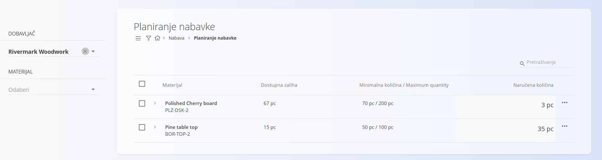
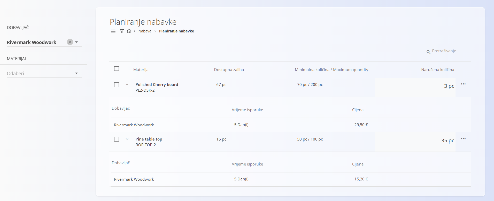

<!-- app_route: /supply/documents/supply-planning -->
<!-- app_label: Planiranje nabavke -->
<!-- canonical_source_url: https://github.com/Tom-PIT/Connected.Docs/blob/main/hr/Domene/Nabava/Dokumenti/PlaniranjeNabavke.md -->
<!-- canonical_source_title: Planiranje nabavke -->

# Planiranje nabavke

Prikaz **Planiranje nabavke** pomaže u proaktivnom planiranju nabave jer prepoznaje materijale čija je zaliha pala ispod definirane minimalne razine. Na ovom zaslonu za te materijale možete izravno izraditi [**Narudžbenice**](Narudzbenice.md) ili [**Upite**](Upiti.md), s većinom podataka unaprijed popunjenih.

Ova je stranica usko povezana sa:
- **[Granicama zalihe](../../Logistika/Upravljanje/GraniceZalihe.md)** – u kojima se definiraju minimalne i maksimalne količine
- **[Materijalima dobavljača](../Upravljanje/SupplierMaterials.md)** – u kojima se materijali dodjeljuju dobavljačima

Za pristup ovoj stranici otvorite **Nabava / Planiranje nabavke** u [navigaciji](../../../Zajednicko/UI/Navigacija.md).

### Kako funkcionira

Materijal se prikazuje u ovom prikazu samo ako su ispunjeni **svi** sljedeći uvjeti:

1. U [**Granicama zalihe**](../../Logistika/Upravljanje/GraniceZalihe.md) definirane su **minimalna i maksimalna količina**.
2. Materijal je u [**Materijalima dobavljača**](../Upravljanje/SupplierMaterials.md) dodijeljen barem jednom dobavljaču.  
3. **Dostupna zaliha** je **ispod minimalne količine**.

Kada su ti uvjeti ispunjeni, materijal se prikazuje na popisu za planiranje i s njim se mogu izvoditi radnje.

## Pregled popisa

Glavni popis prikazuje materijale koji zahtijevaju pozornost, sa sljedećim stupcima:

- **Materijal**
- **Dostupna zaliha**
- **Minimalna količina / Maximum quantity**
- **Naručena količina** – predložena količina za narudžbu (razlika do minimalne količine), koju možete prilagoditi

### Filtri

Bočna traka na lijevoj strani omogućuje sužavanje rezultata prema:
- **Dobavljaču**
- **Materijalu**

Prikazuju se samo materijali koji odgovaraju odabranim filtrima i uvjetima planiranja.

### Detalji retka

Svaki redak može se proširiti kako bi prikazao dobavljače kojima je materijal dodijeljen, sa sljedećim podacima:
- **Dobavljač**
- **Vrijeme isporuke** – broj dana do isporuke
- **Cijena** – jedinična cijena iz [Materijala dobavljača](../Upravljanje/SupplierMaterials.md)

Tako možete usporediti dobavljače prije nego što izradite nove dokumente.

## Izrada narudžbenica ili upita prema razini zaliha

Narudžbenice i upiti izrađuju se izravno na ovom zaslonu.

1. Potvrdnim okvirom odaberite jedan ili više materijala i po potrebi izravno na popisu prilagodite **Naručenu količinu**.

   

2. Kliknite [akcijski gumb](../../../Zajednicko/UI/AkcijskiGumb.md) i odaberite:
   - **Kreiraj novu narudžbenicu** ([narudžbenica](Narudzbenice.md)) ili
   - **[Upit](Upiti.md)**

   

3. Otvara se dijaloški okvir u kojem potvrđujete:
   - **Dobavljača**
   - **Datum nabave**

   

4. Kliknite **Kreiraj** za nastavak.

Zatim se otvara nova **Narudžbenica** ili **Upit** sa svim relevantnim podacima — materijalom, količinama i dobavljačem — već popunjenima.
