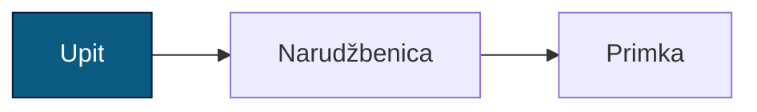
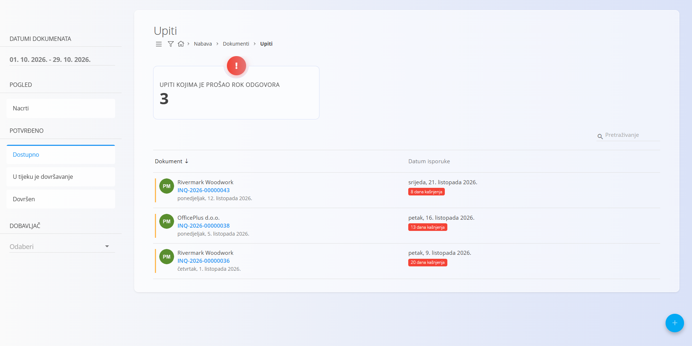
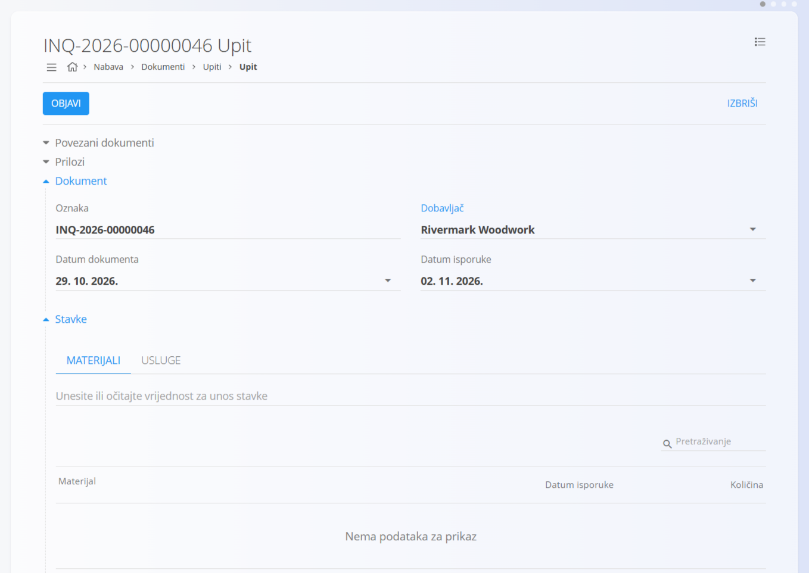
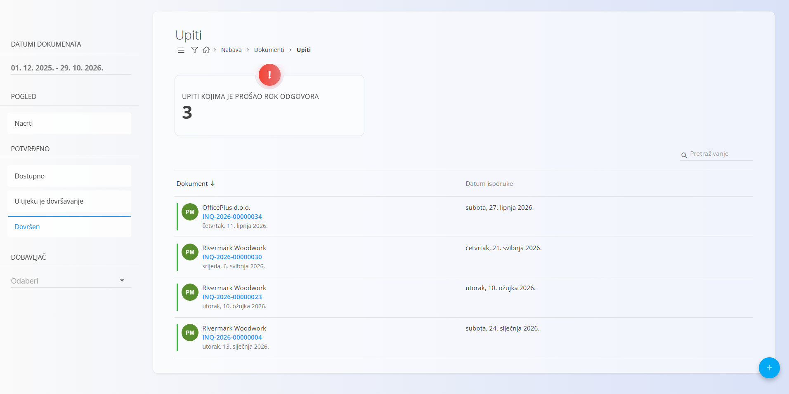

<!-- app_route: /supply/documents/inquiries -->
<!-- app_label: Upiti -->
<!-- canonical_source_url: https://github.com/Tom-PIT/Connected.Docs/blob/main/hr/Domene/Nabava/Dokumenti/Upiti.md -->
<!-- canonical_source_title: Upiti -->

# Upiti

**Upit** je nabavni dokument kojim se od dobavljača traže podaci o cijenama, dostupnosti i rokovima isporuke prije slanja službene narudžbe. Upiti vašoj organizaciji pomažu usporediti odgovore dobavljača, planirati nadolazeću nabavu i jednostavno prijeći na sljedeće dokumente, kao što su [**Narudžbenice**](SupplyOrders.md).

Za pristup ovoj stranici otvorite **Nabava / Dokumenti / Upiti** u [navigaciji](../../../Zajednicko/UI/Navigacija.md).

## Mjesto upita u procesu nabave

Tipičan tijek:

1. Izradite **Upit** i pošaljite ga dobavljaču.  
2. Dobavljač odgovara s podacima o cijenama, dostupnosti i isporuci.  
3. Nakon odobrenja upit pretvorite u [**Narudžbenicu**](SupplyOrders.md) u odjeljku **Povezani dokumenti**.  
4. Kada materijal stigne, iz narudžbenice možete izraditi dokument [**Primka**](../../Logistika/Dokumenti/Primke.md) (djelomičnu ili potpunu).

> [!NOTE]  
> Upiti nisu obavezni — narudžbenice se mogu izraditi i izravno, bez prethodnog upita. Vaša organizacija može provoditi sve korake ili samo neke od njih, ovisno o postupku nabave.

## Shema

| Polje | Opis |
|-------|------|
| [**Oznaka**](../../../Zajednicko/UI/OznakeDokumenata.md) | Oznaka upita koju generira sustav. |
| **Dobavljač** | Dobavljač kojem se šalje upit, odabran iz [**Poslovnog imenika**](../../../Zajednicko/Upravljanje/PoslovniImenik.md) (obavezno). |
| **Datum dokumenta** | Datum izrade upita. |
| **Datum isporuke** | Rok do kojeg upit vrijedi (slično datumu isteka). |
| **Stavke** | Popis traženih materijala ili usluga (obavezno). |

### Polja stavke

| Polje | Opis |
|-------|------|
| **[Materijal](../../RobaIUsluge/Materijali/README.md)** | Materijal za koji se traže podaci. |
| **Datum isporuke** | Očekivani ili predloženi datum isporuke. |
| **Količina** | Tražena količina odabranog materijala. |
| **Oznaka dobavljača** | Interna oznaka materijala kod dobavljača (nije obavezno). |

## Upravljanje

### Stanja dokumenta

Dokument tijekom svog životnog ciklusa prolazi kroz nekoliko mogućih stanja:

- **Nacrt** – Upit još nije objavljen. Sva polja mogu se slobodno uređivati.
- **Potvrđeno** – Upit je objavljen. Ne može se izbrisati niti slobodno mijenjati.
    - **Dostupno** – Upit je valjan i spreman za daljnju obradu.
    - **U tijeku je dovršavanje** – Upit je djelomično obrađen (npr. djelomično pretvoren ili povezan).
    - **Dovršen** – Sve radnje povezane s upitom su u potpunosti izvršene.

### Pregled popisa

Popis upita pruža pregled svih nabavnih zahtjeva, podijeljenih na **Nacrti**, **Dostupno**, **U tijeku je dovršavanje** i **Dovršen**.

### Pokazatelji

Na vrhu popisa sustav prikazuje pokazatelj **Upiti kojima je prošao rok odgovora**:

- **Upiti kojima je prošao rok odgovora** – upiti čiji je datum isporuke prošao, a još nisu dovršeni.  
  Klikom na pokazatelj popis se filtrira tako da prikazuje samo te upite.

### Filtri

Filtri na lijevoj strani pomažu suziti rezultate prema:

- **Datumi dokumenata**  
- **Pogled**  
  - Nacrti  
- **Potvrđeno**  
  - Dostupno  
  - U tijeku je dovršavanje  
  - Dovršen  
- **Dobavljač**  
- traci za pretraživanje  

Ti filtri omogućuju brzo kretanje kroz upite dobavljačima u različitim statusima i razdobljima.

## Akcije

### Izrada novog upita

1. Kliknite [akcijski gumb](../../../Zajednicko/UI/AkcijskiGumb.md) za izradu novog upita u nacrtu.

2. Ispunite polja **Dobavljač**, **Datum dokumenta** i **Datum isporuke**.

    

3. Dodajte stavke u odjeljak **Stavke**. U traku za stavke upišite ili skenirajte **serijski broj**, **EAN** ili **naziv materijala**.  
   - Sustav prikazuje **sve odgovarajuće materijale i serijske brojeve**.  
   - Prilagodite količinu prema potrebi.

   Više informacija o radu sa stavkama dokumenta potražite u odjeljku [**Stavke**](../../../Zajednicko/Koncepti/Stavke.md).

4. Spremite dodane stavke.

5. Kada je upit spreman, kliknite **Objavi** kako biste dovršili nacrt i premjestili upit u stanje **Dostupno**.

### Uređivanje upita

Kliknite bilo koji upit na popisu kako biste ga otvorili. Upiti u nacrtu mogu se slobodno uređivati.

Dokument sadrži nekoliko proširivih odjeljaka:  
- Povezani dokumenti  
- Prilozi  
- Dokument  
- Stavke  

#### Prilozi

U odjeljku **Prilozi** možete učitavati datoteke povezane s dokumentom i upravljati njima, kao što su fotografije, PDF datoteke, certifikati ili popratni zapisi.

Detaljne upute potražite u odjeljku [**Prilozi**](../../../Zajednicko/Koncepti/Privici.md).

#### Povezani dokumenti

Odjeljak **Povezani dokumenti** omogućuje izradu i praćenje povezanih nabavnih dokumenata.

Više informacija o odnosima među dokumentima, sljedivosti i izradi povezanih dokumenata potražite u odjeljku [**Povezani dokumenti**](../../../Zajednicko/Koncepti/PovezaniDokumenti.md).

> [!NOTE]  
> Dostupne akcije u odjeljku **Povezani dokumenti** ovise o vrsti dokumenta i statusu upita.

Dostupne akcije uključuju:

- **Dodaj projekt** – dodjeljivanje upita projektu  
- **+ Narudžbenica** – izrada [narudžbenice](SupplyOrders.md) izravno iz upita  

> [!TIP]
> Kada se narudžbenica izradi iz upita, većina relevantnih polja popunjava se automatski.

### Dovršavanje upita

Kada je upit u stanju **Dostupno** odobren, kliknite **Dovrši** na vrhu stranice. Dokument se tada prikazuje na popisu **Dovršen**.

> [!NOTE]  
> Upit automatski prelazi u status **Dovršen** kada se iz njega izradi nova [**Narudžbenica**](SupplyOrders.md) putem akcije u odjeljku **Povezani dokumenti**.

### Brisanje upita

Upiti se mogu izbrisati na zaslonu za uređivanje. Za brisanje upita otvorite dokument klikom na njega na popisu, a zatim u gornjem desnom kutu odaberite **Izbriši**.

Prikazat će se dijaloški okvir za potvrdu. Ponovno kliknite **Izbriši** za potvrdu brisanja.

> [!NOTE]  
> Izbrisati se mogu samo upiti u nacrtu.

## Izbornik

Izbornik sadrži dodatne radnje dostupne na ovoj stranici.

Dostupne radnje:

- **Ispis**
- **Izvoz u PDF**

Više informacija o radnjama izbornika potražite u odjeljku [**Radnje izbornika**](../../../Zajednicko/Koncepti/RadnjeIzbornika.md).
