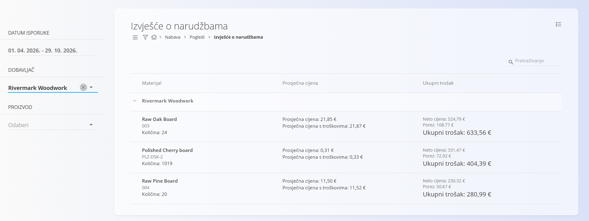

<!-- app_route: /supply/views/supply-orders-reports -->
<!-- app_label: Izvješće o narudžbama -->
<!-- canonical_source_url: https://github.com/Tom-PIT/Connected.Docs/blob/main/hr/Domene/Nabava/Pregledi/IzvjesceONarudzbama.md -->
<!-- canonical_source_title: Izvješće o narudžbama -->

# Izvješće o narudžbama

Prikaz **Izvješće o narudžbama** pruža objedinjeni pregled naručenih materijala i usluga, grupiranih po dobavljaču. Namijenjen je analizi i izvještavanju te **ne** izrađuje niti mijenja dokumente.

Za pristup ovoj stranici otvorite **Nabava / Pogledi / Izvješće o narudžbama** u [navigaciji](../../../Zajednicko/UI/Navigacija.md).

## Namjena prikaza

Izvješće o narudžbama pomaže vam:

- analizirati naručene količine i vrijednosti po dobavljaču
- pregledati povijest narudžbi za određene materijale
- razumjeti prosječne cijene i ukupne troškove narudžbi
- brzo dobiti uvid u učinkovitost nabave bez otvaranja pojedinačnih dokumenata

Ovaj je prikaz **samo za čitanje** i prikazuje podatke iz potvrđenih [**narudžbenica**](../Dokumenti/Narudzbenice.md).

## Izgled i struktura

Izvješće je organizirano hijerarhijski:

- **Dobavljači** su grupe na najvišoj razini
- Ispod svakog dobavljača navedeni su naručeni **materijali**
- Svaki redak materijala objedinjuje podatke iz svih odgovarajućih [**narudžbenica**](../Dokumenti/Narudzbenice.md)

Za svaki materijal izvješće prikazuje:
- naručenu **Količinu**
- **Prosječnu cijenu** i **Prosječnu cijenu s troškovima**
- **Ukupni trošak**, uključujući neto vrijednost i porez

## Filtri

Filtri na lijevoj strani omogućuju sužavanje izvješća:

- **Datum isporuke** — filtriranje narudžbi u određenom razdoblju.
- **Dobavljač** — prikaz podataka o narudžbama za jednog ili više odabranih dobavljača.
- **Proizvod** — prikaz podataka o narudžbama za materijale namijenjene određenim proizvodima (npr. **Raw Pine Board** za **Pine Table**).

Filtri se mogu kombinirati kako bi se usredotočili na vrlo specifične scenarije nabave.

## Tumačenje vrijednosti

- **Količina** predstavlja ukupnu naručenu količinu materijala
- **Prosječna cijena** izračunava se iz svih odgovarajućih [**narudžbenica**](../Dokumenti/Narudzbenice.md)
- **Prosječna cijena s troškovima** uključuje i dodatne troškove nabave
- **Ukupni trošak** prikazuje:
  - **Neto cijenu**
  - iznos **Poreza**
  - konačnu ukupnu vrijednost

Svi se iznosi izračunavaju na temelju [**narudžbenica**](../Dokumenti/Narudzbenice.md) obuhvaćenih odabranim filtrima.

## Napomene

- U ovo izvješće uključuju se samo **potvrđene narudžbenice**.
- Narudžbenice u nacrtu i stornirane narudžbenice ne prikazuju se.
- Prikaz je namijenjen **samo analizi** i ne podržava radnje kao što su uređivanje, storniranje ili izrada dokumenata.

Za detaljne podatke na razini dokumenta otvorite odgovarajuće [**narudžbenice**](../Dokumenti/Narudzbenice.md) izravno u odjeljku **Nabava / Dokumenti / Narudžbenice dobavljača**.
