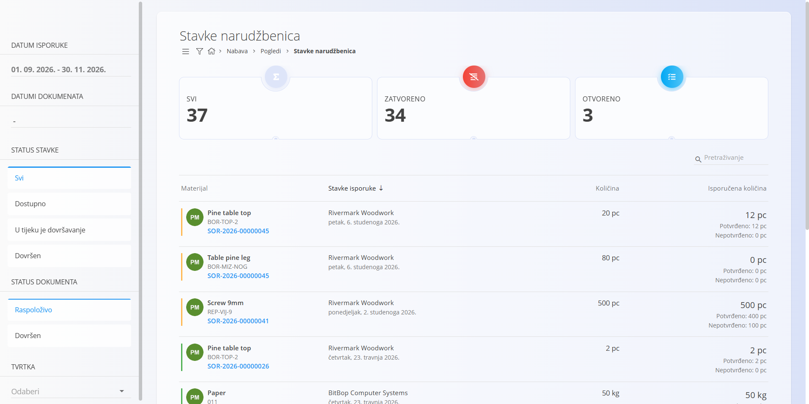
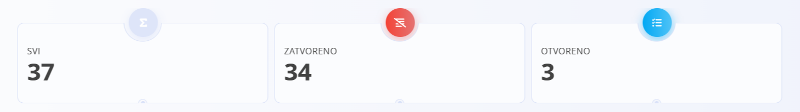
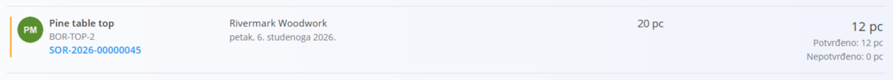

<!-- app_route: /supply/views/supply-order-details -->
<!-- app_label: Stavke narudžbenica -->
<!-- canonical_source_url: https://github.com/Tom-PIT/Connected.Docs/blob/main/hr/Domene/Nabava/Pregledi/StavkeNarudzbenica.md -->
<!-- canonical_source_title: Stavke narudžbenica -->

# Stavke narudžbenica

Prikaz **Stavke narudžbenica** pruža zbirni popis svih stavki iz [**narudžbenica**](../Dokumenti/Narudzbenice.md) dobavljačima.
Ovaj prikaz služi samo za analizu — **ne** izrađuje niti mijenja narudžbenice.

Za pristup ovom prikazu otvorite **Nabava / Pogledi / Stavke narudžbenica** u [navigaciji](../../../Zajednicko/UI/Navigacija.md).

## Pokazatelji

Na vrhu popisa **Stavke narudžbenica** sustav prikazuje ključne pokazatelje koji sažimaju trenutno filtrirane stavke. Ti pokazatelji daju trenutni pregled statusa stavki narudžbenica, što je posebno korisno pri upravljanju velikim količinama materijala u dolasku. 

Klikom na bilo koji pokazatelj popis se automatski filtrira tako da prikazuje samo odgovarajuće stavke.

Prikazuju se sljedeći pokazatelji:

- **Svi** – ukupan broj stavki narudžbenica koje odgovaraju trenutnim kriterijima filtra.
- **Zatvoreno** – stavke koje su u potpunosti isporučene ili čiji je datum isporuke prošao pa se smatraju zatvorenima.
- **Otvoreno** – stavke koje još čekaju isporuku, potpuno neisporučene ili samo djelomično isporučene.

## Popis stavki narudžbenica

Svaki redak na popisu predstavlja **jednu stavku narudžbenice**, uključujući:

- **Materijal** – materijal koji se nabavlja (naziv, oznaka i poveznica na narudžbenicu)
- **Stavke isporuke** – dobavljač i očekivani datum isporuke
- **Količina** – naručena količina
- **Isporučena količina** – prikazuje potvrđenu i nepotvrđenu isporuku  
  - Primjer: *12 pc (Potvrđeno: 12 pc / Nepotvrđeno: 0 pc)*

Tako možete vidjeti što je isporučeno, što je još otvoreno i čemu je datum isporuke stigao ili prošao.

## Filtri

Bočna traka na lijevoj strani sadrži mogućnosti filtriranja koje pomažu u analizi i pronalaženju stavki narudžbenica:

- **Datum isporuke** – filtriranje prema očekivanom datumu isporuke
- **Datumi dokumenata** – filtriranje prema razdoblju datuma narudžbenice
- **Status stavke**  
  - *Svi*  
  - *Dostupno*  
  - *U tijeku je dovršavanje*  
  - *Dovršen*
- **Status dokumenta**  
  - *Raspoloživo*  
  - *Dovršen*
- **Tvrtka** – filtriranje stavki prema dobavljaču

Ti filtri omogućuju sužavanje rezultata samo na materijale, datume isporuke i statuse relevantne za vaše planiranje.

## Namjena

Ovaj je prikaz namijenjen:

- praćenju nadolazećih isporuka od dobavljača  
- provjeri koje su stavke narudžbenica u potpunosti ili djelomično isporučene  
- pregledu potvrđenih i nepotvrđenih isporučenih količina  
- praćenju materijala u dolasku po dobavljaču  
- podršci planiranju nabave i pripremi skladišta

Nadopunjuje zaslon [**Narudžbenice dobavljača**](../Dokumenti/Narudzbenice.md) jer je usmjeren na **stavke**, a ne na dokumente.
