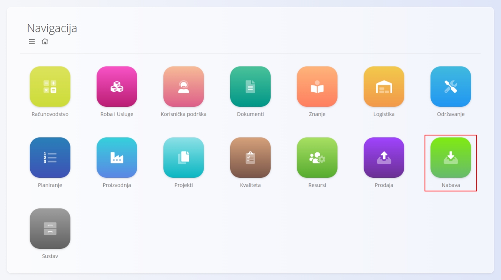
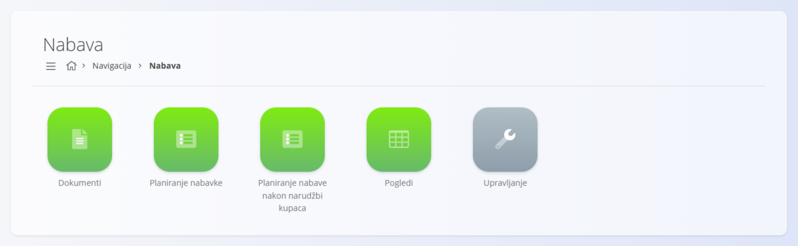
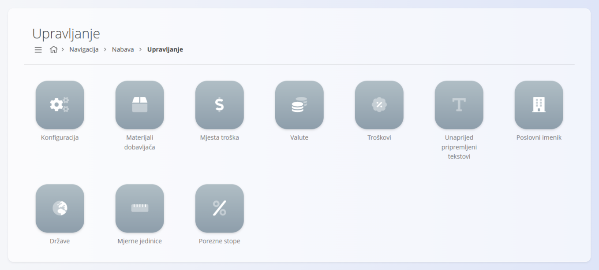

<!-- app_route: /sitemap/supply -->
<!-- app_label: Nabava -->
<!-- canonical_source_url: https://github.com/Tom-PIT/Connected.Docs/blob/main/hr/Domene/Nabava/README.md -->
<!-- canonical_source_title: Nabava -->

# Nabava

Domena **Nabava** upravlja svim procesima povezanima s nabavom, komunikacijom s dobavljačima i planiranjem ulaznih materijala. Sadrži upite dobavljačima, narudžbenice, alate za planiranje i analitičke prikaze koji pomažu održavati optimalne razine zaliha i pravovremenu nadopunu.

Dok domena **[Prodaja](../Prodaja/README.md)** upravlja aktivnostima prema kupcima, domena Nabava upravlja tijekovima rada prema dobavljačima koji osiguravaju dostupnost materijala kada je potreban.

Za pristup domeni Nabava otvorite **Nabava** u [navigaciji](../../Zajednicko/UI/Navigacija.md).

> [!NOTE]  
> Dostupne domene ovise o konfiguraciji tvrtke i poslovnom modelu.

## Što sadrži domena Nabava?

Domena je organizirana u nekoliko funkcionalnih područja:

- **[Dokumenti](#dokumenti)** – nabavni dokumenti za traženje ili naručivanje materijala  
- **[Planiranje nabavke](Dokumenti/PlaniranjeNabavke.md)** – alati za planiranje na temelju pravila granica zaliha  
- [**Planiranje nabave nakon narudžbi kupaca**](Dokumenti/PlaniranjeNabavePoNarudzbamaKupaca.md) – planiranje na temelju potražnje iz prodaje  
- **[Pogledi](#pogledi)** – analitički alati za razumijevanje trendova nabave  
- **[Upravljanje](#upravljanje)** – šifrarnici i konfiguracija za procese vezane uz dobavljače  

> [!TIP]
> Za pregled izrade narudžbenice korak po korak pogledajte [**Kako kreirati narudžbenicu**](Dokumenti/NarudzbeniceIzrada.md).

## Dokumenti

Odjeljak **Dokumenti** sadrži nabavne dokumente koji se koriste za traženje ponuda ili naručivanje materijala od dobavljača.

Dostupni dokumenti:

- **[Upiti](Dokumenti/Upiti.md)** – zahtjevi poslani dobavljačima za cijene ili dostupnost. Ne utječu na zalihu i obično se mogu pretvoriti u narudžbenice putem povezanih dokumenata.
- **[Narudžbenice dobavljača](Dokumenti/Narudzbenice.md)** – potvrđene narudžbe poslane dobavljačima za robu ili usluge. Primke se evidentiraju u **Logistici** pomoću [primki](../Logistika/Dokumenti/Primke.md).

Ti dokumenti pokreću tijek nabave i osiguravaju potpunu sljedivost aktivnosti dobavljača.

> [!NOTE]
> Nabavni dokumenti prolaze kroz standardna stanja poput Nacrt i Potvrđeno. Dostupnost radnji ovisi o trenutnom stanju.

## Pogledi

Odjeljak **Pogledi** pruža analitički uvid u narudžbenice i obrasce nabave. Ti su prikazi samo za čitanje.

Dostupni prikazi:

- **[Stavke narudžbenica](Pregledi/StavkeNarudzbenica.md)** – pojedinosti o stavkama narudžbenica, uključujući rokove i isporuke.  
- **[Izvješće o narudžbama](Pregledi/IzvjesceONarudzbama.md)** – zbirni pregled količina, vrijednosti i statusa narudžbi po dobavljaču.

Ti zasloni podržavaju analizu i donošenje odluka, ali **ne** izrađuju transakcije.

## Upravljanje

Odjeljak **Upravljanje** sadrži konfiguraciju i matične podatke potrebne procesima nabave.

Dostupna konfiguracija i šifrarnici:

- **[Konfiguracija](Upravljanje/KonfiguracijaNabave.md)** – postavke nabave i pravila, uključujući numeriranje narudžbenica.  
- **[Materijali dobavljača](Upravljanje/SupplierMaterials.md)** – povezivanje dobavljača s materijalima koje mogu isporučiti; mogu uključivati rokove isporuke i cijene.  
- **[Troškovi](Upravljanje/Troskovi.md)** – kategorije troškova (npr. prijevoz, carina) koje se koriste na narudžbenicama; utječu na ukupni trošak nabave.  
- **[Poslovni imenik](../../Zajednicko/Upravljanje/PoslovniImenik.md)** – podaci o dobavljačima i partnerima.  
- **[Mjesta troška](../../Zajednicko/Upravljanje/MjestaTroska.md)** – financijska raspodjela troškova nabave.  
- **[Valute](../../Zajednicko/Upravljanje/Valute.md)** – definicije valuta koje se koriste u ponudama i narudžbenicama.  
- **[Unaprijed pripremljeni tekstovi](../../Zajednicko/Upravljanje/UnaprijedPripremljeniTekstovi.md)** – standardni tekstualni blokovi u dokumentima nabave.  
- **[Države](../../Zajednicko/Upravljanje/Drzave.md)** – geografski podaci koji se koriste u profilima dobavljača.  
- **[Mjerne jedinice](../../Zajednicko/Upravljanje/MjerneJedinice.md)** – mjerne jedinice koje se koriste u dokumentima nabave.  
- **[Porezne stope](../../Zajednicko/Upravljanje/PorezneStope.md)** – porezne definicije koje se primjenjuju pri nabavi.

Ti elementi određuju kako se procesi nabave ponašaju i kako su podaci o nabavi strukturirani.

> [!TIP]
> Pregled svih šifrarnika dostupan je u **[Indeksu upravljanja](../../IndeksUpravljanja.md)**.

## Tijek nabave

Postupci nabave obično slijede strukturirani životni ciklus:

### **1. Upit**  
Od dobavljača se traži [upit](Dokumenti/Upiti.md) s cijenama, dostupnošću i očekivanim rokovima isporuke.

### **2. Naručivanje**  
[Narudžbenica](Dokumenti/Narudzbenice.md) se izrađuje i šalje na temelju potreba za materijalom ili dogovora s dobavljačem.

### **3. Isporuka i primitak**  
Dobavljači isporučuju robu, a ona se obrađuje u **Logistici** kroz [primke](../Logistika/Dokumenti/Primke.md).

### **4. Planiranje i nadopuna**  
[**Granice zalihe**](../Logistika/Upravljanje/GraniceZalihe.md) i prikazi planiranja (vidi [**Planiranje nabavke**](Dokumenti/PlaniranjeNabavke.md)) pomažu odrediti kada treba započeti novi ciklus nabave.

### **5. Analiza**  
Prikazi pružaju uvid u učinkovitost dobavljača, rokove narudžbi i ukupnu učinkovitost nabave.

## Nabava i ostale domene

Nabava je povezana s ostalim operativnim domenama:

| Područje | Povezanost |
|----------|------------|
| **[Materijali](../RobaIUsluge/Materijali/README.md)** | Definira artikle koji se nabavljaju. |
| **[Logistika](../Logistika/README.md)** | Zaprima dolaznu robu i ažurira zalihu. |
| **[Proizvodnja](../Proizvodnja/README.md)** | Zahtijeva kupljene materijale za proizvodne procese. |
| **[Prodaja](../Prodaja/README.md)** | Oslanja se na nabavu kako bi prodani artikli bili dostupni. |
