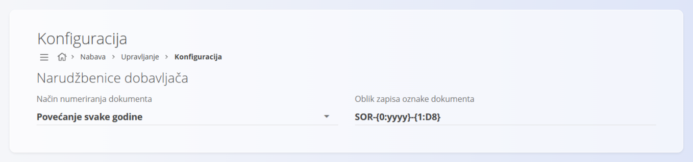

<!-- app_route: /management/supply/configuration -->
<!-- app_label: Konfiguracija -->
<!-- canonical_source_url: https://github.com/Tom-PIT/Connected.Docs/blob/main/hr/Domene/Nabava/Upravljanje/KonfiguracijaNabave.md -->
<!-- canonical_source_title: Konfiguracija -->

# Konfiguracija

Konfigurirajte postavke **Nabave** (odjeljak **Narudžbenice dobavljača**) koje utječu na numeriranje dokumenata. Sve promjene spremaju se automatski.

Za pristup ovoj stranici otvorite **Nabava / Upravljanje / Konfiguracija** u [navigaciji](../../../Zajednicko/UI/Navigacija.md).

## Postavke numeriranja dokumenata

Odaberite model numeriranja i oblik oznake za [**narudžbenice**](../Dokumenti/Narudzbenice.md).

| Polje | Opis |
|-------|------|
| **Način numeriranja dokumenta** | • **Povećanje svake godine:** brojanje se svake godine ponovno pokreće.   • **Povećanje:** globalni niz koji se nikad ne resetira. |
| **Oblik zapisa oznake dokumenta** | Uzorak koji određuje strukturu oznake (npr. SOR-{0:yyyy}-{1:D8} za narudžbenice). |
