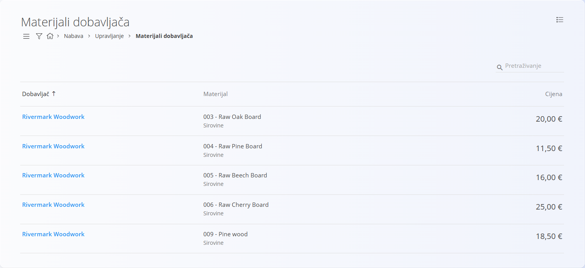
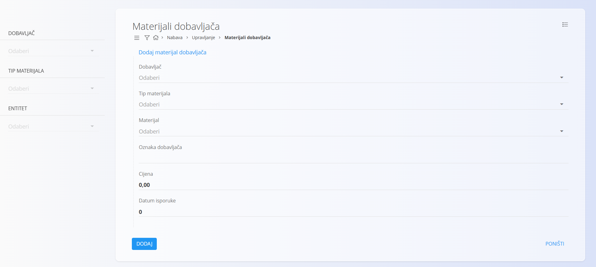
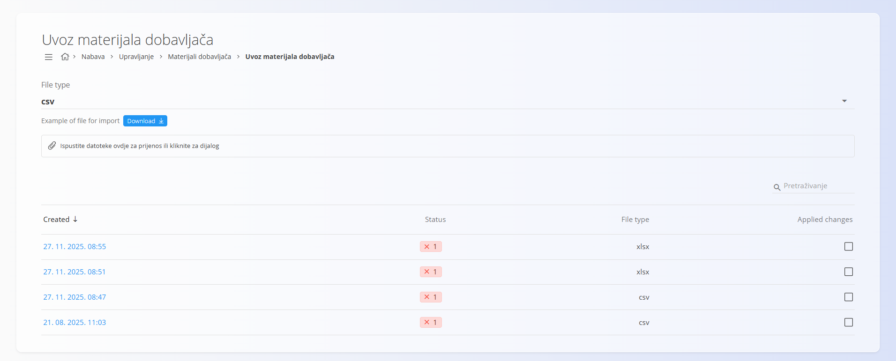

<!-- app_route: /management/supply/supplier-materials -->
<!-- app_label: Materijali dobavljača -->
<!-- canonical_source_url: https://github.com/Tom-PIT/Connected.Docs/blob/main/hr/Domene/Nabava/Upravljanje/SupplierMaterials.md -->
<!-- canonical_source_title: Materijali dobavljača -->

# Materijali dobavljača

**Materijali dobavljača** predstavljaju popis materijala koje dobavljači isporučuju vašoj organizaciji. Svaki zapis povezuje postojeći materijal iz domene [**Materijali**](../../RobaIUsluge/Materijali/README.md) s određenim dobavljačem i sadrži dodatne podatke, kao što su šifra materijala kod dobavljača, cijena i rok isporuke.

Ovaj šifrarnik osigurava da procesi nabave mogu ispravno utvrditi koje materijale pojedini dobavljač nudi i po kojoj cijeni.

Za pristup ovom šifrarniku otvorite **Nabava / Upravljanje / Materijali dobavljača** u [navigaciji](../../../Zajednicko/UI/Navigacija.md).

## Shema

| Polje | Opis |
|-------|------|
| **Dobavljač** | Dobavljač koji isporučuje materijal. Mora postojati u [**Poslovnom imeniku**](../../../Zajednicko/Upravljanje/PoslovniImenik.md) (obavezno). |
| **[Tip materijala](../../RobaIUsluge/Materijali/README.md)** | Vrsta materijala ([**Sirovina**](../../RobaIUsluge/Materijali/Sirovine.md), [**Poluproizvod**](../../RobaIUsluge/Materijali/Poluproizvodi.md), [**Proizvod**](../../RobaIUsluge/Materijali/Proizvodi.md), [**Repromaterijal**](../../RobaIUsluge/Materijali/PomocniProizvodi.md)). Mora odgovarati postojećem tipu materijala (obavezno). |
| **[Materijal](../../RobaIUsluge/Materijali/README.md)** | Materijal koji isporučuje dobavljač. Mora već postojati u domeni **Materijali** (obavezno). |
| **Oznaka dobavljača** | Interna oznaka dobavljača za ovaj materijal. |
| **Cijena** | Neto cijena po kojoj dobavljač isporučuje materijal. |
| **Datum isporuke** | Rok isporuke izražen u danima. |

## Upravljanje

### Popis materijala dobavljača

Sučelje sadrži popis svih materijala dobavljača, koji prikazuje:

- Dobavljača
- Materijal (sa šifrom i nazivom)
- Cijenu

Polje za pretraživanje nalazi se u gornjem desnom kutu.



### Filtri

Bočna traka na lijevoj strani sadrži sljedeće filtre:

- **Dobavljač**
- **Tip materijala**
- **Entitet**

Ti filtri omogućuju sužavanje rezultata prema dobavljaču i kategoriji materijala.

## Akcije

Kliknite [akcijski gumb](../../../Zajednicko/UI/AkcijskiGumb.md) za prikaz dostupnih radnji:

- **Novi**
- **Uvoz**

### Izrada novog materijala dobavljača

Kliknite [akcijski gumb](../../../Zajednicko/UI/AkcijskiGumb.md) i odaberite **Novi**. Obrazac za unos sadrži polja:

- Dobavljač
- Tip materijala
- Materijal
- Oznaka dobavljača
- Cijena
- Datum isporuke



Nakon unosa potrebnih podataka kliknite **Dodaj** za spremanje zapisa ili **Poništi** za povratak na popis.

### Uvoz materijala dobavljača

Kliknite [akcijski gumb](../../../Zajednicko/UI/AkcijskiGumb.md) i odaberite **Uvoz**. Ova funkcija omogućuje masovno stvaranje ili ažuriranje materijala dobavljača pomoću datoteke za proračunsku tablicu.

Zaslon funkcionira slično kao zaslon [**Uvoz materijala**](../../RobaIUsluge/Materijali/ImportMaterials.md). Nudi:

- odabir vrste datoteke (CSV ili XLSX)
- preuzimanje primjera datoteke
- područje za povlačenje i ispuštanje datoteke
- pregled prethodnih uvoza



#### Struktura proračunske tablice

Datoteka za uvoz materijala dobavljača mora sadržavati sljedeće stupce:

```
SupplierName,MaterialCode,Price,SupplierCode,DeliveryDate
```

Primjer retka:

```
Rivermark Woodwork,CODE003,20,SupplierMaterial001,0
```

### Uređivanje materijala dobavljača

Za uređivanje postojećeg materijala dobavljača kliknite njegov zapis na popisu. Sustav otvara prikaz za uređivanje u kojem se mogu mijenjati sva polja.

Kada završite s uređivanjem, kliknite **Spremi**. Ako ne želite spremiti izmjene, kliknite **Poništi**.

## Brisanje materijala dobavljača

Kliknite materijal dobavljača, a zatim **Izbriši** kako biste ga uklonili iz sustava. Pojavit će se skočni prozor za potvrdu. Nakon potvrde zapis se trajno uklanja iz sustava.

> [!NOTE]  
> Materijal dobavljača može se izbrisati samo ako na njega ne pokazuju drugi zapisi.

## Izbornik

Ova stranica sadrži radnje izbornika na dva mjesta.

Radnje izbornika dostupne su putem gumba **Izbornik** u gornjem desnom kutu popisa ili stranice dokumenta.

### Izbornik popisa

Izbornik popisa sadrži radnje za trenutno prikazani popis.

Dostupne radnje:

- **Izvoz u CSV**

### Izbornik dokumenta

Izbornik dokumenta sadrži radnje za trenutno otvoreni dokument.

Dostupne radnje:

- **Izvoz u CSV**

Više informacija o radnjama izbornika potražite u odjeljku [**Radnje izbornika**](../../../Zajednicko/Koncepti/RadnjeIzbornika.md).
