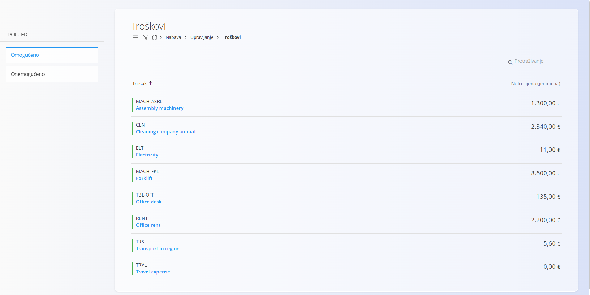
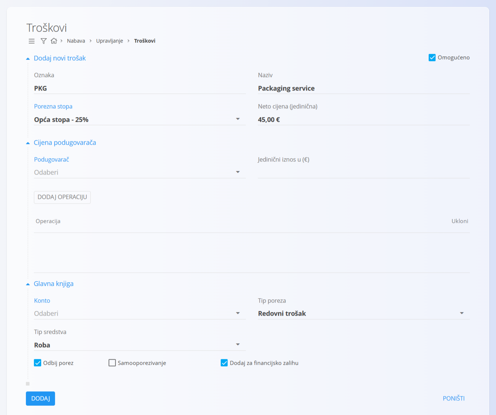
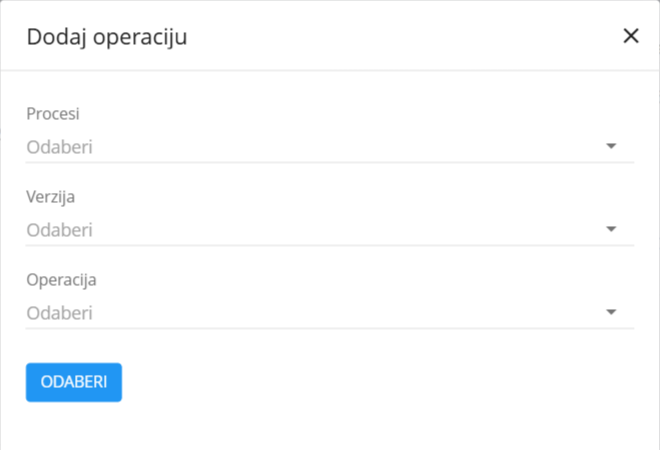

<!-- app_route: /management/common-types/expenses -->
<!-- app_label: Troškovi -->
<!-- canonical_source_url: https://github.com/Tom-PIT/Connected.Docs/blob/main/hr/Domene/Nabava/Upravljanje/Troskovi.md -->
<!-- canonical_source_title: Troškovi -->

# Troškovi

Šifrarnik **Troškovi** sadrži sve troškove koje vaša organizacija želi voditi kao unaprijed definirane troškove. To mogu biti ponavljajuće usluge, troškovi povezani s opremom, naknade podugovaračima ili bilo koji operativni ili financijski trošak na koji se treba pozivati u procesima nabave ili proizvodnje.

Ovaj popis pomaže u održavanju dosljednosti jer su svi troškovi spremljeni na jednom mjestu i dostupni za upotrebu u dokumentima i operativnim tijekovima rada.

Za pristup ovom šifrarniku otvorite **Nabava / Upravljanje / Troškovi** u [navigaciji](../../../Zajednicko/UI/Navigacija.md).

## Shema

<strong>Općenito</strong>

| Polje | Opis |
|-------|------|
| **Oznaka** | Jedinstvena oznaka troška. |
| **Naziv** | Opisni naziv troška. |
| **[Porezna stopa](../../../Zajednicko/Upravljanje/PorezneStope.md)** | Porezna stopa koja se primjenjuje na trošak. |
| **Neto cijena (jedinična)** | Zadana neto cijena troška. |
| **Omogućeno** | Označava je li trošak dostupan za upotrebu u dokumentima. |
| **Podugovarač** | Poslovni partner koji pruža podugovorenu uslugu, odabran iz [**Poslovnog imenika**](../../../Zajednicko/Upravljanje/PoslovniImenik.md). |
| **Jedinični iznos u (€)** | Trošak podugovorene operacije po jedinici. |
| **Operacija** | Popis operacija povezanih s ovim troškom podugovarača. |

<strong>Operacija</strong>

| Polje | Opis |
|-------|------|
| [**Procesi**](../../Proizvodnja/Upravljanje/Procesi.md) | Proces u kojem se operacija koristi. |
| **Verzija** | Verzija odabranog procesa. |
| **Operacija** | Određena operacija koja pripada odabranom procesu i verziji. |

<strong>Glavna knjiga</strong>

| Polje | Opis |
|-------|------|
| [**Konto**](../../Racunovodstvo/Upravljanje/GlavnaKnjiga/ChartOfAccounts.md) | Konto glavne knjige za knjiženja koja nastaju iz ovog troška. |
| **Tip poreza** | Porezna klasifikacija troška (npr. zaliha, redovni trošak, nekretnine). |
| **Tip sredstva** | Vrsta nabave za potrebe izvještavanja (npr. roba, usluge). |
| **Odbij porez** | Označava može li se za ovaj trošak odbiti pretporez. |
| **Samooporezivanje** | Označava primjenjuje li se prijenos porezne obveze (samooporezivanje). |
| **Dodaj za financijsko zalihu** | Kada je označeno, trošak se evidentira, ali se **ne uključuje** u financijsku vrijednost zalihe pri obradi računa (izvorna oznaka: *Ignore for financial stock*). |

## Upravljanje

### Popis troškova

Popis prikazuje sve definirane troškove s njihovom zadanom neto jediničnom cijenom.

Svaki zapis ima indikator statusa lijevo od naziva:  
- **zelena** boja označava da je trošak **omogućen**  
- **siva** boja označava da je trošak **onemogućen**

### Filtri

Bočna traka na lijevoj strani sadrži dva filtra u odjeljku **Pogled**:

- **Omogućeno**  
- **Onemogućeno**

Ti filtri određuju prikazuje li popis aktivne ili neaktivne troškove.

## Akcije

### Izrada novog troška

Kliknite [akcijski gumb](../../../Zajednicko/UI/AkcijskiGumb.md) za izradu novog troška. Obrazac za unos sadrži odjeljke:

- **Dodaj novi trošak**
- **Cijena podugovarača**
- **Glavna knjiga**

Unesite potrebne podatke i, ako je poznat, iznos troška u polje **Neto cijena (jedinična)**. Kliknite **Dodaj** za izradu troška. Novi zapis tada se prikazuje na popisu.

> [!NOTE]
> Iznos troška automatski se popunjava na narudžbenici ako se trošak doda kao stavka, a **Neto cijena (jedinična)** je poznata.

#### Cijena podugovarača

Ovaj neobvezni odjeljak omogućuje dodavanje troškova povezanih s podugovaračem.  
Možete navesti:

- **Podugovarača** 
- **Jedinični iznos u (€)**  
- **Operacije**  

Kliknite **Dodaj operaciju** kako biste otvorili dijaloški okvir za odabir operacije.

U dijaloškom okviru odaberite **Proces**, **Verziju** i **Operaciju**, a zatim kliknite **Odaberi**. Odabranu operaciju s popisa možete ukloniti klikom na **Ukloni**.

#### Glavna knjiga

U ovom odjeljku trošak se dodjeljuje odgovarajućem kontu glavne knjige. Pogledajte [**Kontni plan**](../../Racunovodstvo/Upravljanje/GlavnaKnjiga/ChartOfAccounts.md).

Mogućnosti u ovom odjeljku određuju kako se trošak obrađuje u financijskim knjiženjima i izvještavanju. To su:
- **Odbij porez**
- **Samooporezivanje**
- **Dodaj za financijsko zalihu** (izostavlja trošak iz financijske vrijednosti zalihe)

Te se postavke po potrebi mogu kasnije promijeniti na ulaznom računu.

### Uređivanje troška

Za uređivanje troška kliknite zapis na popisu i sustav otvara način uređivanja.

Sva polja, uključujući cijenu podugovarača i operacije, mogu se mijenjati. Trošak možete omogućiti ili onemogućiti potvrdnim okvirom **Omogućeno**.

Kada završite s uređivanjem, kliknite **Spremi**. Ako ne želite spremiti izmjene, kliknite **Poništi**.

## Brisanje troška

Kliknite zapis na popisu kako bi se otvorio način uređivanja, a zatim kliknite **Izbriši** kako biste nakon potvrde trajno uklonili trošak.

> [!NOTE]  
> - Brisanje je dopušteno samo ako se na trošak ne pozivaju drugi zapisi.
> - Onemogućeni troškovi ostaju u sustavu, ali se ne mogu odabrati u novim dokumentima.
