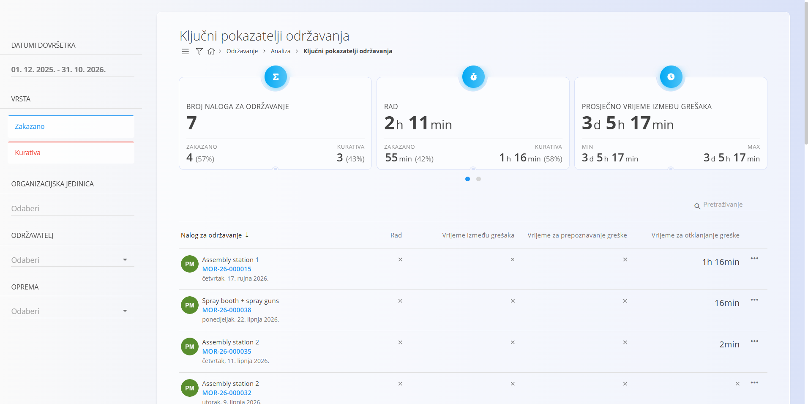
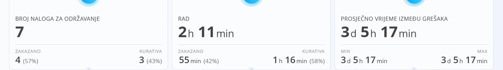

<!-- app_route: /maintenance/analytics/kpis -->
<!-- app_label: Ključni pokazatelji održavanja -->
<!-- canonical_source_url: https://github.com/Tom-PIT/Connected.Docs/blob/main/hr/Domene/Odrzavanje/Analiza/KljucniPokazateljiOdrzavanja.md -->
<!-- canonical_source_title: Ključni pokazatelji održavanja -->

# Ključni pokazatelji održavanja

Zaslon **Ključni pokazatelji održavanja** pruža analitički pregled učinkovitosti održavanja. Objedinjuje podatke iz **dovršenih [naloga za održavanje](../Dokumenti/NaloziZaOdrzavanje.md)** i pomaže u procjeni učinkovitosti, brzine reagiranja i pouzdanosti aktivnosti održavanja.

Za pristup ovom zaslonu otvorite **Održavanje / Analiza / Ključni pokazatelji održavanja** u [navigaciji](../../../Zajednicko/UI/Navigacija.md).

> [!NOTE]
> - U izračun pokazatelja uključuju se samo **dovršeni** nalozi za održavanje
> - Rezultati uvelike ovise o:
>   - točnom evidentiranju rada
>   - pravovremenom prijavljivanju kvarova
>   - ispravnom zatvaranju naloga

## Svrha pokazatelja održavanja

Pokazatelji održavanja omogućuju korisnicima da:

- prate opterećenje i rad na održavanju
- uspoređuju **planirano i kurativno** održavanje
- analiziraju vremena reagiranja i otklanjanja
- uoče kasne, neučinkovite ili ponavljajuće probleme u održavanju
- podupru odlučivanje o poboljšanjima preventivnog održavanja

Svi pokazatelji izračunavaju se prema odabranim **filtrima**.

## Filtri

Lijevi panel omogućuje sužavanje podataka prikazanih na zaslonu.

Dostupni filtri uključuju:

- **Datumi dovršetka** – vremenski raspon za izračun pokazatelja
- **Vrsta**
  - **Zakazano**
  - **Kurativa**
- **Organizacijska jedinica**
- **Održavatelj**
- **Oprema**

Promjena bilo kojeg filtra odmah ponovno izračunava pokazatelje i ažurira popis ispod.

## Kartice pokazatelja

Pri vrhu zaslona sažete kartice prikazuju zbirne ključne pokazatelje učinkovitosti.

### Broj naloga za održavanje

Prikazuje ukupan broj dovršenih naloga za održavanje u odabranom razdoblju.

- raspodijeljeno na **Zakazano** i **Kurativa**
- prikazuje se postotna raspodjela

Ovaj pokazatelj pomaže razumjeti opterećenje održavanja i odnos između preventivnih i korektivnih radnji.

### Rad

Prikazuje ukupan evidentirani rad utrošen na naloge za održavanje.

- raspodijeljeno na **Zakazano** i **Kurativa**
- temelji se na radu evidentiranom tijekom izvođenja operacija

Ovo pomaže procijeniti kako se vrijeme održavanja raspodjeljuje i gdje se troši najviše rada.

### Prosječno vrijeme između grešaka

Prikazuje prosječno vrijeme između kvarova (MTBF).

- izračunava se iz kurativnih naloga za održavanje
- prikazuje **minimalnu** i **maksimalnu** izmjerenu vrijednost

MTBF se često koristi za procjenu pouzdanosti opreme.

### Prosječno vrijeme za prepoznavanje greške

Prosječno vrijeme između nastanka kvara i njegova prepoznavanja.

- korisno za procjenu učinkovitosti praćenja i prijavljivanja

### Prosječno vrijeme za otklanjanje greške

Prosječno vrijeme potrebno za dovršetak održavanja od trenutka početka.

- odražava učinkovitost izvođenja održavanja

### Prosječno vrijeme do nove greške

Prosječno operativno vrijeme prije nastanka kvara.

- često se koristi zajedno s MTBF-om za analizu pouzdanosti

## Popis naloga za održavanje

Ispod kartica pokazatelja prikazuje se detaljan popis naloga za održavanje.

Svaki redak predstavlja nalog za održavanje uključen u izračun.

Prikazani podaci uključuju:

- **Oprema**
- **Šifra naloga za održavanje**
- **Rad**
- **Vrijeme između grešaka**
- **Vrijeme za prepoznavanje greške**
- **Vrijeme za otklanjanje greške**

Ovaj popis omogućuje korisnicima da:

- pregledaju pojedinačne naloge
- uoče iznimke (vrlo duga ili vrlo kratka trajanja)
- povežu pojedinačne naloge s zbirnim pokazateljima

Klik na nalog za održavanje otvara njegov detaljni prikaz radi daljnje provjere.

## Razlikovanje planiranog i kurativnog održavanja

Vizualne oznake na popisu pomažu razlikovati vrste naloga:

- **kurativni nalozi za održavanje** jasno su označeni
- planirani nalozi prikazuju se bez kurativnih oznaka

Tako je lako analizirati kako korektivno održavanje utječe na ukupne pokazatelje učinkovitosti.
