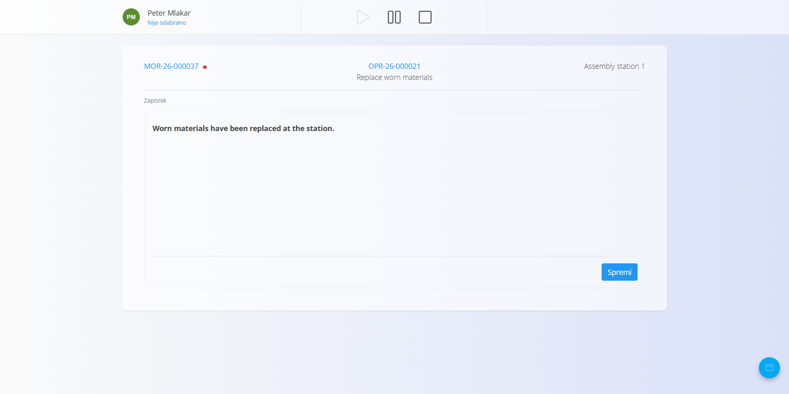
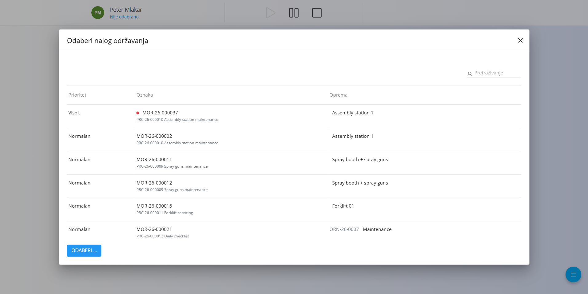
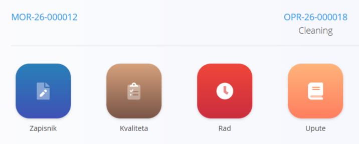
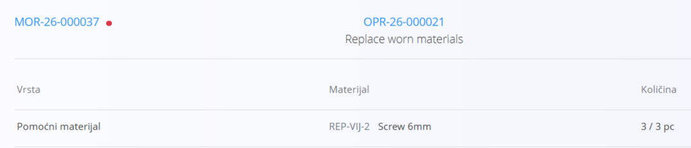
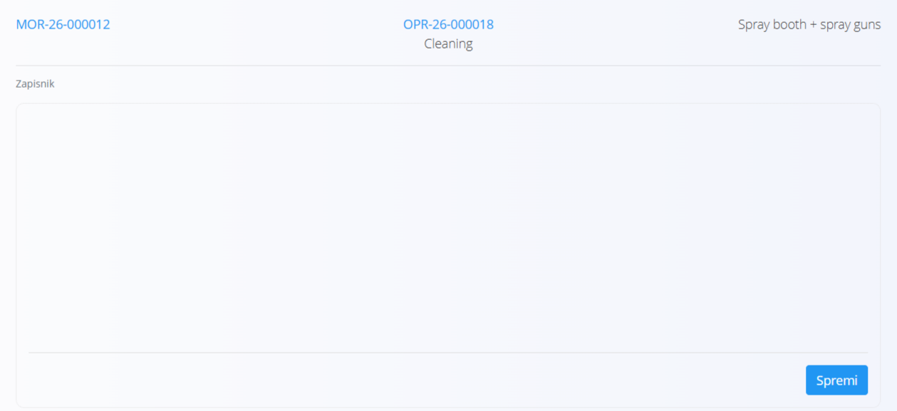
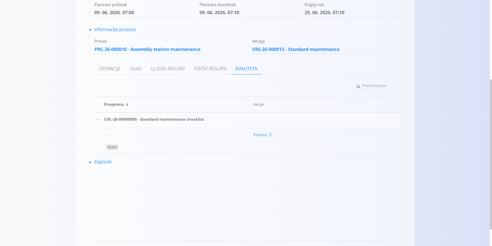

<!-- app_route: maintenance-orders/execution -->
<!-- app_label: Izvođenje održavanja -->
<!-- canonical_source_url: https://github.com/Tom-PIT/Connected.Docs/blob/main/hr/Domene/Odrzavanje/Dokumenti/IzvodenjeOdrzavanja.md -->
<!-- canonical_source_title: Izvođenje održavanja -->

# Izvođenje održavanja

Zaslon **Izvođenje održavanja** služi za izvođenje i evidentiranje rada na nalozima za održavanje.

Pruža središnji radni prostor za izvođenje operacija održavanja, evidentiranje obavljenog rada, provođenje kontrola kvalitete, praćenje rada i pregled uputa.

Za pristup ovoj stranici otvorite **Održavanje / Izvođenje** u [navigaciji](../../../Zajednicko/UI/Navigacija.md).

> [!NOTE]
> Zaslon **Izvođenje održavanja** automatski prikazuje aktivne naloge za održavanje dodijeljene **organizacijskoj jedinici** koja je odabrana na vrhu zaslona.
>
> Za rad s nalozima za održavanje druge organizacijske jedinice promijenite odabranu organizacijsku jedinicu.

## Pregled sučelja za izvođenje

Zaslon **Izvođenje održavanja** sadrži sve kontrole i podatke potrebne za izvođenje tekuće operacije održavanja.

1. **Korisnik i organizacijska jedinica** – prikazuje trenutno prijavljenog korisnika i organizacijsku jedinicu.
2. **Kontrole izvođenja** – pokreću, pauziraju ili završavaju tekuću operaciju.
3. **Nalog za održavanje** – prikazuje tekući nalog za održavanje. Kliknite ga da odaberete drugi aktivni nalog. Ako nalog za održavanje ima visoki prioritet, prikazuje se crvena oznaka.
4. **Operacija** – prikazuje tekuću operaciju i njezin naziv.
5. **Oprema** – prikazuje opremu povezanu s nalogom za održavanje.
6. **Područje izvođenja** – prikazuje tekuću aktivnost izvođenja, primjerice **Zapisnik** ili **Ulazi**.
7. **Akcijski gumb** – otvara dostupne aktivnosti izvođenja.

### Odabir naloga za održavanje

Kliknite **nalog za održavanje** u gornjem lijevom kutu zaslona izvođenja da biste prešli na drugi aktivni nalog.

Otvara se dijaloški okvir **Odaberi nalog održavanja** s dostupnim aktivnim nalozima, uz stupce:

- **Prioritet**
- **Oznaka**
- **Oprema**

Odaberite traženi nalog za održavanje i kliknite gumb za odabir.

## Pokretanje održavanja

Pritisnite gumb za pokretanje (ikona trokuta) da započnete tekuću operaciju održavanja.

Nakon pokretanja operacija postaje aktivna i počinje se bilježiti vrijeme izvođenja.

## Pauziranje održavanja

Pritisnite gumb za pauzu (ikona dviju okomitih crta) da privremeno zaustavite tekuću operaciju održavanja.

Operacija ostaje nedovršena i može se nastaviti pritiskom na gumb za pokretanje.

## Aktivnosti izvođenja

Gumbom za radnje u donjem desnom kutu prebacujete se između aktivnosti dostupnih tijekom izvođenja održavanja. Dostupne aktivnosti ovise o konfiguraciji tekuće operacije. Ako su operaciji dodijeljeni ulazni materijali, prikazuje se i aktivnost **Ulazi**.

Dostupne aktivnosti mogu uključivati:

- **Ulazi** – pregled i evidentiranje materijala utrošenih tijekom održavanja
- **Zapisnik** – unos slobodnog teksta o obavljenom radu na održavanju
- **Kvaliteta** – pregled i dovršavanje kontrolnih popisa kvalitete
- **Rad** – pregled i evidentiranje radnog vremena
- **Upute** – pregled uputa za tekuću operaciju

### Ulazi

Ako su tekućoj operaciji dodijeljeni ulazni materijali, odaberite **Ulazi** da biste pregledali i evidentirali materijale utrošene tijekom održavanja.

Za svaki materijal zaslon prikazuje vrstu, materijal i utrošenu količinu.

Količina pokazuje koliko je potrebnog materijala već utrošeno u odnosu na planiranu količinu. Na primjer, **0 / 3 kom** znači da je od 3 potrebna komada utrošeno 0.

Za evidentiranje potrošnje:

1. Odaberite traženi materijal.
2. Unesite količinu utrošenu tijekom održavanja.
3. Kliknite **Spremi**.

Evidentirana količina dodaje se potrošnji materijala za tekuću operaciju.

### Zapisnik

Odaberite **Zapisnik** da otvorite zapisnik održavanja.

Upišite podatke o obavljenom radu u polje za slobodni tekst, zatim kliknite **Spremi**.

Spremljeni zapisnik prikazuje se i na odgovarajućem nalogu za održavanje.

### Kvaliteta

Pomoću **Kvalitete** pregledavate i dovršavate kontrolne popise kvalitete dodijeljene procesu ili operaciji održavanja.

Ovisno o konfiguraciji, kontrolni popisi kvalitete mogu se automatski otvoriti u određenim fazama izvođenja, primjerice pri pokretanju, pauziranju ili završetku operacije.

Pojedinosti o dovršavanju kontrolnih popisa tijekom izvođenja potražite u odjeljku [**Kvaliteta u izvedbi proizvodnje**](../../Proizvodnja/Dokumenti/Izvedba.md#kontrolni-popisi-i-kontrole-kvalitete).

### Rad

Pomoću **Rada** pregledavate i evidentirate radno vrijeme za tekuću operaciju održavanja.

Rad funkcionira na isti način kao u izvedbi proizvodnje.

Pojedinosti o evidentiranju rada potražite u odjeljku [**Rad u izvedbi proizvodnje**](../../Proizvodnja/Dokumenti/Izvedba.md#rad).

### Upute

Pomoću **Uputa** pregledavate upute povezane s tekućom operacijom održavanja.

Upute funkcioniraju na isti način kao u izvedbi proizvodnje.

Pojedinosti potražite u odjeljku [**Upute u izvedbi proizvodnje**](../../Proizvodnja/Dokumenti/Izvedba.md#upute).

## Završetak održavanja

Pritisnite gumb za zaustavljanje (ikona kvadrata) da završite tekuću operaciju održavanja.

Kad se operacija završi:

- bilježi se vrijeme završetka
- operacija se označava kao **Dovršena**
- ako preostaju operacije, održavanje se može nastaviti sljedećom operacijom
- kad su sve operacije dovršene, nalog za održavanje prelazi u status **Zatvoren**

> [!NOTE]
> Dovršenu operaciju nije moguće ponovno aktivirati sa zaslona **Izvođenje održavanja**. Da biste je ponovno otvorili, otvorite odgovarajući nalog za održavanje i odaberite **Ponovno aktiviraj** za tu operaciju.
