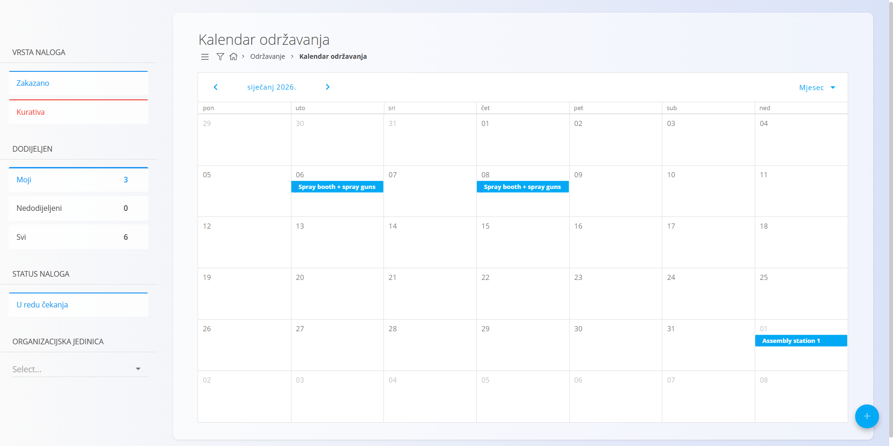
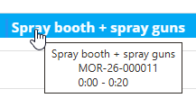
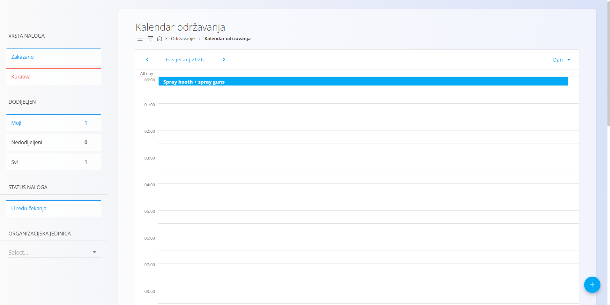

<!-- app_route: /maintenance-orders -->
<!-- app_label: Kalendar održavanja -->
<!-- canonical_source_url: https://github.com/Tom-PIT/Connected.Docs/blob/main/hr/Domene/Odrzavanje/Dokumenti/KalendarOdrzavanja.md -->
<!-- canonical_source_title: Kalendar održavanja -->

# Kalendar održavanja

**Kalendar održavanja** pruža vremenski prikaz radova održavanja. Omogućuje planiranje, pregled i kretanje kroz aktivnosti održavanja u obliku kalendara.

Za pristup ovom zaslonu otvorite **Održavanje / Kalendar održavanja** u [navigaciji](../../../Zajednicko/UI/Navigacija.md).

### Pregled

Prema zadanim postavkama kalendar prikazuje **aktivne** [naloge za održavanje](NaloziZaOdrzavanje.md), raspoređene na vremenskoj crti prema planiranom datumu i vremenu izvršavanja.

Naloge u statusu **U redu čekanja** možete uključiti filtrom **U redu čekanja** (vidi Filtri). Kad je filtar isključen, prikazuju se samo aktivni nalozi.

Kalendar podržava različite vremenske razmjere za planiranje i pregled.

Kad pokazivač miša zadržite iznad unosa u kalendaru, prikazuje se oblačić s dodatnim podacima, na primjer:
- oprema koju treba održavati
- šifra naloga za održavanje
- planirano vrijeme

## Navigacija i interakcija

- Klikom na [**nalog za održavanje**](NaloziZaOdrzavanje.md) u kalendaru otvara se dokument tog naloga.
- Klikom na [**gumb radnje**](../../../Zajednicko/UI/AkcijskiGumb.md) stvara se novi nalog za održavanje.

## Prikazi

Kalendar se može prikazati u sljedećim prikazima, koji se biraju u gornjem desnom kutu:

- **Dan** – detaljan prikaz naloga za održavanje za jedan dan
- **Tjedan** – pregled naloga za održavanje kroz tjedan
- **Mjesec** – pregled planiranih naloga za održavanje na razini mjeseca

## Filtri

Sljedeći filtri dostupni su s lijeve strane zaslona:

### Vrsta naloga

- **Zakazano**
- **Kurativa**

### Dodijeljen

- **Moji**
- **Nedodijeljeni**
- **Svi**

### Status naloga

- **U redu čekanja** (prekidač) – uključuje naloge u čekanju; kad je isključen, prikazuju se samo aktivni nalozi

### Organizacijska jedinica

- Odaberite jednu ili više organizacijskih jedinica

Filtri se mogu kombinirati kako biste suzili prikaz kalendara na relevantne naloge za održavanje.

## Povezano

- **[Nalozi za održavanje](NaloziZaOdrzavanje.md)** – izrada i upravljanje radovima održavanja
- **[Raspored održavanja](RasporedOdrzavanja.md)** – konfiguriranje ponavljajućih rasporeda po vremenu ili brojaču koji generiraju naloge
