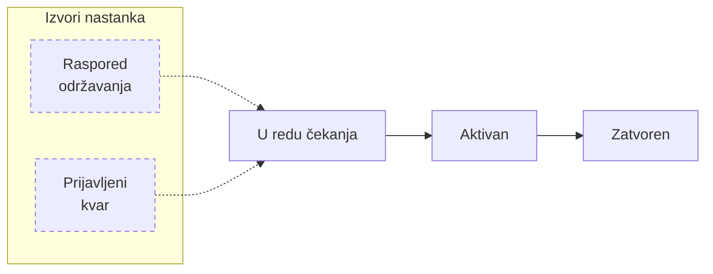
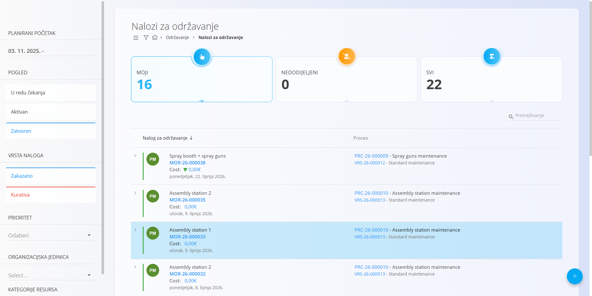
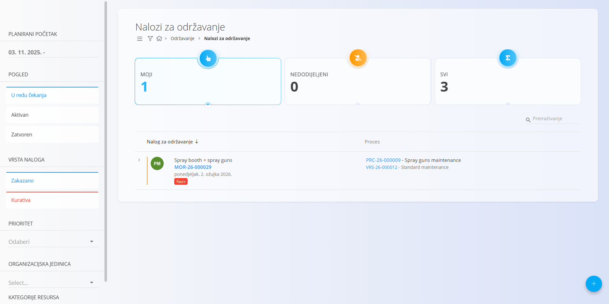
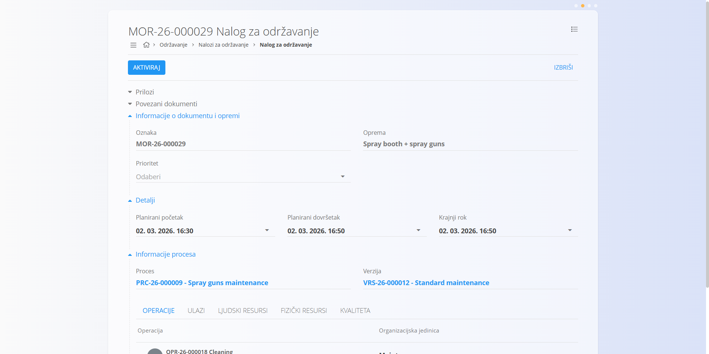
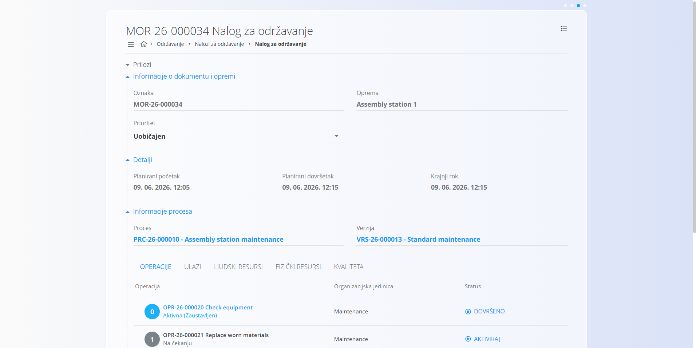
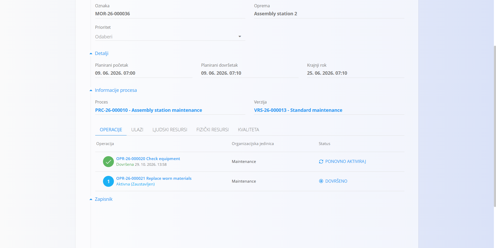

<!-- app_route: /maintenance-orders/list -->
<!-- app_label: Nalozi za održavanje -->
<!-- canonical_source_url: https://github.com/Tom-PIT/Connected.Docs/blob/main/hr/Domene/Odrzavanje/Dokumenti/NaloziZaOdrzavanje.md -->
<!-- canonical_source_title: Nalozi za održavanje -->

# Nalozi za održavanje

Nalozi za održavanje definiraju posao potreban za izvođenje **planiranog ili kurativnog održavanja** opreme, na temelju odabranog **procesa održavanja** i verzije.

Prolaze kroz životni ciklus **U redu čekanja → Aktivan → Zatvoren** i uključuju operacije, resurse, ulaze i kontrole kvalitete definirane odabranim procesom.

> [!NOTE]
> **Preduvjeti**
>
> Prije izrade naloga za održavanje provjerite da su konfigurirani:
> - barem jedan [**proces održavanja**](../../Proizvodnja/Upravljanje/Procesi.md) s aktivnom verzijom
> - definicije opreme
> - dodijeljene [**organizacijske jedinice**](../../Proizvodnja/Upravljanje/OrganizacijskeJedinice.md)
> - dodatne definicije, kao što su [**resursi**](../../Resursi/Upravljanje/Resources.md), [**kontrolni popisi**](../../Kvaliteta/Upravljanje/KontrolniPopisi.md) i [**mjerne jedinice**](../../../Zajednicko/Upravljanje/MjerneJedinice.md), ovisno o vašem tijeku rada održavanja

Za pristup nalozima za održavanje otvorite **Održavanje / Nalozi za održavanje** u [navigaciji](../../../Zajednicko/UI/Navigacija.md).

## Popis naloga za održavanje

Zaslon **Nalozi za održavanje** prikazuje sve naloge za održavanje grupirane prema statusu.
Filtrima s lijeve strane sužavate popis.

### Pregled statusa

Pri vrhu stranice sažete kartice prikazuju broj naloga:

- **Moji** – nalozi dodijeljeni trenutnom korisniku
- **Nedodijeljeni** – nalozi bez dodijeljenog resursa
- **Svi** – ukupan broj naloga za održavanje

Klik na karticu ažurira popis.

### Vizualni pokazatelji na popisu

Nalozi za održavanje mogu prikazivati vizualne pokazatelje koji brzo daju informaciju o statusu:

- **Crvena točka** – kurativni nalog za održavanje
- **Oznaka Kasni** – nalog je prekoračio rok
- **Oznake prioriteta**
  - **crvena strelica prema gore** – visoki prioritet
  - **bez strelice** – normalni prioritet
  - **plava strelica prema dolje** – niski prioritet

### Dostupni filtri

- **Planirani početak** – filtriranje naloga po rasponu datuma planiranog početka
- **Pogled** – filtriranje po statusu životnog ciklusa:
  - **U redu čekanja** – izrađen i spreman za aktivaciju
  - **Aktivan** – trenutno se izvodi
  - **Zatvoren** – dovršeni nalozi za održavanje
- **Vrsta naloga**
  - **Zakazano** – planirano preventivno održavanje
  - **Kurativa** – korektivno održavanje
- **Prioritet**
- **Organizacijska jedinica**
- **Kategorije resursa**

Polje za pretraživanje omogućuje traženje po šifri naloga za održavanje ili nazivu opreme.

## Izrada naloga za održavanje

Za izradu naloga za održavanje koristite [vodič korak po korak](NaloziZaOdrzavanjeIzrada.md).

## Nalozi u statusu U redu čekanja

Novi nalog za održavanje počinje u statusu **U redu čekanja**.

U tom statusu nalog možete:

- pregledati
- uređivati (oprema, prioritet, planirani datumi, proces i verzija)
- izbrisati
- pripremiti za izvođenje

Iz tog statusa možete:

- pregledati operacije
- pregledati potrebne resurse
- dodati privitke ili bilješke

Kad je nalog spreman za izvođenje, kliknite **Aktiviraj**.

### Brisanje naloga za održavanje

Samo naloge u statusu **U redu čekanja** možete izbrisati. Nakon aktivacije naloga brisanje više nije moguće.

## Aktivni nalozi za održavanje

Nakon aktivacije nalog za održavanje postaje **Aktivan**.

Nalog prikazuje:

- opremu i prioritet
- planirani početak i završetak
- proces i verziju
- sve operacije definirane odabranim procesom

### Izvođenje operacija

Operacije se izvode prema definiciji procesa.

Moguća su dva tijeka izvođenja:

- **Brzo dovršavanje** – kliknite **Dovrši** izravno na nalogu za održavanje
- **Detaljno izvođenje** – izvedite operaciju na zaslonu [**Izvođenje održavanja**](IzvodenjeOdrzavanja.md)

Zaslon **Izvođenje održavanja** sadrži kontrole i aktivnosti potrebne za obavljanje posla održavanja, uključujući:

- pokretanje, pauziranje i dovršavanje operacije
- evidentiranje bilješki o održavanju
- evidentiranje potrošnje ulaznih materijala, ako su potrebni
- dovršavanje kontrolnih popisa kvalitete
- evidentiranje rada
- pregled uputa

Pojedinosti o izvođenju održavanja potražite na stranici [**Izvođenje održavanja**](IzvodenjeOdrzavanja.md).

Dovršene operacije prikazuju se **zelenom oznakom**, što daje jasan vizualni status.

Ako treba ponovno otvoriti dovršenu operaciju, kliknite **Ponovno aktiviraj** za tu operaciju.

Nakon potvrde operacija ponovno postaje aktivna i može se ponovno izvesti na zaslonu [**Izvođenje održavanja**](IzvodenjeOdrzavanja.md).

> [!TIP]
> Cijeli nalog za održavanje možete dovršiti odjednom klikom na **Dovrši nalog za održavanje** u [izborniku](#izbornik).

> [!NOTE]
> Potrošnju **ulaza** moguće je automatski evidentirati pri dovršetku operacije, ako je automatska potrošnja uključena. U suprotnom se ulazni materijali evidentiraju ručno tijekom izvođenja, na stranici [**Izvođenje održavanja**](IzvodenjeOdrzavanja.md#ulazi).

## Zatvoreni nalozi za održavanje

Kad su sve operacije dovršene, nalog za održavanje prelazi u status **Zatvoren**.

Zatvoreni nalozi za održavanje:

- su samo za čitanje
- sadrže potpunu povijest izvođenja
- služe kao zapisi o održavanju opreme

Ostaju vidljivi na popisu u prikazu **Zatvoren**.

## Izbornik

Izbornik nudi dodatne radnje dostupne na ovoj stranici za **aktivne** naloge za održavanje.

Dostupne radnje:

- **Dovrši nalog za održavanje**

Kliknite **Dovrši nalog za održavanje** da dovršite sve operacije u nalogu za održavanje. Nakon potvrde nalog prelazi u status **Zatvoren**.

Pojedinosti o radnjama izbornika potražite u općem opisu izbornika u aplikaciji.
