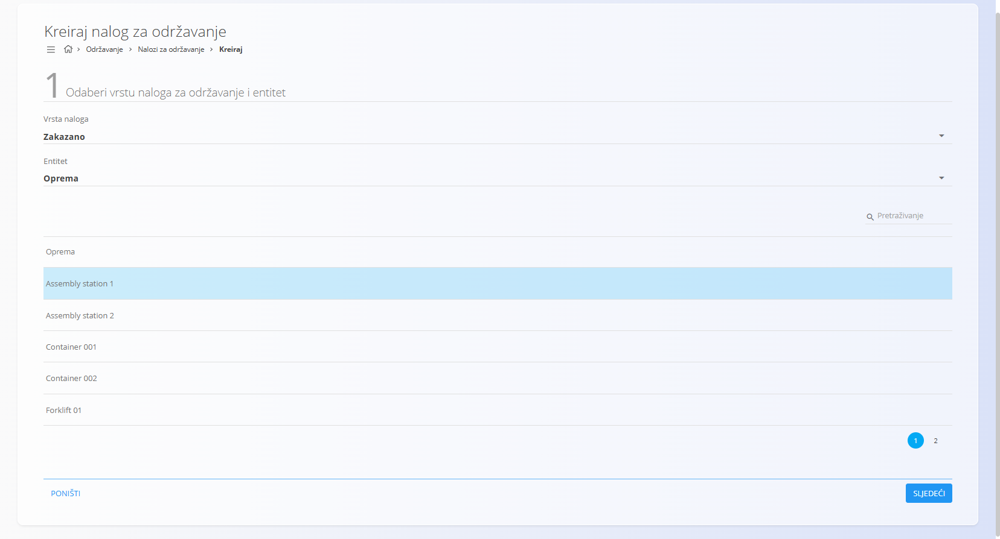
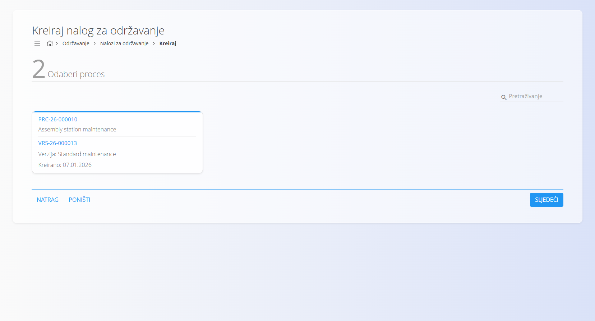
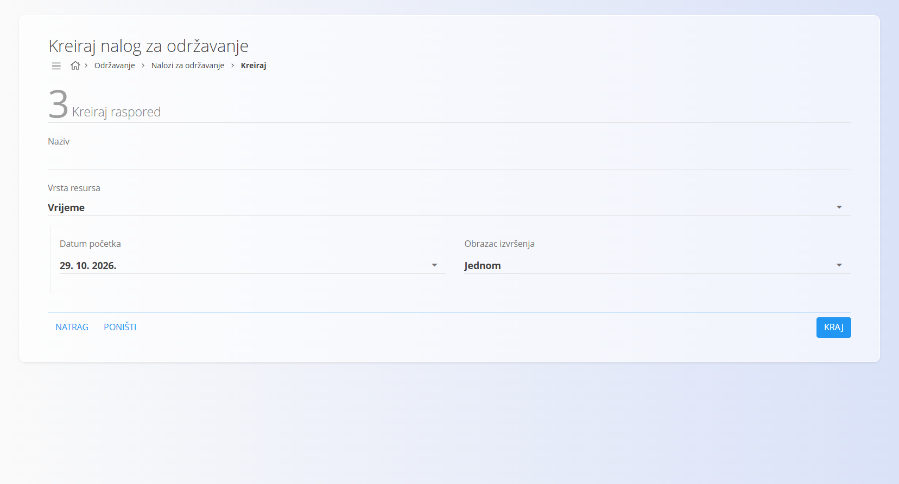
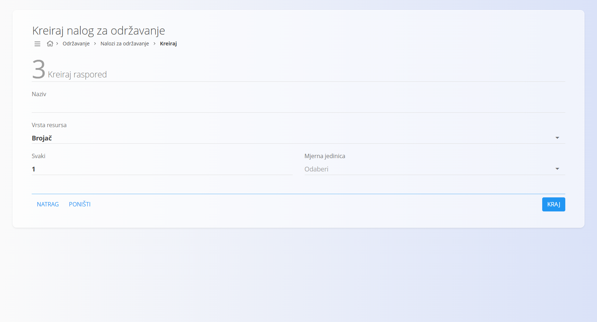
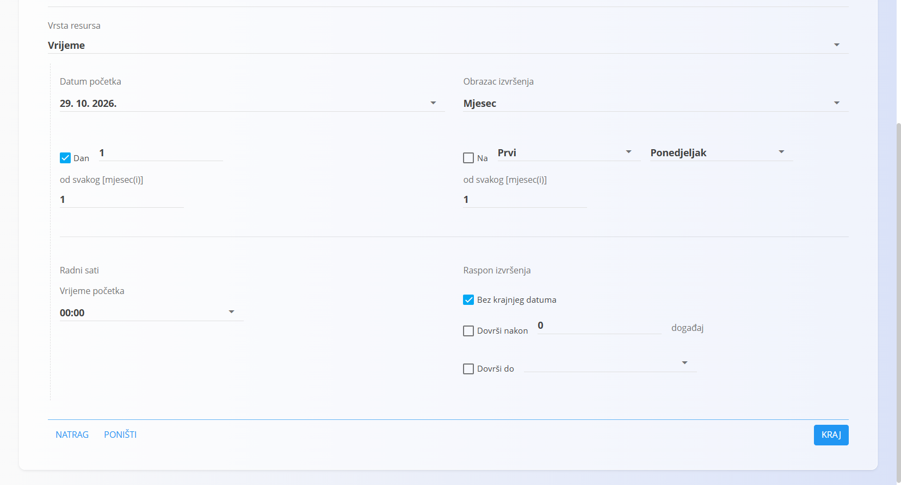

<!-- app_route: /maintenance-orders/create -->
<!-- app_label: Kreiraj nalog za održavanje -->
<!-- canonical_source_url: https://github.com/Tom-PIT/Connected.Docs/blob/main/hr/Domene/Odrzavanje/Dokumenti/NaloziZaOdrzavanjeIzrada.md -->
<!-- canonical_source_title: Kreiraj nalog za održavanje -->

# Kako izraditi novi nalog za održavanje

Kliknite [akcijski gumb](../../../Zajednicko/UI/AkcijskiGumb.md) (**+**) da izradite novi nalog za održavanje.

Čarobnjak za izradu sastoji se od **tri koraka**, slično kao kod proizvodnih naloga.

## Koraci konfiguracije

### Korak 1 – Odabir vrste naloga i entiteta

Za **Entitet** odaberite opremu koju treba održavati, zatim s popisa odaberite određenu opremu.

> [!NOTE]
> Pri ručnoj izradi naloga za održavanje vrsta naloga uvijek je **Zakazano**.
>
> **Kurativni** nalozi za održavanje izrađuju se iz **prijavljenih kvarova**.

### Korak 2 – Odabir procesa

- Odaberite **[proces](../../Proizvodnja/Upravljanje/Procesi.md)** održavanja.
- Odaberite **verziju procesa** koja određuje operacije održavanja.

> [!NOTE]
> Ako u ovom koraku nema dostupnih procesa, provjerite je li:
> - proces dobio oznaku **Održavanje**
> - u operacijama procesa definiran i dodijeljen **neljudski resurs**
> - proces ima barem jednu **aktivnu verziju**

### Korak 3 – Izrada rasporeda

Odredite kako i kada treba izvršiti nalog za održavanje. Dostupna su dva načina raspoređivanja:

- **Vrijeme** – zakazivanje održavanja za određeni datum ili ponavljajući interval

  

- **Brojač** – zakazivanje održavanja prema korištenju ili brojačima

  

> [!NOTE]
> Rasporedi temeljeni na korištenju oslanjaju se na brojače opreme i resursa (npr. komadi, metri, grami, sati). Za konfiguriranje brojača pogledajte [**Radno vrijeme resursa i brojači**](RadnoVrijemeIBrojaci.md).

Ako odaberete ponavljajući obrazac izvršenja (npr. **Mjesec**, **Dan** ili **Godina**), automatski se stvara [**raspored održavanja**](RasporedOdrzavanja.md). Taj raspored generira naloge za održavanje prema odabranom obrascu.

Obrazac izvršenja može biti: **Jednom**, **Sekunda**, **Minuta**, **Sat**, **Dan**, **Tjedan**, **Mjesec** ili **Godina**.

Kliknite **Kraj** da izradite nalog za održavanje u statusu **U redu čekanja**.
