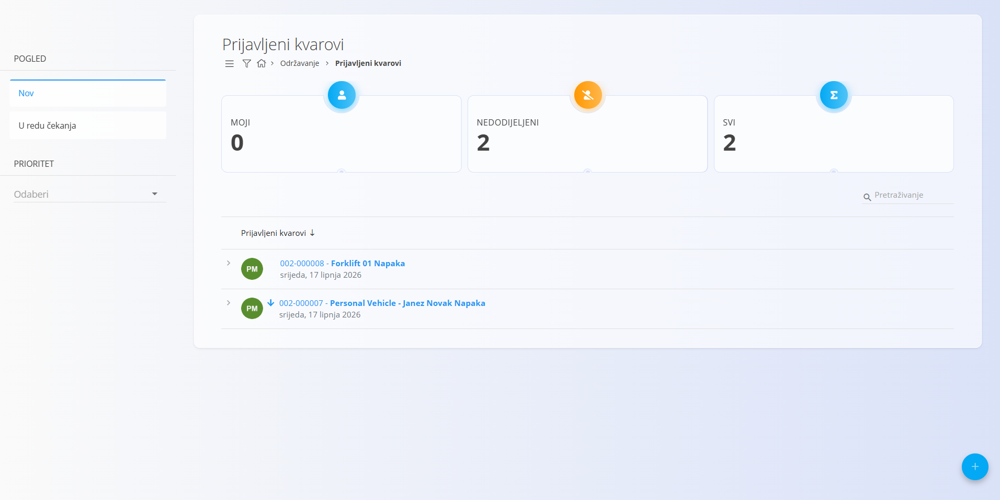
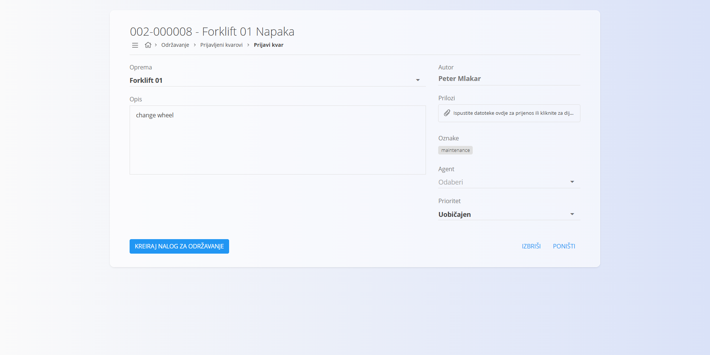
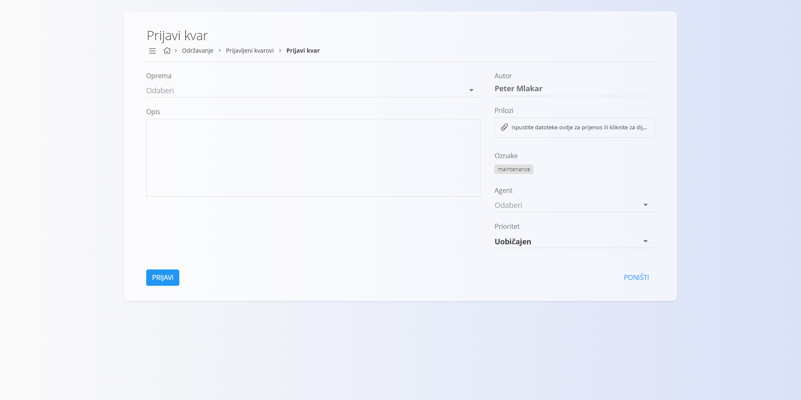
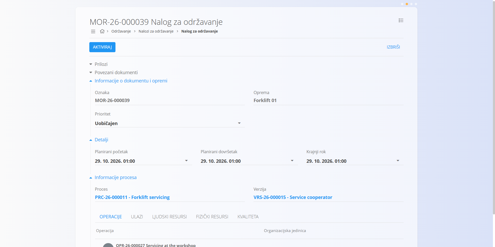

<!-- app_route: /maintenance-orders/tickets -->
<!-- app_label: Prijavljeni kvarovi -->
<!-- canonical_source_url: https://github.com/Tom-PIT/Connected.Docs/blob/main/hr/Domene/Odrzavanje/Dokumenti/PrijavljeniKvarovi.md -->
<!-- canonical_source_title: Prijavljeni kvarovi -->

# Prijavljeni kvarovi

Prijavljeni kvarovi bilježe **probleme uočene na opremi tijekom proizvodnje ili rada**. Služe kao polazna točka za **kurativno održavanje**: tim za održavanje pregledava prijavljene probleme i, kad je potrebno, izravno iz kvara stvara nalog za održavanje.

Za pristup prijavljenim kvarovima otvorite **Održavanje / Prijavljeni kvarovi** u [navigaciji](../../../Zajednicko/UI/Navigacija.md).

## Popis prijavljenih kvarova

Zaslon **Prijavljeni kvarovi** prikazuje sve prijavljene probleme, grupirane prema dodjeli.

### Pregled statusa

Pri vrhu stranice sažete kartice prikazuju broj kvarova:

- **Moji** – kvarovi dodijeljeni trenutnom korisniku
- **Nedodijeljeni** – kvarovi bez dodijeljenog agenta
- **Svi** – ukupan broj prijavljenih kvarova

Klik na karticu filtrira popis.

### Dostupni filtri

- **Pogled**
  - **Nov** – novoprijavljeni kvarovi
  - **U redu čekanja** – kvarovi koji se pregledavaju ili čekaju radnju
- **Prioritet** – filtriranje kvarova prema prioritetu

Pretraživanje radi po šifri kvara ili nazivu opreme.

## Pojedinosti kvara

Klik na kvar u popisu otvara zaslon s pojedinostima.

Pojedinosti sadrže:

- **Oprema** – zahvaćena oprema
- **Autor** – korisnik koji je prijavio kvar
- **Opis** – opis problema
- **Prilozi** – dodatne datoteke ili slike (neobavezno)
- **Oznake** – klasifikacija kvara (npr. *Kvar stroja*)
- **Agent** – dodijeljeni agent održavanja
- **Prioritet** – ozbiljnost kvara

Na ovom zaslonu tim za održavanje pregledava problem i odlučuje o odgovarajućoj korektivnoj radnji.

## Prijava kvara

Za novu prijavu kvara kliknite akcijski gumb (**+**).

Ispunite pojedinosti kvara i kliknite **Prijavi**. Nova prijava pojavljuje se na popisu kvarova.

## Izrada naloga za održavanje iz prijave kvara

Na zaslonu pojedinosti kliknite **Kreiraj nalog za održavanje** da biste iz kvara izradili [**nalog za održavanje**](NaloziZaOdrzavanje.md).

Ta radnja stvara novi **kurativni nalog za održavanje** s ovim ponašanjem:

- izrada se odvija u **jednom koraku**
- nalog se stvara u statusu **U redu čekanja**
- **prioritet se preuzima iz prijavljenog kvara**
- podaci o opremi unaprijed se popunjavaju iz kvara
- kontekst kvara čuva se radi sljedivosti

Nakon izrade nalog slijedi standardni životni ciklus naloga za održavanje i može se aktivirati i izvršiti na zaslonu [**Nalozi za održavanje**](NaloziZaOdrzavanje.md).
