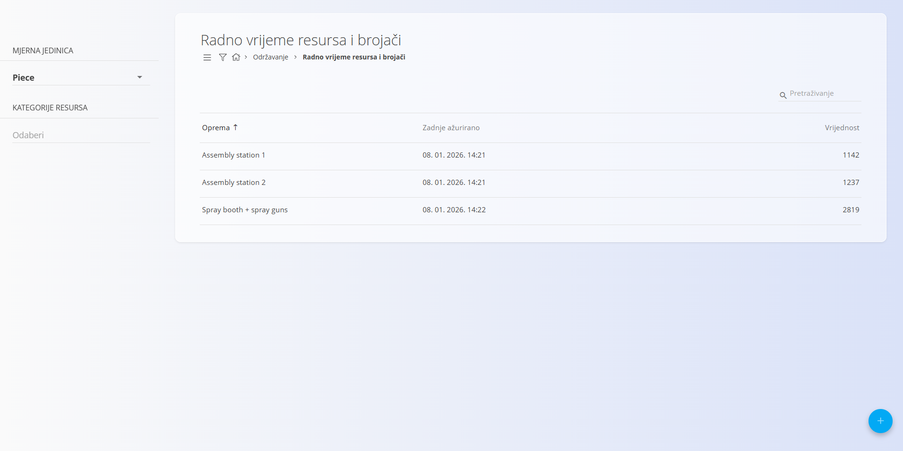
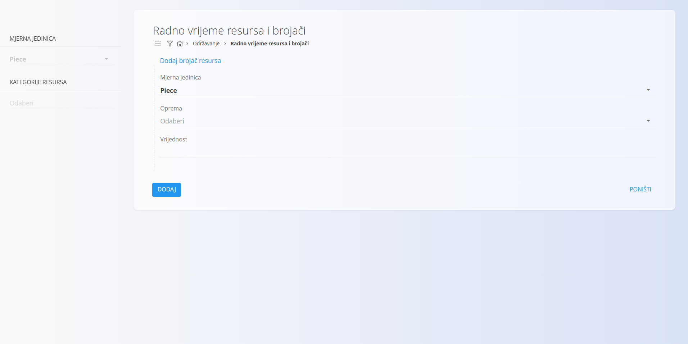
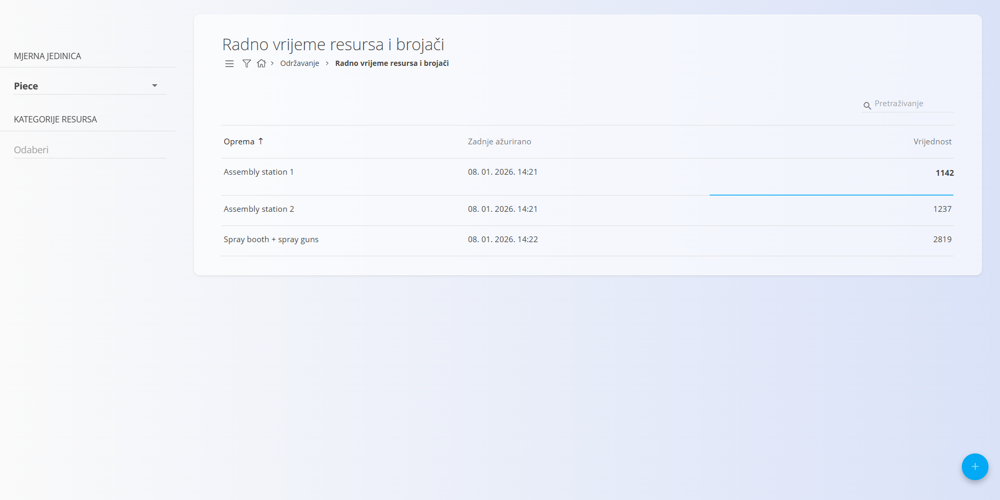

<!-- app_route: /maintenance/resource-counters -->
<!-- app_label: Radno vrijeme resursa i brojači -->
<!-- canonical_source_url: https://github.com/Tom-PIT/Connected.Docs/blob/main/hr/Domene/Odrzavanje/Dokumenti/RadnoVrijemeIBrojaci.md -->
<!-- canonical_source_title: Radno vrijeme resursa i brojači -->

# Radno vrijeme resursa i brojači

Zaslon **Radno vrijeme resursa i brojači** služi za praćenje **vrijednosti korištenja** opreme, na primjer proizvedenih komada, radnih sati, prijeđenih kilometara, volumena ili bilo koje druge mjerljive jedinice.

Te se vrijednosti koriste u **[rasporedima održavanja](RasporedOdrzavanja.md) temeljenima na brojaču** koji automatski generiraju naloge za održavanje kad se dosegnu zadani pragovi.

Za pristup ovom zaslonu otvorite **Održavanje / Radno vrijeme resursa i brojači** u [navigaciji](../../../Zajednicko/UI/Navigacija.md).

## Pregled

Svaki redak predstavlja **brojač** povezan s određenom opremom i određenom [mjernom jedinicom](../../../Zajednicko/Upravljanje/MjerneJedinice.md).

Popis prikazuje:

- **Oprema** – resurs koji se prati
- **Zadnje ažurirano** – datum i vrijeme posljednje promjene vrijednosti
- **Vrijednost** – trenutna vrijednost brojača

Filtri s lijeve strane sužavaju popis prema:

- **Mjernoj jedinici**
- **Kategorijama resursa**

Polje za pretraživanje služi za pronalaženje opreme po nazivu.

## Dodavanje brojača resursa

Kliknite akcijski gumb (**+**) za izradu novog brojača.

Unesite:

- **Mjerna jedinica** – jedinica koja se koristi za brojač (npr. *Piece*, *Hour*, *Liter*)
- **Oprema** – oprema za koju se brojač prati
- **Vrijednost** – početna vrijednost brojača

Kliknite **Dodaj** da biste stvorili brojač.

> **Napomena**
>
> Za jednu opremu i jednu mjernu jedinicu može postojati samo jedan brojač.

## Uređivanje vrijednosti brojača

Vrijednosti brojača mogu se mijenjati izravno na popisu.

Za izmjenu vrijednosti:

1. Kliknite **broj u stupcu Vrijednost**
2. Unesite novu vrijednost
3. Potvrdite promjenu

Polje **Zadnje ažurirano** automatski se osvježava kad se vrijednost promijeni.

## Korištenje u planiranju održavanja

Brojači se obično koriste zajedno s **rasporedima održavanja temeljenima na brojaču**.

Kad je nalog za održavanje konfiguriran s:

- **Vrsta rasporeda** = Brojač
- **Obrazac izvršavanja** = na temelju mjerne jedinice i vrijednosti

sustav uspoređuje **trenutnu vrijednost brojača** sa zadanim intervalom rasporeda kako bi odredio kad treba stvoriti novi nalog za održavanje.

### Primjer održavanja temeljenog na brojaču

Sljedeći primjer pokazuje kako se brojači koriste za pokretanje naloga za održavanje.

1. Za opremu je definiran brojač:
   - **Oprema**: Spray booth
   - **Mjerna jedinica**: Piece
   - **Vrijednost**: 643

2. Nalog za održavanje stvara se s rasporedom temeljenim na brojaču:
   - **Vrsta rasporeda**: Brojač
   - **Svaki**: 200 komada

3. Sustav uspoređuje vrijednost brojača s rasporedom:
   - pragovi održavanja nastupaju na: 200, 400, 600 i 800 komada
   - trenutna vrijednost (643) veća je od 600, pa se sljedeće održavanje očekuje na 800 komada

4. Kad se vrijednost brojača ažurira na **800 ili više**, sustav automatski stvara novi nalog za održavanje.

Na taj se način održavanje pokreće prema **stvarnom korištenju opreme**, a ne prema fiksnim vremenskim razmacima.
