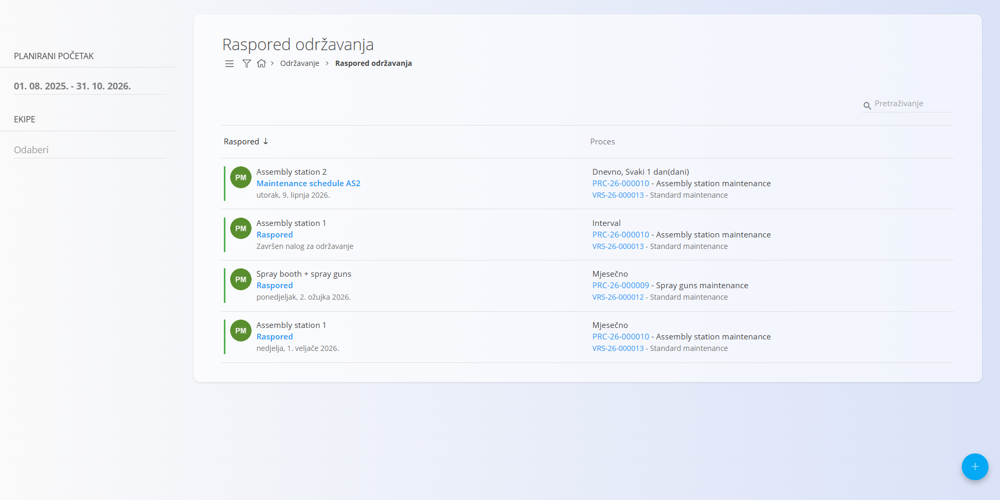
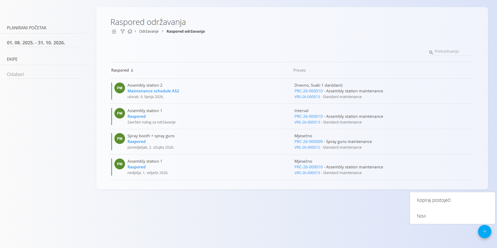
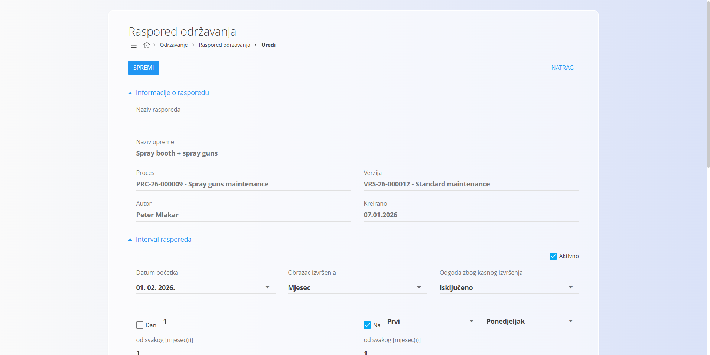

<!-- app_route: /maintenance-orders/schedule -->
<!-- app_label: Raspored održavanja -->
<!-- canonical_source_url: https://github.com/Tom-PIT/Connected.Docs/blob/main/hr/Domene/Odrzavanje/Dokumenti/RasporedOdrzavanja.md -->
<!-- canonical_source_title: Raspored održavanja -->

# Raspored održavanja

**Raspored održavanja** određuje kako se **planirani nalozi za održavanje** automatski generiraju tijekom vremena ili prema korištenju, na temelju zadanog obrasca izvršavanja.

Rasporedi održavanja izrađuju se kao dio planiranog održavanja i osiguravaju da se preventivno održavanje redovito izvodi bez ručnog unosa.

Za pristup rasporedima održavanja otvorite **Održavanje / Raspored održavanja** u [navigaciji](../../../Zajednicko/UI/Navigacija.md).

## Odnos s nalozima za održavanje

Rasporedi održavanja usko surađuju s nalozima za održavanje:

- svaki raspored automatski generira **naloge za održavanje u čekanju**
- generirani nalozi pojavljuju se u:
  - [**Nalozima za održavanje**](NaloziZaOdrzavanje.md)
  - [**Kalendaru održavanja**](KalendarOdrzavanja.md)
- nakon što je nalog za održavanje dovršen, raspored nastavlja generirati sljedeće izvršavanje prema svojoj konfiguraciji

Tako preventivno održavanje ostaje kontinuirano i ne ovisi o ručnom stvaranju zadataka, bez obzira na to temelji li se na vremenu ili na brojaču korištenja.

## Popis rasporeda održavanja

Stranica **Raspored održavanja** prikazuje sve postojeće rasporede nastale iz planiranih naloga za održavanje.

Svaki unos predstavlja **ponavljajuću definiciju održavanja** povezanu s:

- određenom opremom
- procesom održavanja i verzijom
- ponavljajućim obrascem izvršavanja (prema vremenu ili prema brojaču korištenja)

Klik na akcijski gumb (**+**) otvara izbornik sa stavkama **Kopiraj postojeći** i **Novi**. Odabir **Novi** pokreće izradu novog rasporeda održavanja, što je isti postupak kao [izrada naloga za održavanje](NaloziZaOdrzavanjeIzrada.md). Odabir **Kopiraj postojeći** može se koristiti za novu verziju rasporeda.

### Podaci u popisu

Za svaki raspored popis prikazuje:

- **Oprema**
- **Raspored** (poveznica za uređivanje rasporeda)
- **Sljedeći datum izvršenja** (za rasporede prema vremenu) ili **sljedeći prag brojača** (za rasporede prema brojaču)
- **Obrazac izvršenja**
- **Proces i verzija**

Klik na **Raspored** otvara zaslon za uređivanje rasporeda.

### Dostupni filtri

Filtri s lijeve strane sužavaju popis:

- **Planirani početak** – filtriranje rasporeda po rasponu datuma
- **Ekipe** – filtriranje po dodijeljenim ekipama

Polje za pretraživanje omogućuje traženje po nazivu opreme ili procesu.

## Izrada rasporeda održavanja

Kliknite akcijski gumb (**+**) i odaberite jednu od sljedećih mogućnosti:

- **Novi** – izrada novog rasporeda održavanja
- **Kopiraj postojeći** – izrada nove verzije postojećeg rasporeda održavanja

### Izrada novog rasporeda

Odaberite **Novi** da biste rasporedom održavanja stvorili od početka.

Postupak izrade isti je kao izrada naloga za održavanje. Pojedinosti potražite u odjeljku [**Izrada novog naloga za održavanje**](NaloziZaOdrzavanjeIzrada.md).

Rasporedi održavanja mogu se stvoriti i automatski kad je planirani nalog za održavanje konfiguriran s **ponavljajućim obrascem izvršavanja**.

Podržani ponavljajući obrasci uključuju:

- **obrasce prema vremenu** (npr. mjesečno, godišnje, svakih X dana)
- **obrasce prema korištenju ili brojaču** (npr. svakih X komada, metara, grama, sati), uz odgovarajuće brojače opreme i mjerne jedinice

> [!NOTE]
> Za konfiguriranje brojača korištenja na resursima i opremi pogledajte [**Radno vrijeme resursa i brojači**](RadnoVrijemeIBrojaci.md).

### Kopiranje postojećeg rasporeda

Odaberite **Kopiraj postojeći** da biste stvorili novu verziju postojećeg rasporeda održavanja.

Kad se raspored kopira:

- konfiguracija postojećeg rasporeda kopira se u novu verziju
- ažuriraju se **autor**, **valjanost** i **verzija** novog rasporeda
- prethodni raspored automatski se deaktivira

Tako se raspored može mijenjati uz zadržavanje povijesti prijašnjih verzija, primjerice kad želite pregledati kako je održavanje bilo raspoređeno za određenu opremu tijekom vremena.

Nakon izrade aktivni raspored generira buduće naloge za održavanje prema svom zadanom intervalu ili pragu korištenja.

## Uređivanje rasporeda održavanja

Za uređivanje rasporeda kliknite **Raspored** u retku na popisu rasporeda održavanja.

Otvara se zaslon **Uređivanje rasporeda održavanja**, na kojem možete mijenjati način i vrijeme generiranja naloga za održavanje.

### Interval rasporeda

Odjeljak **Interval rasporeda** određuje logiku ponavljanja rasporeda.

Ovdje možete konfigurirati:

- **datum početka** rasporeda
- **obrazac izvršenja** (npr. mjesečno, godišnje, prema intervalu ili prema korištenju)
- je li raspored **aktivan** (potvrdni okvir **Aktivno**)

Dostupna polja i mogućnosti mijenjaju se ovisno o odabranom obrascu izvršenja.

### Generiranje naloga za održavanje

Prema zadanim postavkama nalozi za održavanje generiraju se prema intervalu definiranom u rasporedu.

Ako je u konfiguraciji sustava uključena opcija **Generiranje sljedećeg naloga za održavanje po završetku**, sljedeći planirani nalog stvara se čim se prethodni nalog za održavanje dovrši. Planirani datum novog naloga i dalje se određuje prema datumu i pravilima definiranim u intervalu rasporeda.

Tako je nadolazeći nalog za održavanje unaprijed dostupan za planiranje i dodjelu resursa.

Da biste uključili to ponašanje, otvorite **Sustav / Konfiguracija**, odaberite **Nalozi za održavanje / Postavke** i uključite opciju **Generiranje sljedećeg naloga za održavanje po završetku** u odjeljku **Generiranje naloga za održavanje**.

### Radno vrijeme

Odjeljak **Radno vrijeme** određuje vremenski okvir u kojem je planirano da generirani nalozi za održavanje počnu i završe.

Tako se aktivnosti održavanja mogu uskladiti s radnim vremenom ili smjenama.

### Raspon izvršenja

Odjeljak **Raspon izvršenja** određuje koliko dugo raspored ostaje valjan, na primjer:

- rad bez kraja
- završetak nakon zadanog broja izvršenja
- završetak na određeni datum

### Povezani nalozi za održavanje

Na dnu zaslona raspored prikazuje:

- **aktivne naloge za održavanje** generirane ovim rasporedom
- **zatvorene naloge za održavanje**, koji predstavljaju dovršena izvršenja

Tako postoji sljedivost između rasporeda i svih naloga za održavanje nastalih iz njega.

Kliknite **Spremi** da primijenite promjene na raspored.

> [!NOTE]
> Promjene rasporeda održavanja utječu samo na **buduće naloge za održavanje**. Nalozi za održavanje koji su već izrađeni ne mijenjaju se.
