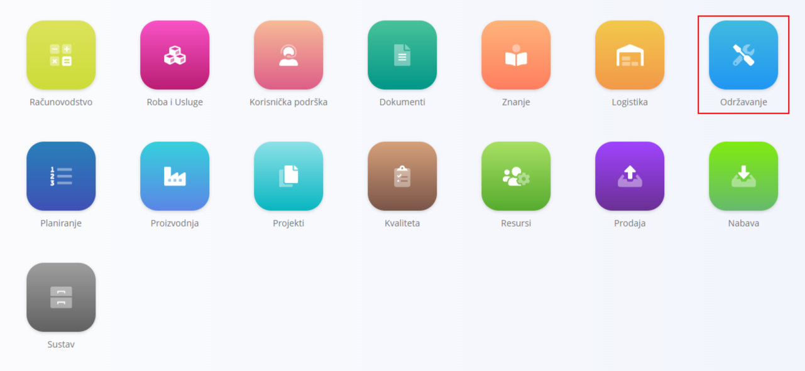
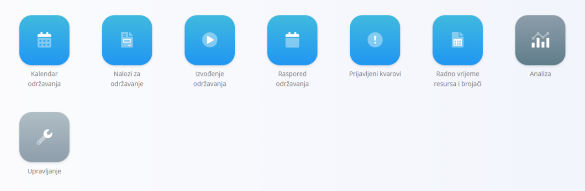
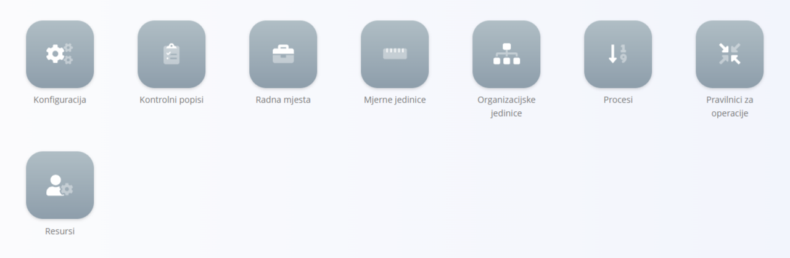
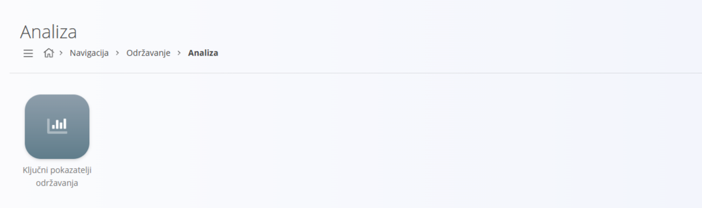

<!-- app_route: /sitemap/maintenance -->
<!-- app_label: Održavanje -->
<!-- canonical_source_url: https://github.com/Tom-PIT/Connected.Docs/blob/main/hr/Domene/Odrzavanje/README.md -->
<!-- canonical_source_title: Održavanje -->

# Održavanje

Domena **Održavanje** pruža zasebni radni prostor za planiranje, izvršavanje i analizu održavanja opreme. Objedinjuje način na koji se definiraju procesi održavanja, kako se izrađuju i izvršavaju nalozi te kako se mjeri učinkovitost radi kontinuiranog poboljšanja.

Ovu domenu koristite za:
- planiranje preventivnog održavanja i zakazivanje ponavljajućih radova
- izvršavanje kurativnog održavanja za prijavljene kvarove
- praćenje operacija, resursa, ulaza i kontrolnih popisa tijekom održavanja
- pregled pokazatelja radi procjene pouzdanosti i brzine reagiranja

Za pristup domeni Održavanje otvorite **Održavanje** u [navigaciji](../../Zajednicko/UI/Navigacija.md).

> [!NOTE]
> Dostupne domene ovise o konfiguraciji tvrtke i poslovnom modelu.

## Što sadrži domena Održavanje?

Domena je organizirana u funkcionalna područja za svakodnevni rad i analizu:

- **Dokumenti** – izrada i upravljanje aktivnostima održavanja i njihovim životnim ciklusom
  - **[Nalozi za održavanje](Dokumenti/NaloziZaOdrzavanje.md)** — planiranje i izvršavanje planiranog ili kurativnog održavanja na temelju odabranog procesa održavanja i verzije. Podržava operacije, resurse, ulaze i kontrole kvalitete.
  - **[Raspored održavanja](Dokumenti/RasporedOdrzavanja.md)** — konfiguriranje ponavljajućih obrazaca izvršavanja (prema vremenu ili brojaču) koji automatski generiraju naloge za održavanje.
  - **[Prijavljeni kvarovi](Dokumenti/PrijavljeniKvarovi.md)** — evidentiranje kvarova opreme s terena; iz prijavljenih kvarova nastaju nalozi za kurativno održavanje.
  - **[Kalendar održavanja](Dokumenti/KalendarOdrzavanja.md)** — kalendarski prikaz planiranog i aktivnog održavanja s filtrima po organizacijskoj jedinici, resursu i statusu naloga.
  - **[Radno vrijeme resursa i brojači](Dokumenti/RadnoVrijemeIBrojaci.md)** — konfiguriranje radnih vremena i brojača korištenja (npr. komadi, metri, grami, sati) koji se koriste u rasporedima i održavanju temeljenom na brojaču.

> [!TIP]
> Pogledajte [**Kako izraditi nalog za održavanje**](Dokumenti/NaloziZaOdrzavanjeIzrada.md) za korak-po-korak vodič za izradu ovih dokumenata.

## Upravljanje

Konfigurirajte zajedničke strukture koje koristi održavanje. Domena Održavanje koristi zajedničke šifrarnike koji se dijele s [**Proizvodnjom**](../Proizvodnja/README.md).

- **[Procesi](../Proizvodnja/Upravljanje/Procesi.md)** — definiranje koraka procesa i verzija koje se koriste za izvršavanje operacija održavanja.
- **[Organizacijske jedinice](../Proizvodnja/Upravljanje/OrganizacijskeJedinice.md)** — definiranje operativnih jedinica (npr. odjeli održavanja, servisne ekipe).
- **[Resursi](../Resursi/Upravljanje/Resources.md)** — upravljanje ljudskim i neljudskim resursima (tehničari, alati, oprema).
- **[Kontrolni popisi](../Kvaliteta/Upravljanje/KontrolniPopisi.md)** — izrada i kategoriziranje kontrolnih popisa koji se koriste tijekom operacija održavanja.

Koristite ove šifrarnike za vođenje tijeka rada održavanja i izvršavanja kroz naloge i rasporede.

> [!TIP]
> Sve stavke upravljanja pogledajte u **[Indeksu upravljanja](../../IndeksUpravljanja.md)**.

## Analiza

Pratite učinkovitost i pouzdanost pomoću ugrađene analize.

- **[Ključni pokazatelji održavanja](Analiza/KljucniPokazateljiOdrzavanja.md)** — kartice pokazatelja i detaljni popisi za MTBF, vrijeme detekcije, vrijeme popravka, rad i raspodjelu opterećenja.

## Životni ciklus i izvršavanje

- Tijek statusa: **U redu čekanja → Aktivan → Zatvoren**
- Izvršavanje: operatori izvršavaju operacije prema odabranom procesu.
- Sljedivost: evidentiraju se rad, ulazi, neljudski resursi i kontrolni popisi.
- Okidači: prijavljeni kvarovi pokreću kurativne radove, a rasporedi automatski generiraju planirane naloge.

> [!NOTE]
> Detaljna poglavlja za svaku stranicu (nalozi, raspored, kvarovi, kalendar, pokazatelji) dostupna su i daju korak-po-korak upute. Ova stranica služi kao pregled domene.
