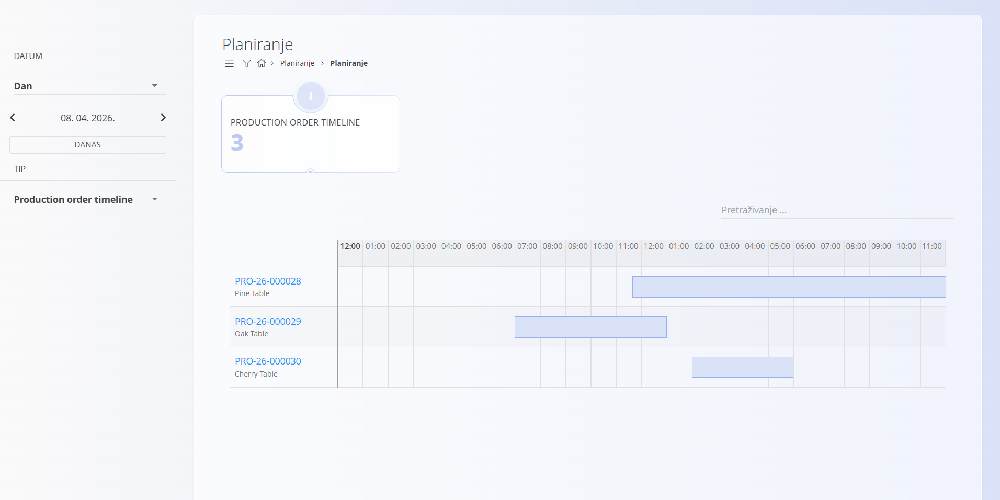
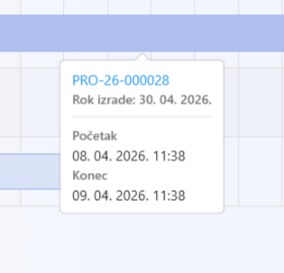

<!-- app_route: /planning -->
<!-- app_label: Planiranje -->
<!-- canonical_source_url: https://github.com/Tom-PIT/Connected.Docs/blob/main/hr/Domene/Planiranje/Pogledi/Planiranje.md -->
<!-- canonical_source_title: Planiranje -->

# Planiranje

Zaslon **Planiranje** pruža vizualni pregled **planiranih proizvodnih naloga** u kalendarskom prikazu. Omogućuje praćenje rasporeda i prilagodbu vremenskog rasporeda proizvodnje.

Za pristup ovom zaslonu otvorite **Planiranje / Planiranje** u [navigaciji](../../../Zajednicko/UI/Navigacija.md).

## Pregled

Proizvodni nalozi prikazuju se u kalendaru prema datumima **Planirani početak** i **Planirani kraj**.

> [!IMPORTANT]
> Proizvodni nalog prikazuje se u Planiranju samo ako su definirani i **Planirani početak** i **Planirani kraj**.  
> Te se vrijednosti postavljaju pri izradi ili uređivanju proizvodnog naloga. Pogledajte [**Proizvodni nalozi**](../../Proizvodnja/Dokumenti/ProizvodniNaloziIzrada.md#datumi).

Svaki unos u kalendaru predstavlja planirani proizvodni nalog i prikazuje njegovo trajanje unutar odabranog vremenskog razdoblja.

## Filtri

Za sužavanje prikaza koristite filtre na lijevoj strani:

- **Datum** – odaberite željeno vremensko razdoblje  
- **Tip** – filtriranje prema tipu planiranja (npr. vremenska crta proizvodnje)

Gumb **Danas** brzo vraća prikaz na današnji datum.

## Kalendarski prikazi

Kalendar se može prikazati u različitim načinima:

- **Dan** – detaljan prikaz jednog dana po satima  
- **Tjedan** – pregled odabranog tjedna  
- **Mjesec** – sažeti mjesečni pregled  

Za kretanje između datuma koristite odabir datuma na lijevoj strani.

## Akcije

### Pregled detalja

Kliknite **šifru proizvodnog naloga** za otvaranje njegova detaljnog prikaza.

### Premještanje planiranih naloga

Planirane naloge možete **preraspodijeliti** izravno u kalendaru povlačenjem i ispuštanjem.

- Povucite nalog u novi vremenski termin kako biste prilagodili njegov raspored  
- Sustav automatski ažurira planirane datume  

> [!NOTE]
> Proizvodni nalog nije moguće premjestiti nakon datuma **Datum roka izrade** definiranog na [proizvodnom nalogu](../../Proizvodnja/Dokumenti/ProizvodniNaloziIzrada.md#datumi).

### Prikaz informacija o nalogu

Kada pokazivač miša zadržite iznad planiranog naloga, prikazuju se dodatni detalji, kao što su:

- šifra proizvodnog naloga  
- rok izrade  
- početak  
- kraj  
