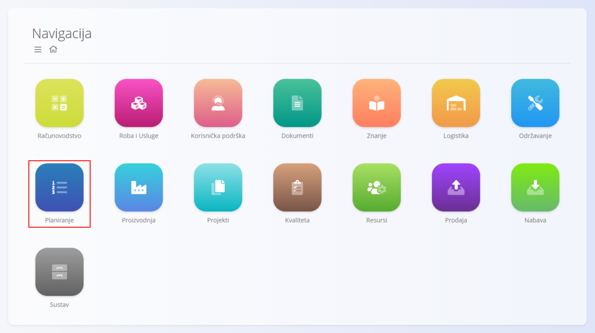
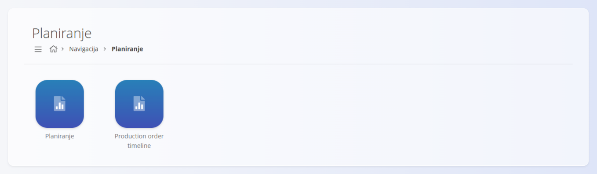

<!-- app_route: /sitemap/planning -->
<!-- app_label: Planiranje -->
<!-- canonical_source_url: https://github.com/Tom-PIT/Connected.Docs/blob/main/hr/Domene/Planiranje/README.md -->
<!-- canonical_source_title: Planiranje -->

# Planiranje

Domena **Planiranje** koristi se za **raspoređivanje i praćenje proizvodnih naloga**. Pruža vizualne alate za upravljanje vremenskim rasporedom proizvodnje i praćenje planiranog rada.

Za pristup domeni otvorite **Planiranje** u [navigaciji](../../Zajednicko/UI/Navigacija.md).

## Dostupni pogledi

Domena sadrži sljedeće poglede:

- **[Planiranje](Pogledi/Planiranje.md)** – kalendarski prikaz planiranih proizvodnih naloga u kojem možete rasporediti i prilagoditi vremenski raspored proizvodnje  
- **Production order timeline** – vremenska crta koja prikazuje redoslijed i trajanje proizvodnih naloga  

