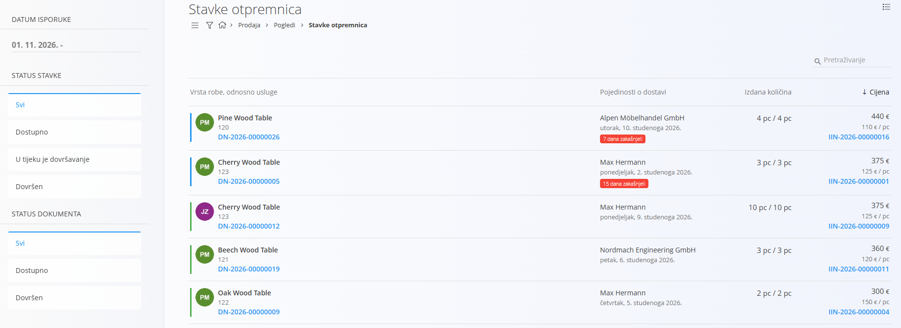

<!-- app_route: /sales/views/delivery-note-details -->
<!-- app_label: Stavke otpremnica -->
<!-- canonical_source_url: https://tom-pit.github.io/Connected.Docs/hr/Domene/Prodaja/Pogledi/StavkeOtpremnica/ -->
<!-- canonical_source_title: Stavke otpremnica -->

# Stavke otpremnica

Pogled **Stavke otpremnica** omogućuje brz pregled stanja isporuka. Prikazuje stavke iz dokumenata [**Otpremnice**](../Dokumenti/Otpremnice.md) redak po redak, pa vidite koliko je već izdano te koje su stavke fakturirane i po kojoj cijeni.

Ovaj pogled služi isključivo za analizu i **ne omogućuje** izradu niti uređivanje otpremnica.

Za pristup ovom pogledu otvorite **Prodaja / Pogledi / Stavke otpremnica** u [navigaciji](../../../Zajednicko/UI/Navigacija.md).

## Popis stavki otpremnica

Svaki redak predstavlja **jednu stavku otpremnice** i prikazuje:

- **Vrstu robe, odnosno usluge** – Artikl koji je isporučen, s njegovom šifrom i nazivom. Šifra otpremnice prikazana je s poveznicom na [**otpremnicu**](../Dokumenti/Otpremnice.md).
- **Pojedinosti o dostavi** – Kupca i datum isporuke.
- **Izdanu količinu** – Broj već izdanih jedinica, a zatim ukupnu količinu na otpremnici, npr. **0 pc / 3 pc**.
- **Cijenu** – Cijenu iz računa. Broj računa prikazan je s poveznicom na račun. Cijena je prazna za otpremnice koje još nisu fakturirane.

## Filtri

Lijeva bočna traka sadrži sljedeće filtre:

- **Datum isporuke** – Odaberite vremensko razdoblje isporuke.
- **Status stavke** – Filtrira stavke prema napretku slanja.
    - *Svi*
    - *Dostupno* – Nijedna stavka nije poslana.
    - *U tijeku je dovršavanje* – Neke stavke su poslane, ali ne sve. Npr. 1 od 4 stavke.
    - *Dovršen* – Sve stavke su poslane.
- **Status dokumenta** – Prikazuje stanje dovršenosti otpremnice.
    - *Svi*
    - *Dostupno* – Otpremnica nije dovršena.
    - *Dovršen* – Otpremnica je dovršena i spremljena.
- **Tvrtka** – Prikazuje stavke za odabranu tvrtku.

## Zakašnjele otpremnice

Ispod datuma isporuke prikazuje se crvena oznaka koja pokazuje koliko je dana isporuka zakašnjela, npr. **15 dana zakašnjeli**. Oznaka se prikazuje kada je datum isporuke, upisan na otpremnici, prošao, i broji dane od tog datuma. Dovršene otpremnice oznaku ne prikazuju.

## Svrha

Ovaj pogled je koristan za:

- pregled koje su isporučene stavke fakturirane i po kojoj cijeni,
- praćenje broja računa za svaku isporučenu stavku,
- pregled povijesti isporuka za kupca, stavku po stavku.

Pogled nadopunjuje [**Izvješća o otpremnicama**](IzvjescaOOtpremnicama.md) jer je usmjeren na **pojedinačne stavke**, a ne na zbirne vrijednosti po kupcu.

## Izbornik

Izbornik pruža dodatne radnje dostupne na ovom zaslonu.

Dostupna je radnja **Izvoz**. U dijaloškom okviru:

- **Izvještaj** – odaberite **Stavke**.
- **Format datoteke** – odaberite **CSV**.

Zatim odaberite **IZVOZ**.

Više informacija o radnjama izbornika potražite u dokumentu [**Radnje izbornika**](../../../Zajednicko/Koncepti/RadnjeIzbornika.md).
