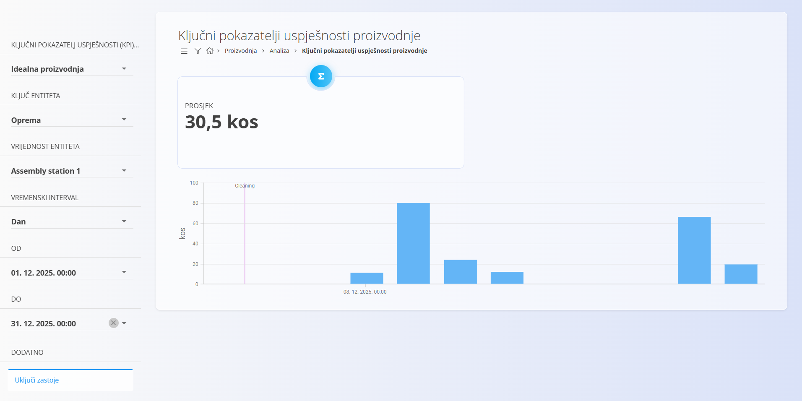
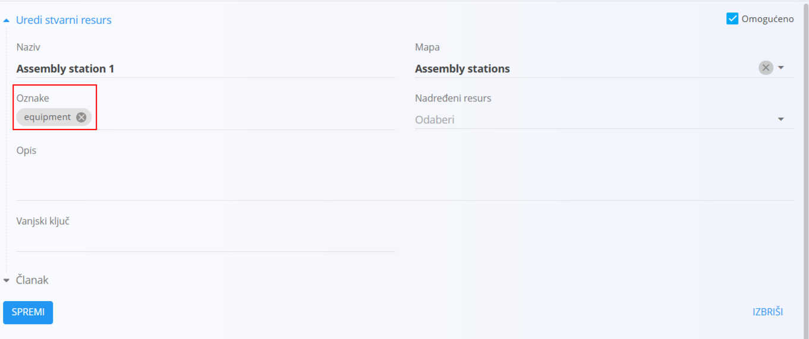
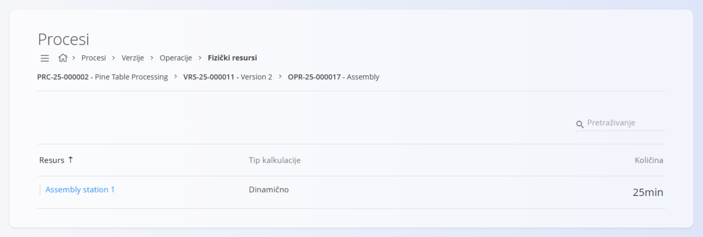

<!-- app_route: /production/analytics/kpis -->
<!-- app_label: Ključni pokazatelji uspješnosti proizvodnje -->
<!-- canonical_source_url: https://github.com/Tom-PIT/Connected.Docs/blob/main/hr/Domene/Proizvodnja/Analiza/KljucniPokazateljiProizvodnje.md -->
<!-- canonical_source_title: Ključni pokazatelji uspješnosti proizvodnje -->

# Ključni pokazatelji uspješnosti proizvodnje

Stranica **Ključni pokazatelji uspješnosti proizvodnje** pruža analitički uvid u učinkovitost proizvodnje i opreme.

Ključni pokazatelji (KPI) pomažu pratiti:
- kvalitetu proizvodnje
- raspoloživost opreme
- zastoje
- učinkovitost proizvodnje
- ukupnu učinkovitost opreme (OEE)

Izračun pokazatelja temelji se na [standardnoj metodologiji OEE](https://www.oee.com/calculating-oee/).

Za pristup ovoj stranici otvorite **Proizvodnja / Analiza / Ključni pokazatelji uspješnosti proizvodnje** u [navigaciji](../../../Zajednicko/UI/Navigacija.md).



> [!TIP]
> Za potpuni prikaz analitike proizvodnje pogledajte video vodič **[Key Performance Indicators](https://www.youtube.com/watch?v=zzs6wJh-tQY)**.

> [!NOTE]
> Vrijednosti pokazatelja mogu se prikazati s kratkim zakašnjenjem nakon unosa proizvodnih podataka.

## Preduvjeti za opremu

Za prikupljanje podataka o ključnim pokazateljima proizvodnje:
- fizički resursi moraju imati oznaku ```equipment```

  

- određeni stroj mora biti dodijeljen proizvodnim operacijama

  

## Filtri

Ploča na lijevoj strani sadrži nekoliko filtara koji određuju koji se podaci prikazuju.

### Ključni pokazatelj uspješnosti (KPI)

Odaberite pokazatelj proizvodnje koji želite analizirati.

| Pokazatelj | Značenje |
|------------|----------|
| **Stvarno vrijeme operacije** | Ukupno vrijeme operacije, uključujući zastoje |
| **Stvarno vrijeme proizvodnje** | Vrijeme provedeno u proizvodnji, bez zastoja |
| **Idealna proizvodnja** | Očekivana proizvedena količina prema normativima |
| **Omjer kvalitete** | Postotak odgovarajućih proizvoda u odnosu na ukupnu proizvodnju |
| **Neplanirani zastoji** | Ukupno trajanje neplaniranih zastoja |
| **Neodgovarajuća proizvodnja** | Broj neispravnih komada |
| **Planirani zastoj** | Ukupno trajanje planiranih zastoja |
| **Proizvodnja** | Ukupan broj proizvedenih komada |
| **Raspoloživost** | Postotak vremena u kojem je oprema bila raspoloživa za proizvodnju |
| **Ukupna učinkovitost opreme** | Kombinirani pokazatelj raspoloživosti, učinkovitosti i kvalitete (OEE) |
| **Učinkovitost** | Usporedba stvarne i očekivane učinkovitosti proizvodnje |
| **Odgovarajuća proizvodnja** | Broj ispravnih komada |

### Ključ entiteta

Određuje za koju se vrstu resursa mjeri pokazatelj:
- **Oprema**
- **Organizacijska jedinica**

### Vrijednost entiteta

Odaberite određeni stroj ili organizacijsku jedinicu, ovisno o ključu entiteta.

### Vremenski interval

Određuje razinu detalja izvješća, na primjer:
- **Četvrt sata**
- **Sat**
- **Dan**
- **Tjedan**
- **Mjesec**
- **Godina**

> [!NOTE]
> Odabrani **Vremenski interval** određuje kako se podaci grupiraju.
>
> - Sat → vrijednosti po satima
> - Dan → vrijednosti po danima
> - Mjesec → vrijednosti po mjesecima
>
> Detaljniji vremenski intervali omogućuju precizniju analizu, ali smisleni rezultati ovise o tome koliko se često unose proizvodni podaci.

### Od / Do

Odaberite raspon datuma i vremena za koji se prikazuju podaci.

### Dodatne postavke

- **Uključi zastoje** – kada je uključeno, vrijednosti zastoja uključuju se u izračun pokazatelja gdje je to primjenjivo.

## Rezultati

Rezultati se prikazuju na vrhu stranice i uključuju:
- **Prosjek** – prosječnu vrijednost odabranog pokazatelja u odabranom razdoblju
- **stupčasti ili linijski grafikon** koji prikazuje kretanje pokazatelja u odabranom vremenskom intervalu

> [!NOTE]
> Vrijednost **Prosjek** izračunava se iz izvornih proizvodnih podataka, a ne kao prosjek vrijednosti prikazanih na grafikonu.
>
> Zbog toga se vrijednost **Prosjek** može razlikovati od vizualnog prosjeka na grafikonu.

Ovisno o odabranom pokazatelju, ispod grafikona mogu se prikazati dodatni detalji:
- za **pokazatelje zastoja** – razlozi i trajanje zastoja
- za **pokazatelje proizvodnje** – odgovarajuće i neodgovarajuće količine
- za **pokazatelje opreme** – dnevni ili satni pokazatelji učinkovitosti

> [!NOTE]
> Vrijednosti koje nedostaju na grafikonu ne znače nužno da je vrijednost pokazatelja bila nula. U nekim slučajevima za odabrano razdoblje nisu evidentirani proizvodni podaci.
