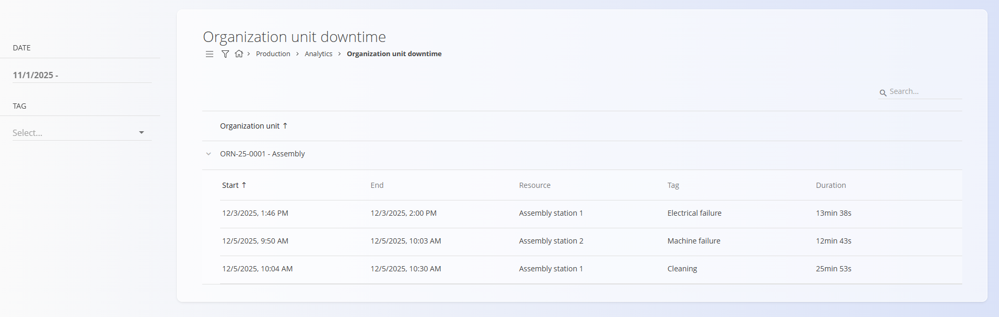

<!-- app_route: /production/analytics/organization-unit-downtime -->
<!-- app_label: Organization unit downtime -->
<!-- canonical_source_url: https://github.com/Tom-PIT/Connected.Docs/blob/main/hr/Domene/Proizvodnja/Analiza/OrganizationUnitDowntime.md -->
<!-- canonical_source_title: Organization unit downtime -->

# Organization unit downtime

Stranica **Organization unit downtime** pruža detaljan popis svih zastoja evidentiranih u odabranim organizacijskim jedinicama. Nadzornicima i planerima omogućuje pregled početka i završetka zastoja, zahvaćenog resursa, oznake klasifikacije zastoja i ukupnog trajanja.

Za pristup ovoj stranici otvorite **Proizvodnja / Analiza / Organization unit downtime** u [navigaciji](../../../Zajednicko/UI/Navigacija.md).

## Filtri

Za sužavanje rezultata koristite filtre na lijevoj strani:

- **Date** – odaberite datum ili raspon datuma za koji se prikazuju zastoji.
- **Downtime type** – filtriranje zastoja prema tome jesu li planirani ili neplanirani (pogledajte [**Downtime type**](SazetakZastoja.md#downtime-type)).
- **Tag** – filtriranje prema oznaci klasifikacije zastoja (pogledajte [**Oznake zastoja**](../Upravljanje/OznakeZastoja.md)).

## Pregled zastoja

Glavna tablica prikazuje zastoje grupirane po **organizacijskoj jedinici**.

Za svaki zastoj prikazuju se sljedeći podaci:

- **Start** – vrijeme početka zastoja
- **End** – vrijeme završetka zastoja
- **Resource** – zahvaćeni fizički resurs ili radno mjesto
- **Tag** – klasifikacija zastoja (npr. električni kvar, kvar stroja, čišćenje)
- **Duration** – ukupno trajanje zastoja koje sustav izračunava automatski

Zastoji unutar svake organizacijske jedinice mogu se proširiti ili sažeti radi lakšeg pregleda.

## Napomene o korištenju

- Ovdje se prikazuju samo zastoji evidentirani putem modula [*Izvedba*](../Dokumenti/Izvedba.md).
- Oznake koristite za brzo prepoznavanje ponavljajućih problema i analizu uzroka.
- Trajanje se izračunava automatski na temelju vremena početka i završetka.
