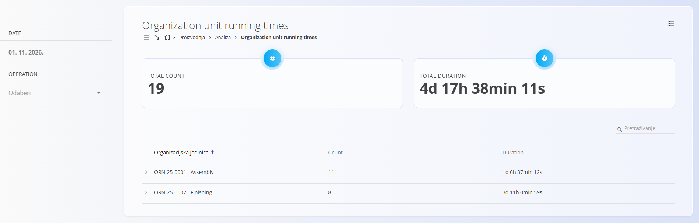
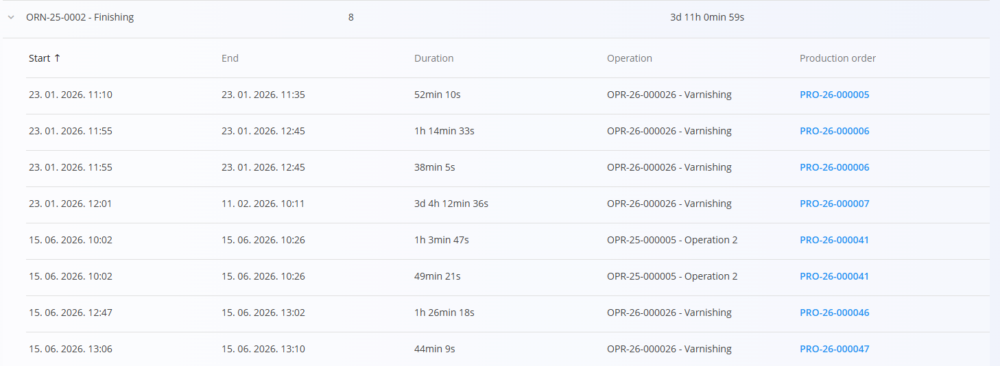

<!-- app_route: /production/analytics/organization-unit-running-times -->
<!-- app_label: Organization unit running times -->
<!-- canonical_source_url: https://tom-pit.github.io/Connected.Docs/hr/Domene/Proizvodnja/Analiza/OrganizationUnitRunningTimes/ -->
<!-- canonical_source_title: Organization unit running times -->

# Organization unit running times

Pogled **Organization unit running times** prikazuje koliko je izvajalnih vremena zabilježeno za svaku organizacijsku jedinicu i koliko su ona ukupno trajala. Pogled koristite kada želite utvrditi koje organizacijske jedinice imaju najviše zabilježenog izvajalnog vremena u odabranom razdoblju.

Ovaj pogled služi isključivo za analizu i **ne omogućuje** izradu ni promjenu operacija.

Za pristup ovom pogledu otvorite **Proizvodnja / Analiza / Organization unit running times** u [navigaciji](../../../Zajednicko/UI/Navigacija.md).

## Ukupne vrijednosti

Dvije pločice na vrhu prikazuju ukupne vrijednosti za trenutni odabir:

- **TOTAL COUNT** – Broj zabilježenih izvajalnih vremena.
- **TOTAL DURATION** – Ukupno trajanje svih zabilježenih izvajalnih vremena, npr. **4d 17h 38min 11s**.

## Filtri

Lijeva bočna traka sadrži sljedeće filtre:

- **DATE** – Odaberite razdoblje za koje želite prikazati izvajalna vremena.
- **OPERATION** – Odaberite operaciju koju želite pregledati.

## Popis organizacijskih jedinica

Popis prikazuje zabilježena izvajalna vremena grupirana po **Organizacijskoj jedinici**. Za svaku organizacijsku jedinicu prikazuje:

- **Organizacijska jedinica** – Šifra i naziv organizacijske jedinice.
- **Count** – Broj zabilježenih izvajalnih vremena za tu organizacijsku jedinicu.
- **Duration** – Ukupno trajanje tih izvajalnih vremena.

Organizacijsku jedinicu pronađite pomoću polja za pretraživanje iznad popisa. Svaki redak možete proširiti strelicom s lijeve strane. Prošireni redak prikazuje svako zabilježeno izvajalno vrijeme za tu organizacijsku jedinicu, sa sljedećim stupcima:

- **Start** – Datum i vrijeme početka izvajalnog vremena.
- **End** – Datum i vrijeme završetka izvajalnog vremena.
- **Duration** – Trajanje tog izvajalnog vremena.
- **Operation** – Operacija koja je izvedena.
- **Production order** – Proizvodni nalog kojem izvajalno vrijeme pripada, prikazan kao poveznica.

## Izbornik

Izbornik sadrži radnju **Pause all operations**. Radnja pauzira sve operacije proizvodnih naloga koji su trenutno u izvođenju. Prije izvođenja pojavi se dijalog u kojem radnju odobravate.

Za pojedinosti o radnjama izbornika pogledajte [**Radnje izbornika**](../../../Zajednicko/Koncepti/RadnjeIzbornika.md).
