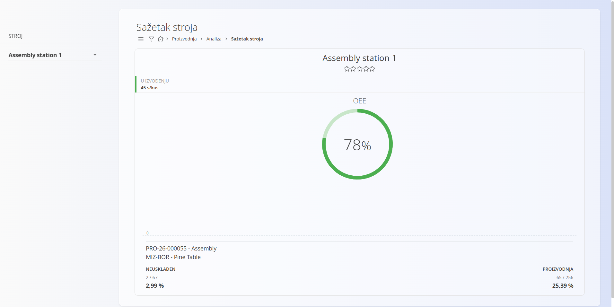

<!-- app_route: /production/analytics/equipment -->
<!-- app_label: Sažetak stroja -->
<!-- canonical_source_url: https://github.com/Tom-PIT/Connected.Docs/blob/main/hr/Domene/Proizvodnja/Analiza/SazetakStroja.md -->
<!-- canonical_source_title: Sažetak stroja -->

# Sažetak stroja

Stranica **Sažetak stroja** pruža pregled učinkovitosti stroja, uključujući zastoje, proizvedenu količinu, kvalitetu i OEE (ukupnu učinkovitost opreme). Pomaže nadzornicima i voditeljima razumjeti kako pojedini stroj radi kroz vrijeme.

Za pristup ovoj stranici otvorite **Proizvodnja / Analiza / Sažetak stroja** u [navigaciji](../../../Zajednicko/UI/Navigacija.md).

> [!TIP]
> Za potpuni prikaz funkcionalnosti pogledajte video vodič **[Equipment summary](https://www.youtube.com/watch?v=PXPXDL5yL4w)**.

## Filtri

### Stroj

Odaberite stroj ili radno mjesto za koje se prikazuju podaci.

## Zaglavlje sažetka

Prikazuje naziv odabranog stroja i ocjenu (ako se koristi).

## Status stroja

Prikazuje trenutačno radno stanje stroja:

- **U izvođenju** – prikazuje vrijeme ciklusa (npr. `45 s/kos`)
- **Zaustavljen** – prikazuje trajanje aktivnog zastoja

Oznaka statusa može se razlikovati ovisno o stanju stroja (npr. *Working*, *Stopped*).

## Pokazatelj OEE

Kružni pokazatelj prikazuje **ukupnu učinkovitost opreme** (OEE) stroja u postotku.

Ako nema dovoljno podataka, OEE može prikazivati **0 %**.

## Pregled proizvodnje i kvalitete

Ispod pokazatelja OEE sustav prikazuje posljednju ili aktivnu proizvodnu operaciju izvedenu na ovom stroju.

To uključuje:

### Proizvodni nalog i operacija

- šifru [proizvodnog naloga](../Dokumenti/ProizvodniNalozi.md) na koju se može kliknuti (npr. `PRO-24-000015`)
- opis [operacije](../Upravljanje/Operacije.md)
- [materijal](../../RobaIUsluge/Materijali/README.md) koji se proizvodi (npr. proizvod ili poluproizvod)

### Neusklađen

Prikazuje neispravne komade u odnosu na ukupno proizvedene:
- **Broj** – neispravni / proizvedeni
- **Postotak** – udio neispravnih komada

### Proizvodnja

Prikazuje napredak proizvodnje za trenutačnu operaciju:
- **Proizvedeno / planirano**
- **Postotak dovršenosti**

Ovaj odjeljak pomaže pratiti i produktivnost i kvalitetu proizvoda za odabrani stroj.
