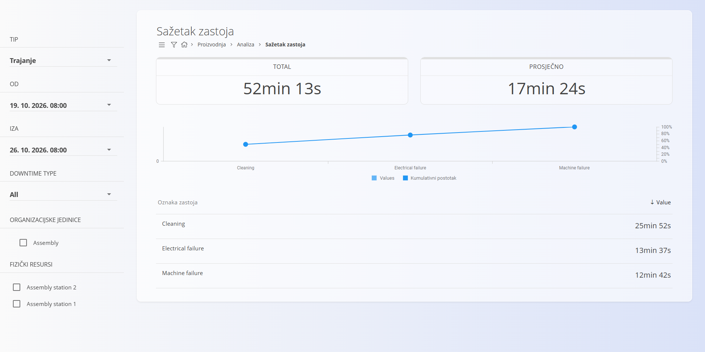
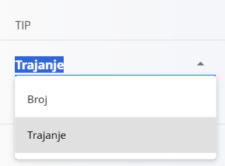
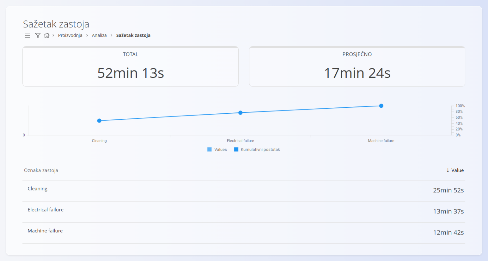

<!-- app_route: /analytics/downtime-summary -->
<!-- app_label: Sažetak zastoja -->
<!-- canonical_source_url: https://github.com/Tom-PIT/Connected.Docs/blob/main/hr/Domene/Proizvodnja/Analiza/SazetakZastoja.md -->
<!-- canonical_source_title: Sažetak zastoja -->

# Sažetak zastoja

Stranica **Sažetak zastoja** pruža pregled evidentiranih proizvodnih zastoja u odabranom razdoblju. Pomaže prepoznati najčešće razloge zastoja, procijeniti njihov utjecaj te pratiti učinkovitost po organizacijskim jedinicama i strojevima.

Za pristup ovoj stranici otvorite **Proizvodnja / Analiza / Sažetak zastoja** u [navigaciji](../../../Zajednicko/UI/Navigacija.md).

> [!TIP]
> Za potpuni prikaz funkcionalnosti pogledajte video vodič **[Downtime summary](https://www.youtube.com/watch?v=IdEsZkN2Wv0)**.

## Filtri

Za sužavanje prikazanih podataka koristite filtre na lijevoj strani.

### Tip

Određuje način zbrajanja podataka o zastojima:
- **Broj** – broj zastoja
- **Trajanje** – ukupno trajanje zastoja

### Od / Iza

Odaberite datumski raspon za koji se uključuju zapisi o zastojima.

### Downtime type

Filtar **Downtime type** omogućuje filtriranje zastoja prema tome jesu li planirani ili neplanirani.

- **All** – prikazuje sve zastoje bez obzira na tip.
- **Planned** – prikazuje samo planirane zastoje.
- **Unplanned** – prikazuje samo neplanirane zastoje.

Je li zastoj planiran ili neplaniran, određuje se u šifrarniku [**Oznake zastoja**](../Upravljanje/OznakeZastoja.md), gdje se svaka oznaka može postaviti kao planirana ili neplanirana.

### Organizacijske jedinice

Filtriranje rezultata prema jednoj ili više [organizacijskih jedinica](../Upravljanje/OrganizacijskeJedinice.md).

### Fizički resursi

Filtriranje zastoja povezanih s određenim strojevima ili radnim mjestima.

## Izgled stranice i rezultati

Sažetak zastoja prikazuje dva ključna pokazatelja:

| Pokazatelj | Značenje |
|------------|----------|
| **Total** | Ukupni zastoj (zbroj svih odabranih zastoja) |
| **Prosječno** | Prosječni zastoj po događaju |

Ispod pokazatelja grafikon prikazuje klasifikacije zastoja (npr. električni kvar, mehanički problem) sa sljedećim vrijednostima:
- **Values** – stvarni zastoj po razlogu
- **Kumulativni postotak** – udio u ukupnom zastoju

Na dnu stranice detaljan popis prikazuje:
- **naziv klasifikacije** zastoja
- pripadajući **broj ili trajanje**

## Primjer

U gornjem primjeru:
- odabran je način **Trajanje**
- ukupni zastoj u odabranom razdoblju iznosi **52 min 13 s**
- prosječni zastoj po događaju iznosi **17 min 24 s**
- zastoj je raspodijeljen na tri oznake:
  - **Cleaning** (čišćenje) – **25 min 52 s**
  - **Electrical failure** (električni kvar) – **13 min 37 s**
  - **Machine failure** (kvar stroja) – **12 min 42 s**
- grafikon i popis prikazuju istu raspodjelu po oznakama zastoja (uključujući krivulju kumulativnog postotka)
