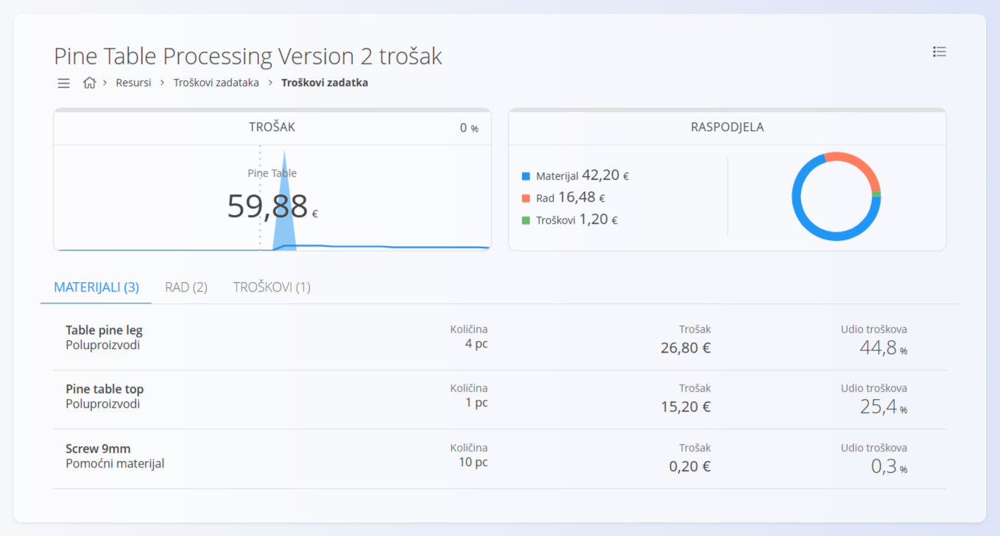

<!-- app_route: /management/processes -->
<!-- app_label: Procesi -->
<!-- app_navigation_hint: Otvorite proces i kliknite vrijednost troška željene verzije. -->
<!-- canonical_source_url: https://github.com/Tom-PIT/Connected.Docs/blob/main/hr/Domene/Proizvodnja/Analiza/TrosakVerzije.md -->
<!-- canonical_source_title: Analiza troška verzije -->

# Analiza troška verzije

Zaslon analize troška verzije prikazuje **procijenjeni trošak proizvodnje po komadu** za određenu **verziju procesa**.

Zaslon se otvara klikom na **vrijednost troška** u stupcu **Cost** na zaslonu **[Verzije](../Upravljanje/Procesi.md#verzije)**.

Stranica pruža detaljnu raščlambu izračuna ukupnog troška proizvodnje, uključujući materijale, rad i dodatne troškove.

> [!NOTE]
> Ista analiza troška dostupna je i iz pogleda [**Troškovi zadataka**](../../Resursi/Pogledi/WorkItemsCosts.md) odabirom **Procesi**.

## Sažetak troška

Ploča **Trošak** prikazuje **ukupni procijenjeni trošak po proizvedenom komadu** za odabranu verziju.

Prikazani podaci uključuju:

- **naziv artikla** – izlazni artikl povezan s verzijom procesa
- **ukupni procijenjeni trošak**
- **pokazatelj kretanja** koji prikazuje razliku u odnosu na prethodno izračunatu vrijednost

Trošak se izračunava na temelju svih resursa i materijala definiranih u operacijama verzije.

## Raspodjela troška

Ploča **Raspodjela** prikazuje grafičku raščlambu ukupnog troška.

**Grafikon i legenda** prikazuju kako je trošak raspodijeljen između:

- **Materijali** – trošak svih ulaznih materijala koje operacije troše
- **Rad** – trošak ljudskog i strojnog rada potrebnog za izvođenje operacija
- **Troškovi** – dodatni troškovi verzije procesa

Ovaj prikaz pomaže brzo prepoznati koje komponente najviše pridonose ukupnom trošku.

Ispod ploča nalaze se kartice **Materijali**, **Rad** i **Troškovi**. Broj u zagradi pokazuje koliko je stavki na kartici.

## Materijali

Odjeljak [**Materijali**](../../RobaIUsluge/Materijali/README.md) prikazuje sve materijale koje troše operacije procesa. Za izračun udjela troška pojedinog materijala koriste se [cijene materijala dobavljača](../../Nabava/Upravljanje/SupplierMaterials.md).

Svaki redak prikazuje:

- **naziv materijala**
- **vrstu materijala** (npr. poluproizvod, sirovina)
- **potrebnu količinu**
- **udio u trošku**
- **Udio troškova** – postotak u odnosu na ukupni trošak artikla

Cijene materijala preuzimaju se iz **trenutačne konfiguracije cijena materijala** u sustavu.

## Rad

Odjeljak **Rad** prikazuje trošak koji stvaraju radni resursi korišteni u procesu. Troškovi se izračunavaju na temelju **trajanja rada** i **satnice** dodijeljenih resursa. Troškovi se preuzimaju iz šifrarnika [**Trošak resursa**](../../Resursi/Upravljanje/ResourcesCosts.md).

To može uključivati:

- **ljudske resurse** (operateri, radnici)
- **fizičke resurse** (strojevi, radna mjesta)

Svaki unos prikazuje:

- **naziv resursa**
- **trajanje rada**
- **izračunati trošak**
- **Udio troškova** – postotak u odnosu na ukupni trošak

Troškovi rada izračunavaju se pomoću konfiguriranih **satnica resursa**.

## Troškovi

Odjeljak **Troškovi** prikazuje sve **dodatne troškove** primijenjene na verziju procesa. Troškovi se definiraju u šifrarniku [**Troškovi**](../../Nabava/Upravljanje/Troskovi.md) i mogu se povezati s verzijom procesa kako bi se obuhvatili troškovi koji nisu izravno vezani uz materijale ili resurse.

Primjeri mogu uključivati:

- vanjske usluge
- potrošnju energije
- opće troškove poslovanja

Ako u procesu nisu konfigurirani troškovi, odjeljak prikazuje **Nema troškova**.

## Ukupni trošak

Iznos na ploči **Trošak** prikazuje konačni **procijenjeni trošak proizvodnje po komadu**, izračunat kao zbroj:

- materijala
- rada
- dodatnih troškova

Ova vrijednost odgovara **trošku prikazanom na popisu verzija**.

Ako se u verziji procesa promijene operacije, materijali ili resursi, trošak je potrebno ponovno izračunati pomoću **Calculate** na stranici **[Verzije](../Upravljanje/Procesi.md#verzije)**.

## Izbornik

Izbornik nudi dodatne radnje dostupne na ovoj stranici.

Dostupne radnje:

- **Izvoz** u PDF
- **Ponovno izračunaj** – ponovno izračunava troškove odabranog zadatka ili verzije procesa na temelju najnovijih materijala, resursa i troškova.

Više informacija o radnjama izbornika potražite u odjeljku [**Radnje izbornika**](../../../Zajednicko/Koncepti/RadnjeIzbornika.md).
