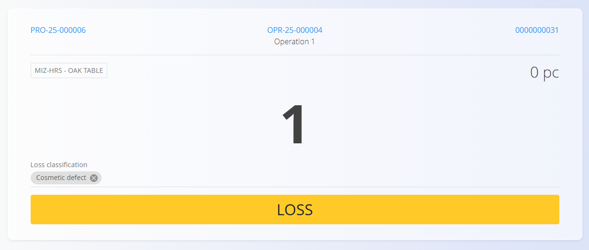

<!-- app_route: /production-orders/execution -->
<!-- app_label: Izvedba -->
<!-- canonical_source_url: https://github.com/Tom-PIT/Connected.Docs/blob/main/hr/Domene/Proizvodnja/Dokumenti/Gubitak.md -->
<!-- canonical_source_title: Loši komadi -->

# Loši komadi

Aktivnost **Loši komadi** evidentira neispravne ili neupotrebljive komade nastale tijekom operacije. Pomaže u praćenju kvalitete te osigurava točno izvještavanje i sljedivost.

Aktivnost **Loši komadi** otvorite sa zaslona [**Izvedba**](Izvedba.md) putem izbornika aktivnosti (dodirnite [akcijski gumb](../../../Zajednicko/UI/AkcijskiGumb.md), a zatim odaberite **Loši komadi**).

## Evidentiranje loših komada

1. Otvorite stranicu **Loši komadi** iz [**izbornika aktivnosti**](Izvedba.md#izbornik-aktivnosti).  
2. Unesite neispravnu količinu.  

    

3. Odaberite oznaku **Klasifikacija gubitka (škarta)** (razlog) — pogledajte [Oznake klasifikacije gubitka (škarta)](../Upravljanje/OznakeKlasifikacijeGubitka.md).   
4. Kliknite **Gubitak (Škart)** (žuti gumb) za spremanje.  
5. Po potrebi ponovite za dodatne gubitke.

Spremljeni gubici povezuju se s proizvodnim nalogom i operacijom te se prikazuju u pregledu izvođenja.

## Klasifikacije i oznake

Razlozi gubitka vode se kao oznake (npr. estetski nedostatak, pogrešna dimenzija, kvar stroja). Odaberite oznaku koja najbolje odgovara kako biste podržali kasniju analizu. Pogledajte [Oznake klasifikacije gubitka (škarta)](../Upravljanje/OznakeKlasifikacijeGubitka.md).

## Analitika i izvještavanje

Zapisi o gubicima koriste se na nekoliko analitičkih stranica:

- [Sažetak gubitka (škarta)](../Analiza/SazetakGubitka.md)
- [Ključni pokazatelji uspješnosti proizvodnje](../Analiza/KljucniPokazateljiProizvodnje.md)
- [Organization unit loss](../Analiza/OrganizationUnitLoss.md)

Dosljedno označavanje omogućuje smislene ključne pokazatelje.
