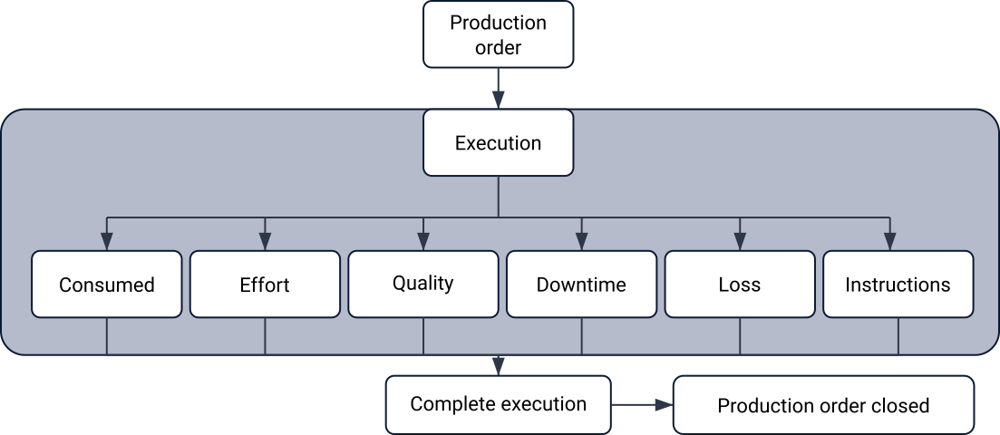
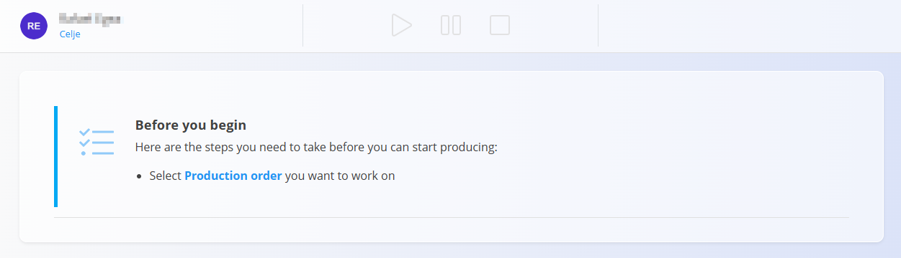
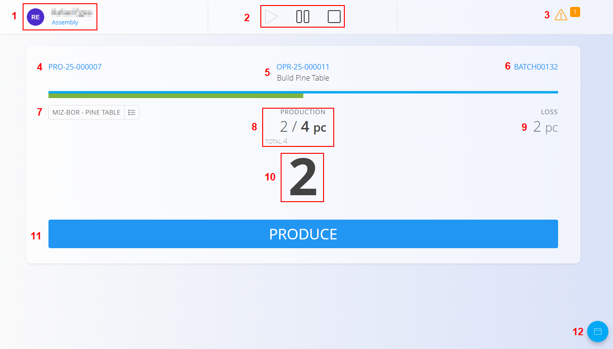
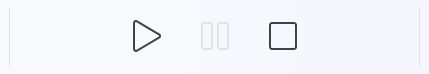
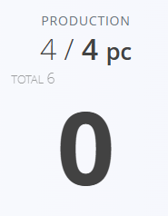
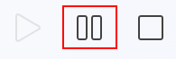
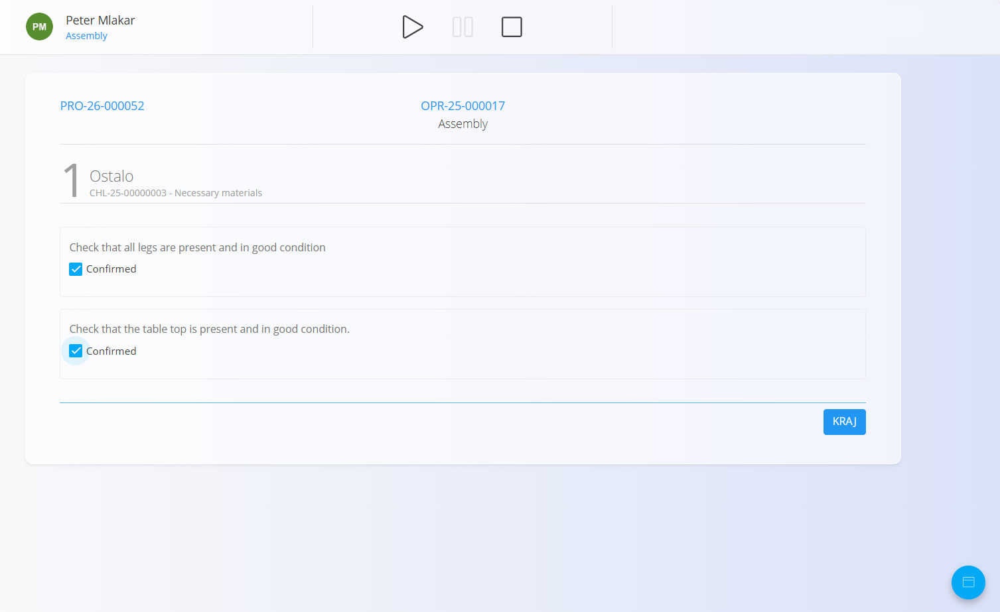
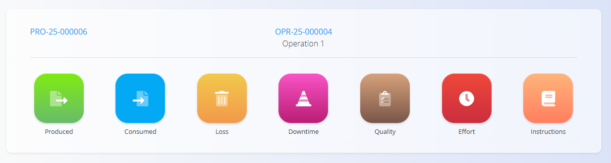
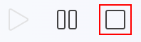

<!-- app_route: /production-orders/execution -->
<!-- app_label: Izvedba -->
<!-- canonical_source_url: https://github.com/Tom-PIT/Connected.Docs/blob/main/hr/Domene/Proizvodnja/Dokumenti/Izvedba.md -->
<!-- canonical_source_title: Izvedba -->

# Izvedba

Modul **Izvedba** koriste proizvodni radnici za izvođenje i evidentiranje rada na dodijeljenim proizvodnim nalozima. Omogućuje praćenje napretka, proizvedenih količina, [zastoja](Zastoj.md), [gubitaka](Gubitak.md), [kontrolnih popisa kvalitete](Kvaliteta.md) i drugih aktivnosti u stvarnom vremenu.

Većina proizvodnih radnika nakon prijave automatski se preusmjerava na prikaz **Izvedba**.

> [!TIP]
> Za potpuni prikaz funkcionalnosti pogledajte video vodič **[Executions](https://www.youtube.com/watch?v=qf0Ftar4hAg&list=PLH4LYaWds6h8kspUco0t_MaFPNbL0zj1D&index=28)**.

Za ručni pristup ovoj stranici otvorite **Proizvodnja / Izvedba** u [navigaciji](../../../Zajednicko/UI/Navigacija.md).

> [!NOTE]
> - Pri otvaranju zaslon obično automatski prikazuje dodijeljene proizvodne naloge. Ako se ne prikaže nijedan, kliknite **Odaberi proizvodni nalog** kako biste ga odabrali.
>   
>   
> - Ako je popis proizvodnih naloga prazan, za odabranu jedinicu nema dostupnih naloga (još nisu izrađeni ili nemaju aktivnih operacija). Izradite naloge u modulu [**Proizvodni nalozi**](ProizvodniNalozi.md) i provjerite je li operacija dodijeljena odabranoj jedinici.
> - Ako je popis organizacijskih jedinica prazan, šifrarnik još nije definiran. Definirajte jedinice u šifrarniku [**Organizacijske jedinice**](../Upravljanje/OrganizacijskeJedinice.md).

## Pregled sučelja za izvođenje

Glavni zaslon za izvođenje prikazuje ključne podatke o trenutnom proizvodnom nalogu i operaciji.

| Br. | Opis |
|-----|------|
| **1** | Prijavljeni korisnik i **organizacijska jedinica**.  • Klik na sliku korisnika → odjava  • Klik na organizacijsku jedinicu → promjena jedinice (pogledajte [**Organizacijske jedinice**](../Upravljanje/OrganizacijskeJedinice.md)) |
| **2** | Gumbi za upravljanje operacijom:  • **Početak** – pokreće operaciju  • **Pauza** – privremeno zaustavlja rad  • **Zaustavi** – dovršava operaciju |
| **3** | Prečaci:  • **Žuta kanta** – evidentiranje neispravnih komada  • **Narančasti trokut** – pregled otvorenih uskih grla ili problema |
| **4** | Trenutni proizvodni nalog |
| **5** | Trenutna operacija |
| **6** | Podaci o seriji / lotu |
| **7** | Trenutni izlaz operacije i ispis etiketa |
| **8** | Napredak proizvodnje (proizvedeno / planirano) |
| **9** | Trenutno evidentirani gubici |
| **10** | Preostala količina za dovršetak proizvodnog zadatka (može se uređivati) |
| **11** | Gumb **Proizvedi** — evidentira proizvedenu količinu |
| **12** | Gumb aktivnosti (akcijski gumb) koji otvara stranicu za odabir aktivnosti |

### Upravljanje operacijom

## Postupak izvođenja 

### Pokretanje proizvodnje

Operaciju možete pokrenuti na dva načina:

#### **1. Klikom na Početak**

Kliknite **Početak** za pokretanje operacije.

#### **2. Klikom na Proizvedi (automatsko pokretanje)**

Ako kliknete **Proizvedi**, sustav:

- automatski pokreće operaciju  
- evidentira količinu prikazanu iznad gumba  
- ažurira preostalu količinu
- ako zadani broj odgovara planiranoj količini i ne promijenite ga, sustav evidentira **sve preostale komade kao proizvedene**.
  
  

### Pauziranje proizvodnje

Kliknite **Pauza** za privremeno zaustavljanje operacije. Time se proizvodnja **ne dovršava** — samo se pauzira do nastavka.

### Kontrolni popisi i kontrole kvalitete

[**Kontrolni popisi**](../../Kvaliteta/Upravljanje/KontrolniPopisi.md) kvalitete pomažu u osiguravanju sigurnosti i kvalitete proizvoda. Ako je za operaciju potreban kontrolni popis, on se automatski prikazuje u pravom trenutku (na početku, tijekom izvođenja ili prije dovršetka).

Radnici potvrđuju svaki korak definiran u kontrolnom popisu.

> [!NOTE]
> Ako pokušate zaustaviti operaciju dok obvezni kontrolni popis nije dovršen, sustav će zatražiti da ga najprije dovršite.

## Izbornik aktivnosti

Plutajući [akcijski gumb](../../../Zajednicko/UI/AkcijskiGumb.md) u donjem desnom kutu otvara izbornik za odabir aktivnosti.

Ovdje možete odabrati:

- **Proizvodnja** – otvara glavni zaslon za izvođenje  
- **[Potrošeno](Potroseno.md)** – evidentiranje potrošnje ulaznih materijala
- **[Loši komadi](Gubitak.md)** – evidentiranje neispravnih ili neupotrebljivih komada  
- **[Zastoj](Zastoj.md)** – evidentiranje gubitaka vremena i prekida  
- **[Kvaliteta](Kvaliteta.md)** – pregled i dovršavanje kontrolnih popisa kvalitete  
- **[Rad](Rad.md)** – evidentiranje radnog vremena  
- **[Upute](Upute.md)** – pregled uputa za operaciju  

Svaka je mogućnost opisana u nastavku.

### Proizvodnja (glavni zaslon proizvodnje)

Mogućnost **Proizvodnja** vraća vas na glavni zaslon za izvođenje na kojem se evidentiraju proizvedeni komadi.

### Potrošeno

Evidentiranje potrošnje ulaznih materijala za trenutnu operaciju. Potpune upute korak po korak i provjere potražite na stranici [**Potrošeno**](Potroseno.md).

### Loši komadi

Evidentiranje neispravnih ili neupotrebljivih komada za trenutnu operaciju. Detaljne upute potražite na stranici [**Loši komadi**](Gubitak.md).

### Zastoj

Evidentiranje prekida tijekom proizvodnje. Detaljne upute potražite na stranici [**Zastoj**](Zastoj.md).

### Kvaliteta

Pregled i ponavljanje kontrolnih popisa kvalitete prema potrebi. Detaljne upute o korištenju, statusu i ponavljanju kontrolnih popisa potražite na stranici [**Kvaliteta**](Kvaliteta.md).

### Rad

Evidentiranje radnog vremena za operaciju. Načine evidentiranja (automatski putem Početak/Zaustavi ili ručni unos) i savjete za uređivanje potražite na stranici [**Rad**](Rad.md).

### Upute

Pregled uputa povezanih s trenutnom operacijom. Detaljne upute potražite na stranici [**Upute**](Upute.md).

## Dovršetak izvođenja

Kliknite **Zaustavi** za dovršetak trenutne operacije.

Prije dovršetka operacije provjerite:

- jesu li proizvedene sve potrebne količine
- jesu li evidentirani svi gubici i zastoji
- jesu li dovršene sve kontrolne točke kvalitete

Nakon dovršetka operacija se označava kao **Dovršena**.

Ako se operacija zaustavi prije nego što je proizvedena planirana količina, dovršava se s djelomičnom proizvodnjom.

Kada su sve operacije proizvodnog naloga dovršene, proizvodni nalog prelazi u status **Zatvoren**.

### Evidentiranje rada karticom

Neke radne stanice za izvođenje mogu imati **ploču za registraciju karticom** koja radnicima omogućuje prijavu na trenutnu operaciju ili odjavu s nje skeniranjem zaposleničke kartice.

Kada se kartica skenira:

* ako radnik trenutno nije prijavljen na operaciju, sustav započinje novi zapis rada.
* ako radnik već ima aktivan zapis rada na operaciji, sustav zaustavlja zapis rada.

> [!IMPORTANT]
> Utječe se samo na radno vrijeme radnika. Skeniranje kartice **ne**:
>
> * pokreće niti zaustavlja operaciju
> * mijenja status operacije
> * pauzira operaciju
> * dovršava operaciju

Operacijom se i dalje upravlja uobičajenim gumbima **Početak**, **Pauza** i **Zaustavi**.

### Tipična upotreba

Voditelj smjene pokreće operaciju i prijavljuje se na zaslon za izvođenje.

Kada radnici dođu na radno mjesto, skeniraju kartice kako bi započeli evidentiranje radnog vremena na trenutnoj operaciji. Kada napuste radno mjesto, ponovno skeniraju kartice kako bi zaustavili evidentiranje radnog vremena.

Više radnika može neovisno evidentirati radno vrijeme na istoj operaciji.
