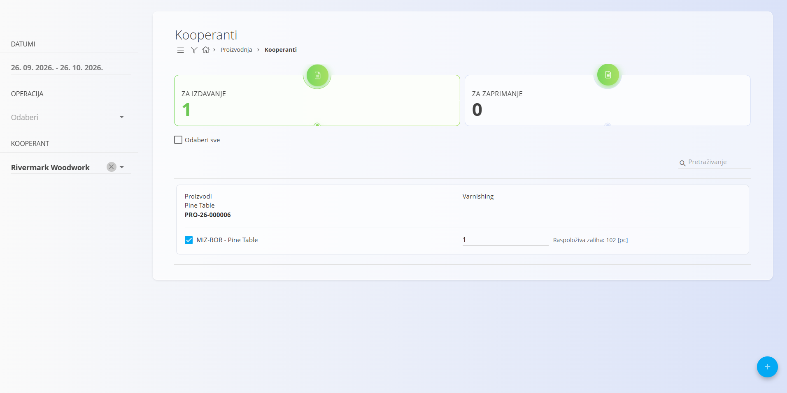
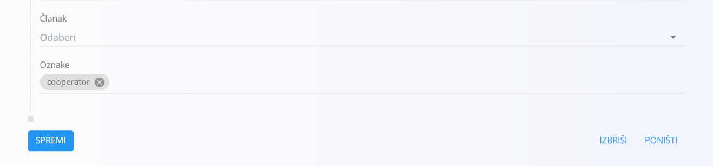
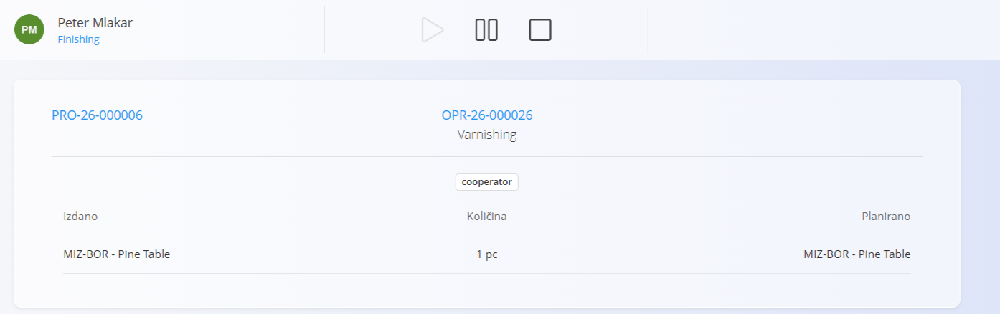
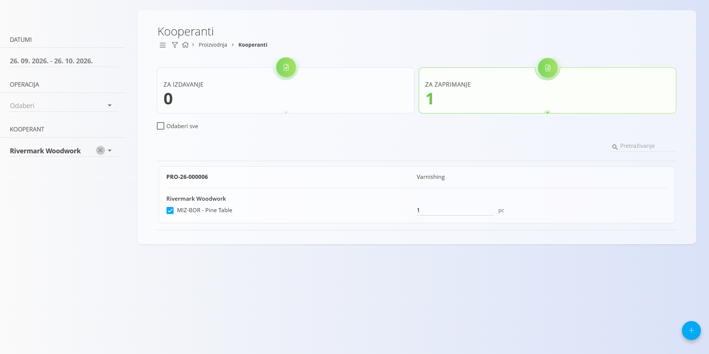

<!-- app_route: /production/cooperators -->
<!-- app_label: Kooperanti -->
<!-- canonical_source_url: https://github.com/Tom-PIT/Connected.Docs/blob/main/hr/Domene/Proizvodnja/Dokumenti/Kooperanti.md -->
<!-- canonical_source_title: Kooperanti -->

# Kooperanti

Kooperanti su vanjske tvrtke (definirane u [**Poslovnom imeniku**](../../../Zajednicko/Upravljanje/PoslovniImenik.md)) koje mogu izvoditi određene operacije povezane s proizvodnim nalozima ili nalozima za održavanje.

- U Poslovnom imeniku partnerima dodijelite ulogu **Kooperant** kako bi se mogli odabrati ovdje.
- Operacije namijenjene vanjskoj izradi moraju imati oznaku `cooperator` (pogledajte Preduvjete u nastavku).

Ovaj zaslon pruža poseban tijek rada za izdavanje materijala kooperantima i njegovo ponovno zaprimanje nakon dovršetka vanjske operacije.

Za pristup ovom zaslonu otvorite **Proizvodnja / Kooperanti** u [navigaciji](../../../Zajednicko/UI/Navigacija.md).

## Preduvjeti

Kako bi operacija bila dostupna kooperantima:

- operacija mora pripadati **[Proizvodnom nalogu](ProizvodniNalozi.md)** ili domeni **Održavanje** (pogledajte [domenu Održavanje](../../Odrzavanje/README.md))
- u obrascu za izradu ili uređivanje operacije mora biti dodijeljena oznaka `cooperator`
- vanjska tvrtka mora postojati u [**Poslovnom imeniku**](../../../Zajednicko/Upravljanje/PoslovniImenik.md) s omogućenom ulogom **Kooperant**

Na zaslonu **Kooperanti** prikazuju se samo operacije s oznakom `cooperator`.

> [!TIP]
> Ako se očekivana operacija ne prikazuje, provjerite:  1. oznaku `cooperator` na operaciji,  2. je li nalog u statusu Aktivan,  3. je li operacija pokrenuta u modulu **[Izvedba](Izvedba.md)** (kliknite **Početak**)

## Pregled zaslona

Na vrhu zaslona Kooperanti nalaze se dva glavna pokazatelja:

- **Za izdavanje** – operacije koje čekaju izdavanje kooperantu
- **Za zaprimanje** – operacije koje čekaju povrat od kooperanta

Klikom na pokazatelj prikazuje se odgovarajući popis. Za sužavanje popisa koristite filtre na lijevoj bočnoj traci:
- razdoblje
- operacija
- kooperant (vanjska tvrtka)

### Prikaz za operatera (Izvedba)

Kada operater otvori operaciju za koju je potreban vanjski kooperant, zaslon [**Izvedba**](Izvedba.md) jasno prikazuje da se taj korak izvodi izvana. 

Operater sada može kliknuti **Početak** za pokretanje operacije. Nakon pokretanja operacija se prikazuje na popisu **Za izdavanje** na zaslonu **Kooperanti**.

> [!NOTE]
> Nepokrenute operacije ne ulaze na popise tijeka rada za vanjsku izradu.

## Za izdavanje

Prikaz **Za izdavanje** prikazuje operacije spremne za slanje vanjskom kooperantu.

Tipičan tijek rada:

1. Odaberite jednu ili više operacija s popisa.
2. Na lijevoj bočnoj traci odaberite **Kooperanta** (iz [**Poslovnog imenika**](../../../Zajednicko/Upravljanje/PoslovniImenik.md)).
3. Kliknite [akcijski gumb](../../../Zajednicko/UI/AkcijskiGumb.md).
4. Odaberite jednu od dostupnih radnji:
   - **Kreiraj otpremnicu** ([Otpremnica](../../Prodaja/Dokumenti/Otpremnice.md))
   - **Add to existing delivery note** (dodavanje u postojeću [otpremnicu](../../Prodaja/Dokumenti/Otpremnice.md))

Nakon odabira nastavlja se standardni tijek:

**[Otpremnica](../../Prodaja/Dokumenti/Otpremnice.md) → [Izdatnica](../../Logistika/Dokumenti/Izdatnica.md)**

Nakon izdavanja materijala operacija se uklanja s popisa Za izdavanje.

> [!EXAMPLE]
> **Primjer:** 
>
> Za lakiranje stolova koristite usluge vanjske tvrtke. U prikazu **Za izdavanje** odaberite operaciju lakiranja za stol od bora, odaberite kooperanta, izradite **Otpremnicu**, a zatim potpunu **Izdatnicu**. Stolovi se otpremaju, a operacija prelazi na popis **Za zaprimanje**.

## Za zaprimanje

Nakon izdavanja materijala operacija se prikazuje u prikazu **Za zaprimanje**.

Ovdje je tijek rada obrnut:

1. Odaberite operaciju.
2. Kliknite [akcijski gumb](../../../Zajednicko/UI/AkcijskiGumb.md).
3. Izradite novu **[Narudžbenicu](../../Nabava/Dokumenti/SupplyOrders.md)** (za evidentiranje usluge dobavljača i povratne logistike). 
4. Slijedite standardni tijek:
   **[Narudžbenica](../../Nabava/Dokumenti/SupplyOrders.md) → [Primka](../../Logistika/Dokumenti/Primke.md)**

Nakon zaprimanja materijala operacija više ne čeka.

> [!EXAMPLE]
> **Primjer:**
> 
> Lakirani stolovi od bora spremni su za povrat od kooperanta. Izradite **Narudžbenicu** za uslugu lakiranja, a zatim **Primku** za zaprimanje stolova na zalihu. Operacija nestaje s popisa **Za zaprimanje**.

## Dovršetak operacije

Kada je vraćeni materijal dostupan:
- operater može otvoriti operaciju u modulu **[Izvedba](Izvedba.md)** i nastaviti uobičajeno (evidentirati proizvodnju, gubitke i zastoje, potvrditi kontrolne popise).
- po završetku može zaustaviti i dovršiti operaciju.

Nakon dovršetka:
- operacija više nije vidljiva na zaslonu **Kooperanti**.
- tijek rada s kooperantom za tu operaciju je završen.

## Praktični savjeti i sljedivost

- Poveznice među dokumentima: koristite odjeljke povezanih dokumenata na **[Otpremnicama](../../Prodaja/Dokumenti/Otpremnice.md)**, **[Izdatnicama](../../Logistika/Dokumenti/Izdatnica.md)**, **[Narudžbenicama](../../Nabava/Dokumenti/SupplyOrders.md)** i **[Primkama](../../Logistika/Dokumenti/Primke.md)** za kretanje kroz cijeli lanac.
- Organizacijske jedinice: provjerite je li na nalogu odabrana ispravna **[Organizacijska jedinica](../Upravljanje/OrganizacijskeJedinice.md)** kako bi radnici nakon zaprimanja vidjeli operaciju u modulu **[Izvedba](Izvedba.md)**.
