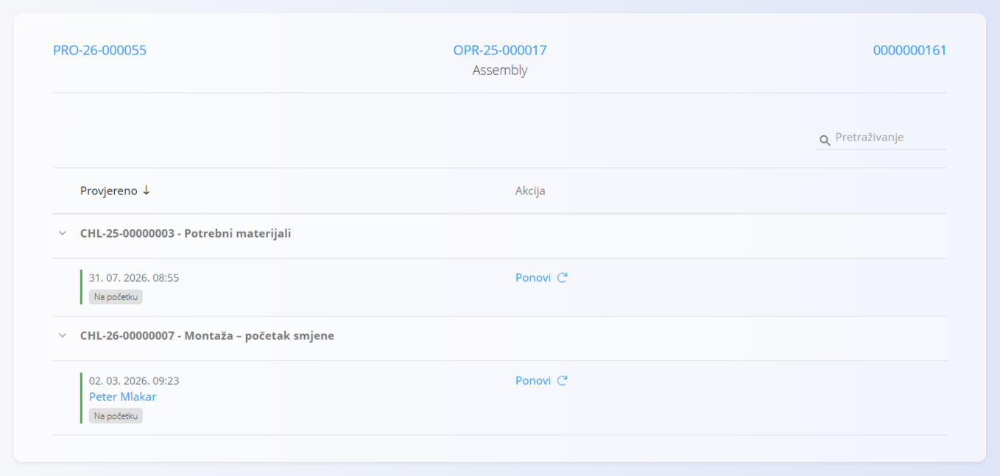

<!-- app_route: /production-orders/execution -->
<!-- app_label: Izvedba -->
<!-- canonical_source_url: https://github.com/Tom-PIT/Connected.Docs/blob/main/hr/Domene/Proizvodnja/Dokumenti/Kvaliteta.md -->
<!-- canonical_source_title: Kvaliteta -->

# Kvaliteta

Aktivnost **Kvaliteta** prikazuje i evidentira kontrolne popise kvalitete povezane s trenutnom operacijom. Kontrolni popisi pomažu u sigurnom radu i ispravnosti proizvoda jer vode kroz kontrole korak po korak.

Tijekom izvođenja obvezni kontrolni popisi automatski se prikazuju u pravom trenutku (na početku, tijekom rada ili prije dovršetka). Stranica **Kvaliteta** omogućuje pregled bilo kojeg kontrolnog popisa i njegovo ponavljanje prema potrebi. Primjer potražite u odjeljku [Izvedba — Kontrolni popisi i kontrole kvalitete](Izvedba.md#kontrolni-popisi-i-kontrole-kvalitete).

Aktivnost **Kvaliteta** otvorite sa zaslona [**Izvedba**](Izvedba.md) putem izbornika aktivnosti (dodirnite [akcijski gumb](../../../Zajednicko/UI/AkcijskiGumb.md), a zatim odaberite **Kvaliteta**).

## Kontrolni popisi kvalitete

Za svaki kontrolni popis prikazuje se boja statusa:

- zelena — svi koraci su dovršeni i potvrđeni
- crvena — nešto nedostaje ili nije potvrđeno

> [!NOTE]
> Ako se točka kontrolnog popisa ne može dovršiti (npr. zbog nedostatka materijala), dovršite dostupne korake, a zatim kliknite **Ponovi** kako biste ponovno izvršili kontrolni popis kada se uvjet ispuni.

## Ponavljanje kontrolnog popisa

1. Otvorite stranicu **Kvaliteta** iz [**izbornika aktivnosti**](Izvedba.md#izbornik-aktivnosti).
2. Pregledajte kontrolni popis prikazan za vašu operaciju (ako ih je dostupno više).
3. Kliknite **Ponovi** za ponovno izvršavanje kontrolnog popisa.
4. Slijedite korake na zaslonu i potvrdite svaku kontrolnu točku.
5. Kada su svi koraci dovršeni, kliknite **Kraj**.

Spremljeni rezultati povezuju se s proizvodnim nalogom i operacijom te se prikazuju u pregledu izvođenja.

## Uređivanje kontrolnog popisa 

- Ponovno otvorite kontrolni popis kako biste prilagodili unose, ako to vaš proces dopušta.
- Kliknite **Ponovi** kako biste ponovno izvršili kontrolni popis kada je to potrebno.

## Pogledajte i

- [**Kontrolni popisi izvođenja**](../Upravljanje/KontrolniPopisiKvalitete.md) — pridruživanje kontrolnih popisa verzijama procesa ili operacijama.
- [**Kontrolni popisi**](../../Kvaliteta/Upravljanje/KontrolniPopisi.md) — izrada predložaka kontrolnih popisa i upravljanje njima.
- [**Kontrolne točke**](../../Kvaliteta/Upravljanje/KontrolneTocke.md) — definiranje pojedinačnih koraka kontrolnog popisa.
